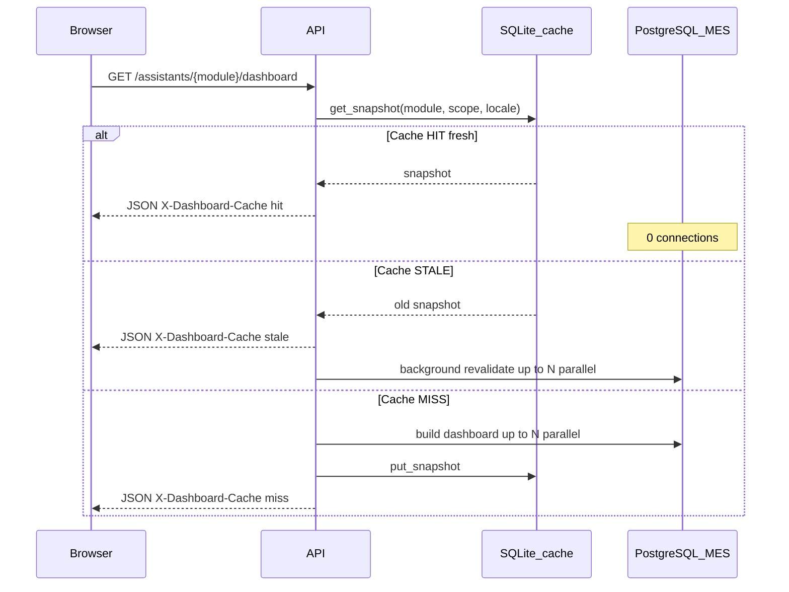

# PostgreSQL Connection Usage — MES AI Assistant

This document explains **how many database connections** the MES AI backend opens, **when** they open, **why** the shared MES PostgreSQL limit is hit, and **what defaults** scope the data (including the fact that scheduled cache refresh only prewarms **one line**, not all production lines).

**Related docs:** [all-features.md](./all-features.md) · [integration.md](./integration.md) · [database.md](./database.md)

---

## 1. Executive summary

| Fact | Detail |
|------|--------|
| **Database** | Remote PostgreSQL `mes_db` (readonly user `mes_readonly`) via `DATABASE_URL` |
| **App pool (per API process)** | `pool_size=5` + `max_overflow=10` → **up to 15** concurrent connections to PostgreSQL |
| **Idle connections when idle** | Up to **5** connections can stay open in the pool after work finishes (SQLAlchemy keeps `pool_size` connections warm) |
| **Dashboard build peak** | **4–7 parallel** PostgreSQL sessions per module build (`asyncio.gather`) |
| **Chat MCP peak** | **1** connection per tool call ( **3** for cross-module analysis ) |
| **Scheduled cache refresh** | **10 dashboard builds** per cycle (5 modules × 2 locales), **only default scope** — not all lines/warehouses |
| **Typical failure** | `remaining connection slots are reserved for non-replication superuser connections` — PostgreSQL `max_connections` exhausted on the **shared MES server**, not a bug in the chat query text |

---

## 2. Architecture — two databases

The app uses **two separate stores**:

| Store | Technology | Used for | Opens PG connections? |
|-------|------------|----------|------------------------|
| **MES data** | PostgreSQL (`n2admin.*`) | MCP tools, dashboard SQL | **Yes** |
| **Dashboard cache** | SQLite (`data/dashboard_cache.db`) | Cached KPI/chart snapshots | **No** |
| **Chat history (backend)** | SQLite (`data/chat_history.db`) | Optional API chat persistence | **No** |
| **RAG (default)** | Chroma / file (`data/chroma`) | Knowledge retrieval | **No** (unless `RAG_BACKEND=pgvector`) |

Only **PostgreSQL** connections count toward the MES server `max_connections` limit described in this document.

---

## 3. Connection pool configuration

Defined in [`core/db.py`](../core/db.py) and [`core/config.py`](../core/config.py):

```python
create_async_engine(
    settings.database_url,
    pool_pre_ping=True,
    pool_size=settings.db_pool_size,   # default: 5
    max_overflow=10,                   # hardcoded
)
```

| Setting | Env var | Default | Meaning |
|---------|---------|---------|---------|
| Pool size | `DB_POOL_SIZE` | `5` | Connections **kept in the pool** after use (can remain open to PostgreSQL while idle) |
| Max overflow | *(not configurable)* | `10` | Extra connections allowed beyond `pool_size` during bursts |
| **Max per API worker** | — | **15** | `pool_size + max_overflow` |

Each MCP tool and dashboard SQL helper calls `get_session()` → **one checkout from this pool** → **one PostgreSQL connection** until `await session.close()`.

**Multiple uvicorn workers:** Each worker process has its **own pool**. Example: `--workers 4` → up to **4 × 15 = 60** potential PostgreSQL connections from this app alone.

---

## 4. Ongoing connections when no query is running

### 4.1 After the API has started

On startup, `init_db()` runs once:

1. Creates the SQLAlchemy engine and pool.
2. Opens **one** connection for `SELECT 1` (health check), then returns it to the pool.

After any PostgreSQL activity, SQLAlchemy **does not close all connections**. Up to **`pool_size` (default 5)** connections per worker may remain **idle but open** to PostgreSQL, waiting in the pool for the next `get_session()`.

There is **no** long-running query or subscription holding connections when idle — only **pooled idle TCP connections**.

### 4.2 When nothing has touched PostgreSQL yet

Before the first dashboard or chat request, the pool may still hold the connection from the startup `SELECT 1` (or zero, depending on pool return timing). No background thread permanently holds a connection except:

| Background task | PostgreSQL? | Notes |
|-----------------|-------------|-------|
| Dashboard cache **scheduler** | **Yes**, during refresh | Runs `refresh_all_dashboards()` then sleeps (default 3600 s) |
| Dashboard **stale revalidation** | **Yes**, when triggered | Fire-and-forget `asyncio.create_task` after stale cache hit |
| SQLite cache read/write | No | Local file only |
| Bailian / DashScope LLM calls | No | HTTP only |

**Between scheduler runs** (default 1 hour), there are **no scheduled PostgreSQL queries** unless a user request or stale revalidation occurs.

### 4.3 Dashboard cache does not use PostgreSQL

Reading `X-Dashboard-Cache: hit` serves data from **SQLite only** → **0** PostgreSQL connections for that HTTP response.

---

## 5. Defaults and data scope (not all lines / warehouses)

Your suspicion is **correct for scheduled refresh and the frontend dashboard**: the system does **not** fetch all production lines or all warehouses by default.

### 5.1 Backend defaults (`core/config.py`)

| Setting | Env var | Default | Effect |
|---------|---------|---------|--------|
| Default line | `DEFAULT_LINE_ID` | **`FDQ-SMT-3`** | Production dashboard **requires** a line; cache refresh uses this line |
| Default warehouse | `DEFAULT_WH_CODE` | **`None`** (empty) | Warehouse/procurement: empty = **all warehouses** (`scope_key = __all__`) |
| Reference end date | `DASHBOARD_REFERENCE_DATE` | **`2026-06-21`** | Caps dashboard lookback window end (won't query beyond this snapshot date) |
| Lookback window | API param `lookback_days` | **`7`** | Range: `[ref_end − 6 days, ref_end]` via `resolve_date_range()` |
| Workshop | `DEFAULT_WORKSHOP_ID` | `WS-001` | HTTP header context only; not a SQL filter for most tools |
| Cache TTL | `DASHBOARD_CACHE_TTL_SECONDS` | **900** (15 min) | Fresh window before cache marked stale |
| Cache refresh interval | `DASHBOARD_CACHE_REFRESH_INTERVAL_SECONDS` | **3600** (1 h) | Scheduler loop period |
| Cache stale OK | `DASHBOARD_CACHE_STALE_OK` | **true** | Serve stale snapshot + refresh in background |

### 5.2 Frontend defaults (`frontend/src/api/client.js`, `dashboard.js`)

| Setting | Env var | Default | Effect |
|---------|---------|---------|--------|
| Line ID | `VITE_DEFAULT_LINE_ID` | **`FDQ-SMT-3`** | Sent on every production/quality/equipment dashboard GET |
| Warehouse | `VITE_DEFAULT_WH_CODE` | **empty** | Omitted from URL when empty → backend all-warehouse scope |
| Lookback | — | **7** | `lookback_days=7` |
| Locales refreshed in scheduler | — | **`zh-CN`, `en-US`** | Two cache rows per module/scope |

**Opening `/assistant/production` always requests dashboard data for `FDQ-SMT-3`** unless you change env or frontend to pass another `line_id`. Other lines (e.g. `FDQ-SMT-6`) are **not** pre-cached by the scheduler.

### 5.3 What the scheduler actually refreshes

[`refresh_all_dashboards()`](../core/dashboard_cache/service.py) runs on API startup and every hour:

| Module | Scope refreshed | Locales | Builds per cycle |
|--------|-----------------|---------|------------------|
| production | **`DEFAULT_LINE_ID` only** (`FDQ-SMT-3`) | zh-CN, en-US | 2 |
| quality | **`DEFAULT_LINE_ID` only** | zh-CN, en-US | 2 |
| equipment | **`DEFAULT_LINE_ID` only** | zh-CN, en-US | 2 |
| warehouse | `DEFAULT_WH_CODE` or **`__all__`** | zh-CN, en-US | 2 |
| procurement | `DEFAULT_WH_CODE` or **`__all__`** | zh-CN, en-US | 2 |
| **Total** | | | **10 dashboard builds** |

**Not refreshed automatically:** `FDQ-SMT-6`, `HZ-SMT-1`, other lines, or per-warehouse scopes unless a user request or manual `scripts/refresh_dashboard_cache.py --module …` triggers them.

### 5.4 Chat vs dashboard scope

| Path | Line / scope |
|------|----------------|
| **Dashboard GET** | Frontend default **`FDQ-SMT-3`** (or env override) |
| **Chat POST `/api/v1/query`** | Bailian intent extraction reads **`line_id` from natural language** (e.g. `FDQ-SMT-6` in your question) — **not** limited to dashboard default |

So the dashboard can show **FDQ-SMT-3** while chat queries **FDQ-SMT-6**; both hit PostgreSQL independently.

---

## 6. How dashboard sync with live DB works



| Cache header | User wait | PostgreSQL |
|--------------|-----------|------------|
| **`hit`** | Fast | **None** for this request |
| **`stale`** | Fast (old data) | **Background** rebuild: up to **4–7** parallel connections |
| **`miss`** | Slow | **Foreground** rebuild: up to **4–7** parallel connections, then write SQLite |

Live data is always read from PostgreSQL **through MCP tools and parameterized SQL** in `core/dashboard/*.py` — never from LLM-generated SQL. Cached snapshots decouple repeat page loads from the MES DB, but **first load**, **miss**, **stale background refresh**, and **hourly scheduler** all hit PostgreSQL.

---

## 7. Connections per dashboard build (parallel burst)

Each dashboard builder uses **`asyncio.gather()`** so multiple tools/SQL helpers run **at the same time**. Each task calls `get_session()` → **one connection each**.

| Module | Parallel tasks | Peak PG connections | Source file |
|--------|----------------|----------------------|-------------|
| **Production** | **7** | **7** | 6 MCP tools + `_fetch_monthly_defect_counts` |
| **Equipment** | **7** | **7** | 5 MCP tools + 2 SQL helpers |
| **Procurement** | **6** (+1 sequential first) | **6** | `_fetch_receive_docs` then 5 SQL + 1 MCP |
| **Warehouse** | **5** | **5** | 2 MCP tools + 3 SQL helpers |
| **Quality** | **4** | **4** | 2 MCP tools + 2 SQL helpers |

### 7.1 Production dashboard — 7 connections at once

[`core/dashboard/production.py`](../core/dashboard/production.py) gathers:

1. `get_yield_aggregation` (total achievement)
2. `get_yield_aggregation` (daily)
3. `compare_yield_periods`
4. `get_device_production_rate`
5. `forecast_capacity_hr`
6. `get_yield_anomalies` (below_standard)
7. `_fetch_monthly_defect_counts` (SQL on `t_wip_detail`)

Each opens its own session; sessions are closed in `finally` blocks inside the tools.

### 7.2 Full scheduler refresh — connection timeline

One `refresh_all_dashboards()` cycle (startup + hourly):

- **10 builds sequentially** (not 10× parallel).
- **Peak at any instant:** **7** connections (while production or equipment build runs).
- **Typical duration:** tens of seconds to minutes depending on MES latency and table size (`t_smt_program_consumption_record` ~453K rows in the documented window).

**Rough connection work per cycle:** sum of parallel bursts across 10 builds (e.g. 7+7+6+5+4 repeated twice for locales) — **many sequential bursts**, not one giant parallel spike of 70.

### 7.3 Worst-case overlap (why chat fails)

Multiple asyncio tasks can run **different** dashboard builds **at the same time**:

| Concurrent activity | Peak connections (one worker) |
|---------------------|-------------------------------|
| Hourly scheduler: production build | 7 |
| Stale revalidation: production build | 7 |
| User cache miss: production build | 7 |
| Chat MCP tool | 1 |

If scheduler + stale revalidation overlap → **up to 14** parallel checkouts. Add chat → **15** (app pool ceiling). The pool may queue; under load, requests wait or PostgreSQL rejects new connections if **server** limit is lower than app demand.

---

## 8. Connections when MCP / chat runs

Chat path: `POST /api/v1/query` → [`orchestrator/router.py`](../orchestrator/router.py) → intent → **one MCP tool** (usually) → optional Bailian synthesis (HTTP, not PG).

### 8.1 Single-intent chat (typical)

| Step | PostgreSQL connections |
|------|--------------------------|
| Intent parse (Bailian) | 0 |
| One production/warehouse/quality tool | **1** (closed after tool returns) |
| RAG enrich (default Chroma) | 0 |
| RAG enrich (`RAG_BACKEND=pgvector`) | **+1** optional |
| Report synthesis (Bailian) | 0 |

**Example:** “Equipment output on FDQ-SMT-6 for week ending 2026-06-21” → likely `get_device_production_rate` or `get_yield_aggregation` → **1 connection** for the duration of the SQL (often seconds on large tables).

### 8.2 Tools that run multiple SQL statements in one session

Still **1 connection**, multiple queries inside:

| Tool | Connections | Queries in session |
|------|-------------|-------------------|
| `get_yield_anomalies` | 1 | Up to 2 aggregation fetches |
| `get_inventory_status` | 1 | Multiple SQL statements |
| `trace_material_forward` / `trace_product_reverse` | 1 | Loop of trace queries |

### 8.3 Multi-tool chat paths

| Intent | Parallel tools | Peak PG connections |
|--------|----------------|---------------------|
| **`cross_module_analysis`** | 3 (`yield_anomalies`, quality defects, inventory) | **3** |
| Dashboard build | 4–7 | **4–7** |

There is **no** persistent MCP connection; each tool checkout is **short-lived** (open → query → close).

### 8.4 UNKNOWN intent

No MCP tool, no PostgreSQL — fixed greeting from `module_personas.py` only.

---

## 9. Why PostgreSQL limits connections

### 9.1 Server-side limit

PostgreSQL is configured with **`max_connections`** (often 20–100 on embedded/tunneled MES instances). A few slots are **reserved for superusers**:

> `remaining connection slots are reserved for non-replication superuser connections`

When non-superuser clients (e.g. `mes_readonly`) exceed available slots, **new connections are refused**. This is a **server policy**, not an application bug.

### 9.2 Shared database

The same PostgreSQL instance serves:

- The **MES application** (many persistent connections)
- **Other readonly clients**
- **This AI assistant** (bursty, up to 15 per worker)

The AI app’s pool limit (15) can still exhaust a **small shared** `max_connections` if MES already holds most slots.

### 9.3 Application-side amplification

| Factor | Effect |
|--------|--------|
| **`asyncio.gather` in dashboard builders** | 4–7× parallel sessions per build |
| **Stale-while-revalidate** | Extra background build while user reads cached data |
| **Hourly `refresh_all_dashboards`** | 10 builds per hour, 7-connection bursts |
| **Slow scans** on `t_smt_program_consumption_record` | Connections held longer → slots occupied longer |
| **Multiple uvicorn workers** | Multiplies pool capacity |
| **Chat during dashboard refresh** | Adds 1+ connections on top of 7+7 overlap |

### 9.4 App pool vs server limit

| Limit | Value | What happens when exceeded |
|-------|-------|----------------------------|
| **App pool** | 15 / worker | SQLAlchemy waits for a free connection or times out |
| **PostgreSQL server** | `max_connections` (env-specific) | **FATAL** error; chat/dashboard returns error to user |

---

## 10. Cases that trigger connection pressure

| Case | Dashboard PG | Chat PG | Notes |
|------|-------------|---------|-------|
| Open module, cache **hit** | 0 | — | SQLite only |
| Open module, cache **stale** | 0 sync + **7 async** background | — | User sees old data immediately |
| Open module, cache **miss** | **7** foreground | — | Slow first paint |
| User sends chat while stale refresh runs | 7 background | **1** | Common failure scenario |
| API startup / hourly scheduler | **7** bursts × 10 builds | — | Runs even with no users |
| User asks FDQ-SMT-6 in chat, dashboard shows FDQ-SMT-3 | 0–7 (dashboard) | **1** (chat) | Different scopes, both use PG |
| Cross-module analysis chat | — | **3** | Rare |
| `RAG_BACKEND=pgvector` + RAG intent | — | **1 + tool** | Extra PG for vector search |
| Multiple API workers / restarts | All of above × **workers** | | |

---

## 11. Error you saw — mapped to this model

**Query:** “Show me the equipment output for each product … **FDQ-SMT-6** … week ending **2026-06-21**.” on `/assistant/production`.

| Aspect | Explanation |
|--------|-------------|
| **Error** | PostgreSQL refused a new connection — server full |
| **Not caused by** | Invalid line ID (`FDQ-SMT-6` exists in MES) |
| **Likely caused by** | Dashboard stale/miss refresh (7 conn) + scheduler (7 conn) + chat tool (1 conn) overlapping on a shared low-`max_connections` server |
| **Data note** | No single MCP tool returns “equipment output **per product**” in one call; `get_device_production_rate` groups by **device**, `get_product_yield` needs one **product_code** |

---

## 12. Monitoring and mitigation

### 12.1 Confirm on PostgreSQL (superuser)

```sql
SHOW max_connections;

SELECT usename, application_name, state, count(*)
FROM pg_stat_activity
GROUP BY 1, 2, 3
ORDER BY count(*) DESC;
```

Run while reproducing: open Production, wait for stale refresh, send chat.

### 12.2 Response headers

| Header | Meaning |
|--------|---------|
| `X-Dashboard-Cache: hit` | No PG for that dashboard request |
| `X-Dashboard-Cache: stale` | Background PG rebuild started |
| `X-Dashboard-Cache: miss` | Foreground PG rebuild |

### 12.3 Operational mitigations

| Action | Env / change |
|--------|----------------|
| Reduce background load | `DASHBOARD_CACHE_REFRESH_INTERVAL_SECONDS=7200` or disable scheduler |
| Stop double-build on page load | `DASHBOARD_CACHE_STALE_OK=false` (forces sync refresh, trades UX) |
| Smaller pool (does not fix server limit) | `DB_POOL_SIZE=3` |
| Single worker | `uvicorn --workers 1` |
| Prewarm only what you need | `scripts/refresh_dashboard_cache.py --module production` with explicit line |
| Infrastructure | Raise `max_connections` or add **PgBouncer** on MES side |

### 12.4 Code-level improvements (future)

- Serialize dashboard SQL (one shared session per build instead of `gather`)
- Global semaphore limiting concurrent PG checkouts across tasks
- Skip background revalidation when pool utilization is high
- Prewarm multiple `line_id` values if product requires all lines

---

## 13. Quick reference tables

### Connections by activity

| Activity | Min | Peak (1 worker) |
|----------|-----|-----------------|
| Idle after prior DB use | 0 | **5 idle pooled** |
| Dashboard cache read (hit) | 0 | 0 |
| Dashboard build | 4 | **7** |
| Full scheduler cycle | 0 | **7** (instantaneous peak) |
| Chat single tool | 1 | 1 |
| Chat cross-module | 3 | 3 |
| Overlap scheduler + stale + chat | — | **up to 15** (pool cap) |

### Defaults affecting which MES data is queried

| Data | Default scope |
|------|----------------|
| Production dashboard | **`FDQ-SMT-3`** |
| Quality / equipment dashboard | **`FDQ-SMT-3`** (if line omitted) |
| Warehouse / procurement dashboard | **All warehouses** (`wh_code` empty) |
| Scheduler prewarm | **`FDQ-SMT-3`** + all-warehouse only |
| Chat queries | **From user text** (any valid `line_id` / entity) |
| Date window end | **`DASHBOARD_REFERENCE_DATE`** (default 2026-06-21) |
| Lookback | **7 days** |

---

## 14. Source files

| Topic | File |
|-------|------|
| Pool / `get_session()` | [`core/db.py`](../core/db.py) |
| Defaults | [`core/config.py`](../core/config.py) |
| Date window | [`core/dashboard/base.py`](../core/dashboard/base.py) |
| Cache read/write/refresh | [`core/dashboard_cache/service.py`](../core/dashboard_cache/service.py) |
| Scheduler | [`core/dashboard_cache/scheduler.py`](../core/dashboard_cache/scheduler.py) |
| Stale background refresh | [`api/routes.py`](../api/routes.py) |
| Frontend line default | [`frontend/src/api/client.js`](../frontend/src/api/client.js) |
| Dashboard API client | [`frontend/src/api/dashboard.js`](../frontend/src/api/dashboard.js) |
| Chat router | [`orchestrator/router.py`](../orchestrator/router.py) |
| Cross-module (3 tools) | [`orchestrator/cross_module.py`](../orchestrator/cross_module.py) |
