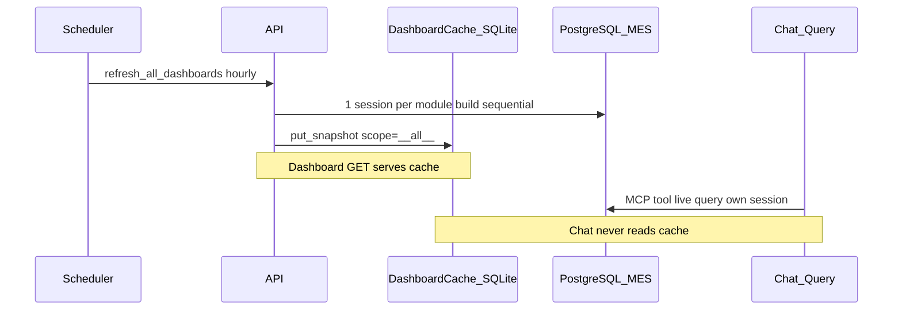

# PostgreSQL Connection Architecture — MES AI Assistant

This document describes how the MES AI backend uses PostgreSQL connections after the connection-exhaustion refactor: serialized dashboard builds with a single shared session, global (unfiltered) dashboard data scope, and a strict split between cached dashboard views and live chat queries.

**Related docs:** [all-features.md](./all-features.md) · [integration.md](./integration.md) · [database.md](./database.md)

---

## 1. Executive summary

| Fact | Detail |
|------|--------|
| **MES database** | Remote PostgreSQL `mes_db` (readonly user `mes_readonly`) via `DATABASE_URL` |
| **App pool (per API worker)** | `pool_size=3` + `max_overflow=10` → up to **13** concurrent connections |
| **Idle connections when idle** | Up to **3** connections can remain open in the pool after work finishes |
| **Dashboard build peak** | **1** PostgreSQL session per module build (shared `AsyncSession`, sequential queries) |
| **Chat MCP peak** | **1** connection per tool call (**3** for cross-module analysis) |
| **Scheduled cache refresh** | **10 dashboard builds** per cycle (5 modules × 2 locales), **global scope** (`__all__`) |
| **Dashboard data scope** | **No default line ID** — all active lines/products unless `line_id` is explicitly passed |
| **Chat data scope** | **Always live** — intent-extracted parameters from natural language; never reads dashboard cache |

---

## 2. Two-store architecture

| Store | Technology | Used for | Opens PG connections? |
|-------|------------|----------|------------------------|
| **MES data** | PostgreSQL (`n2admin.*`) | MCP tools, dashboard SQL | **Yes** |
| **Dashboard cache** | SQLite (`data/dashboard_cache.db`) | Cached KPI/chart snapshots | **No** |
| **Chat history** | SQLite (`data/chat_history.db`) | Optional API persistence | **No** |
| **RAG (default)** | Chroma / file (`data/chroma`) | Knowledge retrieval | **No** |

Only PostgreSQL connections count toward the shared MES server `max_connections` limit.



---

## 3. Connection pool configuration

Defined in [`core/db.py`](../core/db.py) and [`core/config.py`](../core/config.py):

```python
create_async_engine(
    settings.database_url,
    pool_pre_ping=True,
    pool_size=settings.db_pool_size,   # default: 3
    max_overflow=10,                   # hardcoded
)
```

| Setting | Env var | Default | Meaning |
|---------|---------|---------|---------|
| Pool size | `DB_POOL_SIZE` | `3` | Connections kept warm in the pool |
| Max overflow | *(not configurable)* | `10` | Extra connections during bursts |
| **Max per API worker** | — | **13** | `pool_size + max_overflow` |

Each standalone MCP tool call (chat path) calls `get_session()` → one checkout until `session.close()`.

**Multiple uvicorn workers:** Each worker has its own pool. Example: `--workers 4` → up to **4 × 13 = 52** potential PostgreSQL connections from this app.

---

## 4. Serialized dashboard builds (1 connection per build)

### 4.1 Problem that was fixed

Previously, each dashboard builder used `asyncio.gather()` to run 4–7 MCP tools and SQL helpers in parallel. Each task called `get_session()` independently, peaking at **7 simultaneous connections** per build and exhausting the shared MES PostgreSQL limit.

### 4.2 New pattern

1. [`build_dashboard_response()`](../core/dashboard_cache/service.py) acquires **one** `AsyncSession` at the entry point.
2. The session is passed into `builder.build(..., session=session)`.
3. All MCP tool calls use `tool.run(params, context, session=session)`.
4. All dashboard `_fetch_*` SQL helpers accept the shared session — they do **not** call `get_session()` internally.
5. Queries run **sequentially** (no `asyncio.gather` in dashboard builders).
6. The session is closed in a `finally` block when the build completes or fails.

[`mcp_tools/base.py`](../mcp_tools/base.py) provides `optional_session()`:

- Dashboard path: reuses the injected session (no extra checkout).
- Chat path: acquires and closes its own session when none is injected.

### 4.3 Peak connections per dashboard module

| Module | Sequential steps | Peak PG connections |
|--------|------------------|---------------------|
| Production | 7 (6 MCP tools + 1 SQL helper) | **1** |
| Equipment | 7 (5 MCP + 2 SQL) | **1** |
| Procurement | 8+ (6 SQL + 1 MCP, after receive-doc prefetch) | **1** |
| Warehouse | 5 (2 MCP + 3 SQL) | **1** |
| Quality | 4 (2 MCP + 2 SQL) | **1** |

### 4.4 Scheduler overlap

`refresh_all_dashboards()` runs **10 builds sequentially** (not in parallel). Peak at any instant during refresh: **1** connection per worker.

---

## 5. Global data scope (no default line / no top-N throttling)

### 5.1 Removed defaults

| Removed | Former behavior |
|---------|-----------------|
| `DEFAULT_LINE_ID` / `default_line_id` | Backend and frontend defaulted to `FDQ-SMT-3` |
| Production `line_id` requirement | API rejected requests without a line |
| Chart top-N slicing | `devices[:5]`, `scored[:5]`, `most_common(5)`, etc. |

### 5.2 Current scope rules

| Module | Default scope (no query param) | Explicit filter |
|--------|-------------------------------|-----------------|
| production, quality, equipment | **All lines** (`scope_key = __all__`) | `?line_id=FDQ-SMT-6` |
| warehouse, procurement | **All warehouses** (`scope_key = __all__`) | `?wh_code=WH01` |

MCP production tools treat `line_id=None` as global:

- Equipment yield: no `cd_location` filter (`1=1`).
- Reported yield: no `line.area_sn` filter (`1=1`).
- Capacity forecast: queries all consumption records when no line is set.

Charts include **all** devices, suppliers, defect types, and flagged buckets returned by the query — no artificial top-5/top-6 limits.

### 5.3 Cache prewarm

[`refresh_all_dashboards()`](../core/dashboard_cache/service.py) refreshes:

| Module | Scope | Locales | Builds per cycle |
|--------|-------|---------|------------------|
| production, quality, equipment | `__all__` (global) | zh-CN, en-US | 6 |
| warehouse, procurement | `__all__` (or `DEFAULT_WH_CODE` if set) | zh-CN, en-US | 4 |
| **Total** | | | **10** |

Frontend dashboard client ([`frontend/src/api/dashboard.js`](../frontend/src/api/dashboard.js)) omits `line_id` unless explicitly provided.

---

## 6. Dashboard cache vs live chat

### 6.1 Dashboard GET — SQLite cache

`GET /api/v1/assistants/{module}/dashboard`

| Cache header | User wait | PostgreSQL |
|--------------|-----------|------------|
| **`hit`** | Fast | **None** for this request |
| **`stale`** | Fast (old data) | **Background** rebuild: **1** connection |
| **`miss`** | Slow | **Foreground** rebuild: **1** connection |

Live data is read from PostgreSQL through MCP tools and parameterized SQL in `core/dashboard/*.py`, then written to SQLite.

### 6.2 Chat POST — always live PostgreSQL

`POST /api/v1/query` → [`orchestrator/router.py`](../orchestrator/router.py) → Bailian intent → MCP tool(s) → optional synthesis.

- **Never** reads `core/dashboard_cache/` or SQLite dashboard snapshots.
- **Never** uses cached KPI/chart data.
- Each tool acquires its own session (or up to 3 for cross-module analysis).
- Intent parameters (`line_id`, `wh_code`, dates) come from the user's natural-language query.

This separation is documented in the module docstring of `orchestrator/router.py`.

---

## 7. Connections by activity

| Activity | Peak PG connections (1 worker) |
|----------|-------------------------------|
| Idle after prior DB use | 0–**3** idle pooled |
| Dashboard cache read (hit) | **0** |
| Dashboard build (any module) | **1** |
| Full scheduler cycle (sequential) | **1** at any instant |
| Chat single tool | **1** |
| Chat cross-module | **3** |
| Overlap: stale refresh + chat | **2** (was up to 15 before refactor) |

---

## 8. Operational mitigations

| Action | Env / change |
|--------|----------------|
| Reduce idle pool footprint | `DB_POOL_SIZE=3` (default) |
| Disable background prewarm | `DASHBOARD_CACHE_ENABLED=false` |
| Longer refresh interval | `DASHBOARD_CACHE_REFRESH_INTERVAL_SECONDS=7200` |
| Single worker | `uvicorn --workers 1` |
| Filter to one line (optional) | Pass `?line_id=` on dashboard GET or in chat query text |
| Infrastructure | Raise `max_connections` or add PgBouncer on MES side |

### Monitor on PostgreSQL (superuser)

```sql
SHOW max_connections;

SELECT usename, application_name, state, count(*)
FROM pg_stat_activity
GROUP BY 1, 2, 3
ORDER BY count(*) DESC;
```

### Response headers (dashboard only)

| Header | Meaning |
|--------|---------|
| `X-Dashboard-Cache: hit` | No PG for that dashboard request |
| `X-Dashboard-Cache: stale` | Background PG rebuild started (1 connection) |
| `X-Dashboard-Cache: miss` | Foreground PG rebuild (1 connection) |

---

## 9. Source files

| Topic | File |
|-------|------|
| Pool / `get_session()` | [`core/db.py`](../core/db.py) |
| Pool size default | [`core/config.py`](../core/config.py) |
| Shared session lifecycle | [`core/dashboard_cache/service.py`](../core/dashboard_cache/service.py) |
| `optional_session()` helper | [`mcp_tools/base.py`](../mcp_tools/base.py) |
| Dashboard builders (sequential) | [`core/dashboard/*.py`](../core/dashboard/) |
| Global line filters in MCP | [`mcp_tools/production_tools.py`](../mcp_tools/production_tools.py) |
| Capacity global scope | [`core/analytics/capacity.py`](../core/analytics/capacity.py) |
| Cache scheduler | [`core/dashboard_cache/scheduler.py`](../core/dashboard_cache/scheduler.py) |
| Dashboard API scope resolution | [`api/routes.py`](../api/routes.py) |
| Frontend (no default line) | [`frontend/src/api/dashboard.js`](../frontend/src/api/dashboard.js) |
| Chat router (live only) | [`orchestrator/router.py`](../orchestrator/router.py) |
| Cross-module chat (3 tools) | [`orchestrator/cross_module.py`](../orchestrator/cross_module.py) |
