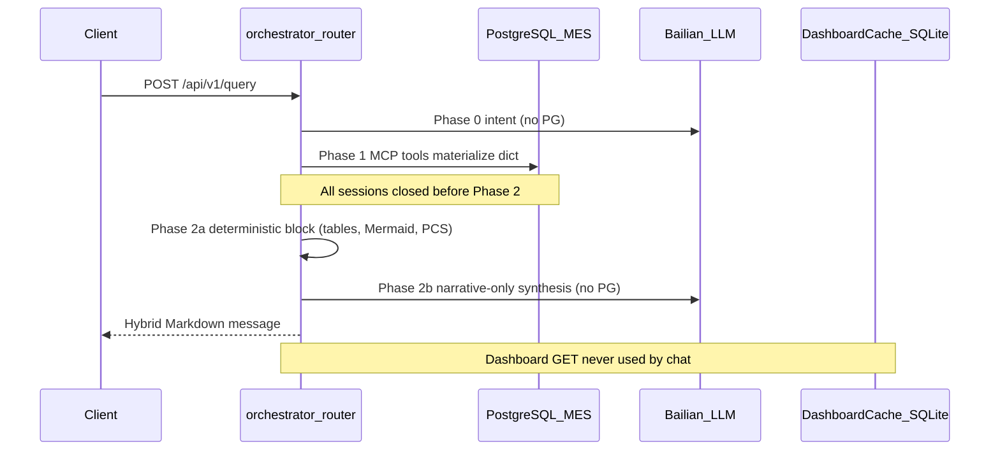

# PostgreSQL Connection Architecture — MES AI Assistant

This document describes how the MES AI backend uses PostgreSQL connections after the connection-leak elimination refactor: NullPool-by-default, explicit DB-then-LLM orchestrator phases, serialized cross-module chat, bounded dashboard PG work via a semaphore, and a strict split between cached dashboard views and live chat queries.

**Related docs:** [all-features.md](./all-features.md) · [integration.md](./integration.md) · [database.md](./database.md)

---

## 1. Executive summary

| Fact | Detail |
|------|--------|
| **MES database** | Remote PostgreSQL `mes_db` (readonly user `mes_readonly`) via `DATABASE_URL` |
| **Default pool mode** | `DB_POOL_SIZE=0` → **NullPool** (TCP opened and closed per query) |
| **Dashboard build peak** | **1** PostgreSQL session per module build (shared `AsyncSession`, sequential queries) |
| **Dashboard PG concurrency** | **1** at a time via `pg_work_slot()` semaphore (`DB_PG_WORK_CONCURRENCY=1`) |
| **Chat MCP peak** | **1** connection per tool call (**sequential** for cross-module analysis) |
| **Chat LLM phase** | **No** open `AsyncSession` during Bailian intent or synthesis calls |
| **Scheduled cache refresh** | **10 dashboard builds** per cycle (5 modules × 2 locales), **global scope** (`__all__`) |
| **Dashboard data scope** | **No default line ID** — all active lines/products unless `line_id` is explicitly passed |
| **Chat data scope** | **Always live** — intent-extracted parameters from natural language; never reads dashboard cache |
| **Health check** | `GET /api/v1/health` returns **503** if PostgreSQL `SELECT 1` fails |

---

## 2. Two-store architecture

| Store | Technology | Used for | Opens PG connections? |
|-------|------------|----------|------------------------|
| **MES data** | PostgreSQL (`n2admin.*`) | MCP tools, dashboard SQL | **Yes** |
| **Dashboard cache** | SQLite (`data/dashboard_cache.db`) | Cached KPI/chart snapshots | **No** |
| **Chat history** | SQLite (`data/chat_history.db`) | Optional API persistence | **No** |
| **RAG (default)** | Chroma / file (`data/chroma`) | Knowledge retrieval | **No** (pgvector optional) |

Only PostgreSQL connections count toward the shared MES server `max_connections` limit.



---

## 3. Connection pool configuration

Defined in [`core/db.py`](../core/db.py) and [`core/config.py`](../core/config.py):

```python
if settings.db_pool_size == 0:
    engine_kwargs["poolclass"] = NullPool
else:
    engine_kwargs["pool_size"] = settings.db_pool_size
    engine_kwargs["max_overflow"] = settings.db_max_overflow
```

| Setting | Env var | Default | Meaning |
|---------|---------|---------|---------|
| Pool size | `DB_POOL_SIZE` | `0` | `0` = NullPool; `>0` = QueuePool with warm connections |
| Max overflow | `DB_MAX_OVERFLOW` | `0` | Extra burst connections (only when `DB_POOL_SIZE > 0`) |
| Dashboard PG concurrency | `DB_PG_WORK_CONCURRENCY` | `1` | Max simultaneous dashboard builds |

**NullPool (`DB_POOL_SIZE=0`):** Each query opens a fresh TCP connection and closes it when the `AsyncSession` exits. This is the recommended production default when MES `max_connections` is under pressure.

**QueuePool (`DB_POOL_SIZE > 0`):** Use only after confirming headroom. Max per worker = `pool_size + max_overflow`.

`init_db()` runs `SELECT 1` at startup and **raises** on failure — the API will not start with a dead database.

---

## 4. Orchestrator: DB-then-LLM phase separation

[`orchestrator/router.py`](../orchestrator/router.py) enforces a hard invariant:

> **No `AsyncSession` may remain open across any Bailian / DashScope call.**

| Phase | Functions | PostgreSQL? | External LLM? |
|-------|-----------|-------------|---------------|
| 0 | `parse_intent()` | No | Yes (Bailian intent) |
| 0b | `retrieve_context()` (optional RAG) | Brief PG search after embed | Yes (embedding API) |
| 1 | `_fetch_tool_result()` / `_fetch_cross_module_result()` | Yes — materialize dicts, close sessions | No |
| 2 | `_synthesize_message()` → `generate_ai_analysis()` | **No** | Yes (Bailian narrative when hybrid; full synthesis otherwise) |
| 2a | `_build_system_deterministic_block()` (inside synthesis, no PG) | **No** | **No** — pure Python from MCP JSON dict |
| 2b | `_call_bailian_synthesis()` | **No** | Yes (Bailian) |

Cross-module analysis ([`orchestrator/cross_module.py`](../orchestrator/cross_module.py)) runs **three MCP tools sequentially** (not `asyncio.gather`), so peak chat PG use is **1** connection at a time.

---

## 5. Serialized dashboard builds (1 connection per build)

### 5.1 Pattern

1. [`build_dashboard_response()`](../core/dashboard_cache/service.py) acquires `pg_work_slot()` then **one** `AsyncSession`.
2. The session is passed into `builder.build(..., session=session)`.
3. All MCP tool calls use `tool.run(params, context, session=session)`.
4. Queries run **sequentially** (no `asyncio.gather` in dashboard builders).
5. The session is closed in a `finally` block when the build completes or fails.

[`mcp_tools/base.py`](../mcp_tools/base.py) provides `optional_session()`:

- Dashboard path: reuses the injected session (no extra checkout).
- Chat path: acquires and closes its own session when none is injected.
- `close()` runs in `finally` on success, `Exception`, and `asyncio.CancelledError`.

Analytics helpers ([`core/analytics/root_cause.py`](../core/analytics/root_cause.py), [`core/analytics/scheduling.py`](../core/analytics/scheduling.py)) accept an optional injected session via `optional_session()` — they no longer call `get_session()` directly when a dashboard shared session is passed.

### 5.2 Peak connections per dashboard module

| Module | Sequential steps | Peak PG connections |
|--------|------------------|---------------------|
| Production | 7 (6 MCP tools + 1 SQL helper) | **1** |
| Equipment | 7 (5 MCP + 2 SQL) | **1** |
| Procurement | 8+ (6 SQL + 1 MCP) | **1** |
| Warehouse | 5 (2 MCP + 3 SQL) | **1** |
| Quality | 4 (2 MCP + 2 SQL) | **1** |

---

## 6. Background tasks and concurrency limits

### 6.1 `pg_work_slot()` semaphore

[`core/db.py`](../core/db.py) exports `pg_work_slot()` — an asyncio semaphore limiting concurrent dashboard PG work.

Wrapped by:

- [`build_dashboard_response()`](../core/dashboard_cache/service.py)
- [`core/dashboard_cache/scheduler.py`](../core/dashboard_cache/scheduler.py) `_refresh_loop`
- Stale-cache revalidation in [`api/routes.py`](../api/routes.py) (via `refresh_dashboard_module` → `build_dashboard_response`)

### 6.2 Stale-cache revalidation deduplication

[`api/routes.py`](../api/routes.py) tracks in-flight revalidation tasks by `(module, scope_key, locale, lookback_days)`. Duplicate `create_task` calls for the same key are skipped.

### 6.3 Scheduler startup

`DASHBOARD_CACHE_REFRESH_ON_STARTUP=false` (default) — the scheduler waits one interval before the first refresh, avoiding overlap with cold-start cache misses.

`refresh_all_dashboards()` runs **10 builds sequentially**. With the semaphore, only **1** dashboard PG build runs at any instant across scheduler + HTTP paths.

---

## 7. Global data scope (no default line / no top-N throttling)

| Module | Default scope (no query param) | Explicit filter |
|--------|-------------------------------|-----------------|
| production, quality, equipment | **All lines** (`scope_key = __all__`) | `?line_id=FDQ-SMT-6` |
| warehouse, procurement | **All warehouses** (`scope_key = __all__`) | `?wh_code=WH01` |

MCP production tools treat `line_id=None` as global (no line filter in SQL).

---

## 8. Dashboard cache vs live chat

### 8.1 Dashboard GET — SQLite cache

`GET /api/v1/assistants/{module}/dashboard`

| Cache header | User wait | PostgreSQL |
|--------------|-----------|------------|
| **`hit`** | Fast | **None** for this request |
| **`stale`** | Fast (old data) | **Background** rebuild (semaphore-gated, 1 connection) |
| **`miss`** | Slow | **Foreground** rebuild (semaphore-gated, 1 connection) |

### 8.2 Chat POST — always live PostgreSQL

`POST /api/v1/query` → orchestrator → Bailian intent → MCP tool(s) → **hybrid report assembly**.

- **Never** reads dashboard SQLite cache.
- DB phase completes and all sessions close **before** synthesis LLM call.
- When tool JSON has list arrays: Python builds deterministic tables/charts first; Bailian writes narrative only.
- Cross-module: **1** connection at a time (sequential tools).

---

## 9. Connections by activity

| Activity | Peak PG connections (1 worker, NullPool) |
|----------|------------------------------------------|
| Idle | **0** (no warm pool) |
| Dashboard cache read (hit) | **0** |
| Dashboard build (any module) | **1** (semaphore-gated) |
| Full scheduler cycle | **1** at any instant |
| Chat single tool | **1** (open only during SQL) |
| Chat cross-module | **1** at a time (sequential) |
| Overlap: stale refresh + chat | **1** (semaphore serializes dashboard work; chat uses separate checkout) |

---

## 10. Operational mitigations and redeploy

### Recommended redeploy sequence

1. `docker compose down`
2. Deploy with `DASHBOARD_CACHE_ENABLED=false` initially (chat-only, minimal PG load)
3. Set `DB_POOL_SIZE=0` (NullPool default)
4. Verify `GET /api/v1/health` returns `database: ok` and test `POST /api/v1/query`
5. Prewarm cache: `docker compose exec api python scripts/refresh_dashboard_cache.py`
6. Re-enable `DASHBOARD_CACHE_ENABLED=true`

### Other tuning

| Action | Env / change |
|--------|----------------|
| NullPool (default) | `DB_POOL_SIZE=0` |
| Warm pool (only if PG has headroom) | `DB_POOL_SIZE=3`, `DB_MAX_OVERFLOW=0` |
| Disable background prewarm | `DASHBOARD_CACHE_ENABLED=false` |
| Skip immediate scheduler refresh | `DASHBOARD_CACHE_REFRESH_ON_STARTUP=false` |
| Longer refresh interval | `DASHBOARD_CACHE_REFRESH_INTERVAL_SECONDS=7200` |
| Single worker | `uvicorn` default (1 worker in Dockerfile) |

### Monitor on PostgreSQL (superuser)

```sql
SHOW max_connections;

SELECT usename, application_name, state, count(*)
FROM pg_stat_activity
GROUP BY 1, 2, 3
ORDER BY count(*) DESC;
```

### Response headers (dashboard only)

| Header | Meaning |
|--------|---------|
| `X-Dashboard-Cache: hit` | No PG for that dashboard request |
| `X-Dashboard-Cache: stale` | Background PG rebuild started (deduped, semaphore-gated) |
| `X-Dashboard-Cache: miss` | Foreground PG rebuild (semaphore-gated) |

---

## 11. Source files

| Topic | File |
|-------|------|
| Pool / NullPool / `pg_work_slot()` | [`core/db.py`](../core/db.py) |
| Pool size / concurrency settings | [`core/config.py`](../core/config.py) |
| Shared session lifecycle | [`core/dashboard_cache/service.py`](../core/dashboard_cache/service.py) |
| `optional_session()` helper | [`mcp_tools/base.py`](../mcp_tools/base.py) |
| DB-then-LLM orchestrator | [`orchestrator/router.py`](../orchestrator/router.py) |
| Sequential cross-module chat | [`orchestrator/cross_module.py`](../orchestrator/cross_module.py) |
| Analytics session injection | [`core/analytics/root_cause.py`](../core/analytics/root_cause.py), [`core/analytics/scheduling.py`](../core/analytics/scheduling.py) |
| Cache scheduler | [`core/dashboard_cache/scheduler.py`](../core/dashboard_cache/scheduler.py) |
| Health check + revalidation dedup | [`api/routes.py`](../api/routes.py) |
| Env template | [`.env.example`](../.env.example) |
