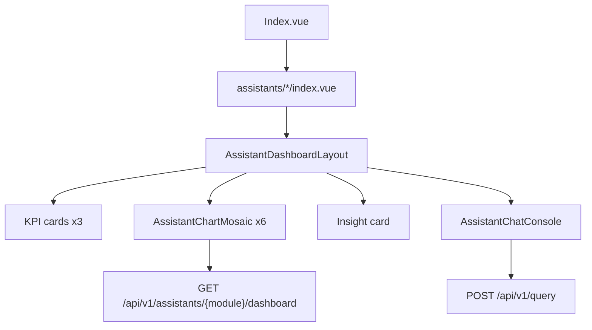

# MES AI — Module Feature Catalog / 模块功能对照

Feature catalog for the **宁波睿创 AI 工业大脑** frontend and its backend integrations. Each of the five assistant modules is documented with dashboard charts (tables, fetch logic, status) and chat (MCP tools, tables, routing, report format).

**Legend / 图例**

| Mark | Dashboard meaning | Chat meaning |
|------|-------------------|--------------|
| ✅ | Live MES data (`source: "live"`) | Dedicated MCP intents registered in `orchestrator/tool_registry.py` |
| ❌ | Static mock series (`source: "fallback"`) | No dedicated MCP module; reuses other intents or UNKNOWN greeting only |

Chat integration status in this document reflects **backend MCP wiring only** (not the frontend `VITE_INTEGRATED_ASSISTANTS` deployment gate).

---

## Frontend layout / 前端布局

The SPA (`mes-ai-client`) uses Vue 3 + Element Plus + ECharts. Every assistant page shares the same shell and dashboard layout.

| Route | Module | Scope param |
|-------|--------|-------------|
| `/` | Home | — |
| `/assistant/production` | Production | `line_id` (default `FDQ-SMT-3`) |
| `/assistant/warehouse` | Warehouse | `wh_code` (optional) |
| `/assistant/quality` | Quality | `line_id` (optional) |
| `/assistant/equipment` | Equipment | `line_id` (optional) |
| `/assistant/procurement` | Procurement | `wh_code` (optional) |

**Shared components**

| Component | Role |
|-----------|------|
| `AppShell.vue` | Global shell: background, header, router outlet |
| `AssistantDashboardLayout.vue` | KPI grid + chart mosaic + insight + chat |
| `AssistantChartMosaic.vue` | Six ECharts containers in bento grid |
| `AssistantChatConsole.vue` | Collapsible AI chat panel |

**Shared data flow**

- **Dashboard:** `useIntegratedAssistantPage.js` → `GET /api/v1/assistants/{module}/dashboard` → SQLite cache (server) → `core/dashboard/{module}.py` → MCP tools + SQL → frontend merges live slots via `adapters/chartSlots.js` (only when `source === "live"`).
- **Chat:** `useAssistantChat.js` → `adapters/chat.js` → `POST /api/v1/query` → Bailian intent parse → MCP tool → Bailian synthesis → Markdown reply (or deterministic fallback template).

---

## Global frontend features / 全局功能

| Feature | Status | Notes |
|---------|--------|-------|
| Home page (5 assistant cards) | ✅ | `frontend/src/views/Index.vue` |
| i18n (Chinese / English) | ✅ | `useLocale.js` + `messages.js`; persisted in `localStorage` |
| Dashboard API (all 5 modules) | ✅ | Always fetched via `useIntegratedAssistantPage.js` on mount / locale change |
| Dashboard SQLite cache | ✅ | Backend only; check `X-Dashboard-Cache: hit \| stale \| miss` |
| Chart loading UX | ✅ | Plain "Loading" text in chart boxes; staggered ECharts init |
| Live chat API (backend) | ✅ | Orchestrator + MCP fully wired for production, warehouse, quality |
| Live chat API (frontend gate) | Config | `VITE_INTEGRATED_ASSISTANTS` (default: `production` only); not counted in ✅/❌ below |
| Chat history persistence | ❌ | Backend SQLite exists; frontend keeps messages in component state only |
| Partial dashboard flag | ✅ | API sets `partial: true` when any slot falls back; UI does not surface it yet |

---

## Report generation (all modules) / 报告生成

Reports are **not** a fixed PDF template. Content is **dynamic** based on the user query and live MCP tool results.

| Path | Format |
|------|--------|
| **Primary** | **Dynamic AI Markdown** — Bailian second pass (`orchestrator/report_generator.py` → `generate_ai_analysis`) using module persona from `orchestrator/module_personas.py` + tool JSON |
| **UNKNOWN intent** | **Fixed greeting** — static module greeting + sample prompts from `module_personas.py` (no tool call, no DB query) |
| **Fallback** | **Deterministic template** — `_fallback_markdown_report()` builds titled sections, metric bullets, and tables from tool JSON when Bailian is unavailable or fails |
| **Export** | `EXPORT_REPORT` intent wraps the last synthesis (cross-module) |

Structure is guided by persona prompts (e.g. "executive summary → metrics → actions"); wording and numbers change per query and data.

---

## 1. Production / AI生产助手

| Item | Value |
|------|-------|
| Route | `/assistant/production` |
| Module key | `production` |
| Scope | `line_id` (required) |
| Frontend composable | `useProductionAssistantPage.js` |
| Chart mock fallback | `views/assistants/production/charts.js` |
| Backend builder | `core/dashboard/production.py` |
| Dashboard API | `GET /api/v1/assistants/production/dashboard?line_id=…` |
| Chat prefix | `【AI生产助手】` |

### Dashboard — KPIs

| KPI (zh / en) | Tables | Fetch logic | Status |
|---------------|--------|-------------|--------|
| 计划达成率 / Plan Attainment | `t_smt_program_consumption_record`, `t_co_device` | `get_yield_aggregation` — equipment achievement rate | ✅ |
| 设备稼动率 / Equipment Utilization | `t_smt_program_consumption_record`, `t_co_device` | `get_device_production_rate` — avg output per device | ✅ |
| 在制工单 / WIP Orders | — | No work-order count tool wired | ❌ |

### Dashboard — Charts

| # | Chart (zh / en) | Type | Tables | Fetch logic | Status |
|---|-----------------|------|--------|-------------|--------|
| 0 | 产线达成趋势 / Line Attainment Trend | line | `t_smt_program_consumption_record`, `t_co_device` | `get_yield_aggregation` — daily achievement breakdown | ✅ |
| 1 | 工单状态分布 / Work Order Status | bar | — | No work-order status aggregation tool | ❌ |
| 2 | 产能负荷 / Capacity Load | gauge | `t_smt_program_consumption_record`, `t_co_device`, `t_co_standard_time` | `forecast_capacity_hr` — utilization % vs standard time | ✅ |
| 3 | 产线负荷对比 / Line Load Comparison | bar | `t_smt_program_consumption_record`, `t_co_device` | `get_device_production_rate` — top 5 devices by avg rate | ✅ |
| 4 | 不良品分析 / Defect Analysis | line | `t_wip_detail`, `t_co_area` | SQL — monthly sum of `ng_qty + scrap_qty` on line | ✅ |
| 5 | 异常停机分析 / Downtime Analysis | bar | `t_smt_program_consumption_record`, `t_co_device` | `get_yield_anomalies` — below_standard hourly buckets | ✅ |

### Chat integration

| Item | Detail |
|------|--------|
| MCP module | `mcp_tools/production_tools.py`, `mcp_tools/production_engines.py` |
| **Integration status** | **✅** — 9 dedicated intents in `orchestrator/tool_registry.py` |
| NL routing | User question → Bailian intent extraction → production intent → MCP tool → synthesis with production analyst persona |

| Intent / tool | PostgreSQL tables |
|---------------|-------------------|
| `get_yield_aggregation` | `t_smt_program_consumption_record`, `t_co_device` |
| `get_yield_anomalies_and_peaks` | `t_smt_program_consumption_record`, `t_co_device` |
| `compare_yield_periods` | `t_smt_program_consumption_record`, `t_co_device` |
| `get_product_yield` | `t_smt_program_consumption_record`, `t_co_device`, `t_co_item` |
| `get_device_production_rate` | `t_smt_program_consumption_record`, `t_co_device` |
| `get_standard_time_achievement` | `t_co_standard_time`, `t_smt_program_consumption_record` |
| `get_production_root_cause` | `t_smt_program_consumption_record`, `t_wip_detail`, `t_co_area` |
| `optimize_production_schedule` | `t_aps_plan_mo_info`, `t_smt_program_consumption_record` |
| `forecast_capacity_hr` | `t_smt_program_consumption_record`, `t_co_device`, `t_co_standard_time` |

**Report generation:** Dynamic AI Markdown (production planning analyst persona). RAG enrichment for `yield_anomalies` and `production_root_cause`. UNKNOWN → fixed production greeting.

---

## 2. Warehouse / AI仓库助手

| Item | Value |
|------|-------|
| Route | `/assistant/warehouse` |
| Module key | `warehouse` |
| Scope | `wh_code` (optional; empty = all warehouses) |
| Frontend composable | `useWarehouseAssistantPage.js` |
| Chart mock fallback | `views/assistants/warehouse/charts.js` |
| Backend builder | `core/dashboard/warehouse.py` |
| Dashboard API | `GET /api/v1/assistants/warehouse/dashboard?wh_code=…` |
| Chat prefix | `【AI仓库助手】` |

### Dashboard — KPIs

| KPI (zh / en) | Tables | Fetch logic | Status |
|---------------|--------|-------------|--------|
| 库存准确率 / Inventory Accuracy | `t_wms_stock_info`, `t_co_item` | SQL `_fetch_stock_summary` — non-low, non-expiring rows / total | ✅ |
| 周转天数 / Turnover Days | `t_wms_stock_info`, `t_co_item` | Same SQL — avg days since `instock_time` | ✅ |
| 待拣任务 / Pick Tasks | `t_wms_stock_info`, `t_co_item` | `get_inventory_status` — low-stock count as replenishment proxy | ✅ |

### Dashboard — Charts

| # | Chart (zh / en) | Type | Tables | Fetch logic | Status |
|---|-----------------|------|--------|-------------|--------|
| 0 | 出入库趋势 / Inbound/Outbound Trend | line/bar | — | No inbound/outbound time-series MCP tool | ❌ |
| 1 | 库存结构 / Inventory Structure | bar | `t_wms_stock_info`, `t_co_item` | SQL `_fetch_stock_summary` — healthy / low / expiring counts | ✅ |
| 2 | 库位利用率 / Bin Utilization | gauge | `t_wms_area`, `t_wms_stock_info` | SQL `_fetch_bin_utilization` — occupied storage codes / total areas | ✅ |
| 3 | 呆滞库存分析 / Slow-moving Stock | bar | `t_wms_stock_info` | SQL `_fetch_age_buckets` — age buckets from `instock_time` | ✅ |
| 4 | 拣货效率趋势 / Picking Efficiency | line | — | No picking-efficiency time series | ❌ |
| 5 | 收货及时率 / Receiving On-time Rate | gauge | — | No receiving OTD tool in warehouse MCP set | ❌ |

### Chat integration

| Item | Detail |
|------|--------|
| MCP module | `mcp_tools/warehouse_tools.py` |
| **Integration status** | **✅** — 5 dedicated intents in `orchestrator/tool_registry.py` |
| NL routing | Warehouse intents: inventory monitor, obsolete profile, inbound/outbound guide, material trace forward/reverse |

| Intent / tool | PostgreSQL tables |
|---------------|-------------------|
| `get_inventory_status` | `t_wms_stock_info`, `t_co_item` |
| `guide_inbound_outbound` | `t_wms_stock_info`, `t_wms_area` |
| `profile_obsolete_inventory` | `t_wms_stock_info`, `t_co_item` |
| `trace_material_forward` | `t_wms_mid_item`, `t_wms_stock_info` |
| `trace_product_reverse` | `t_wip_detail`, `t_wms_stock_info` |

**Report generation:** Dynamic AI Markdown (WMS operator persona). RAG enrichment for `warehouse_obsolete_profile`. Fallback template renders `low_stock`, `expiring`, `stagnant_items`, trace chains. UNKNOWN → fixed warehouse greeting.

---

## 3. Quality / AI质量助手

| Item | Value |
|------|-------|
| Route | `/assistant/quality` |
| Module key | `quality` |
| Scope | `line_id` (optional) |
| Frontend composable | `useQualityAssistantPage.js` |
| Chart mock fallback | `views/assistants/quality/charts.js` |
| Backend builder | `core/dashboard/quality.py` |
| Dashboard API | `GET /api/v1/assistants/quality/dashboard?line_id=…` |
| Chat prefix | `【AI质量助手】` |

### Dashboard — KPIs

| KPI (zh / en) | Tables | Fetch logic | Status |
|---------------|--------|-------------|--------|
| 一次合格率 / First Pass Yield | `t_qm_inspect_info` | `get_quality_defect_aggregation` — `100% − defect_rate` | ✅ |
| 异常批次 / Abnormal Lots | `t_qm_problem_report` | SQL `_fetch_problem_summary` — 8D reports in lookback window | ✅ |
| 闭环率 / Closure Rate | `t_qm_problem_report` | Same SQL — `close_time IS NOT NULL` / total reports | ✅ |

### Dashboard — Charts

| # | Chart (zh / en) | Type | Tables | Fetch logic | Status |
|---|-----------------|------|--------|-------------|--------|
| 0 | 不良率趋势 / Defect Rate Trend | line | `t_qm_inspect_info` | SQL `_fetch_daily_defect_rates` — `(error_qty / real_qty) × 100` daily | ✅ |
| 1 | 缺陷类型排行 / Defect Type Ranking | bar | `t_qm_problem_report`, `t_qm_problem_reason` | `analyze_defect_root_cause` — top root-cause hypotheses | ✅ |
| 2 | 质量健康度 / Quality Health | gauge | `t_qm_inspect_info` | `get_quality_defect_aggregation` — `100 − defect_rate` | ✅ |
| 3 | 返修率趋势 / Rework Rate Trend | line | `t_qm_inspect_info` | Same daily defect SQL used as rework proxy | ✅ |
| 4 | 工序良率对比 / Process Yield | bar | `t_qm_inspect_info` | Defect tool breakdown by `process_code` | ✅ |
| 5 | 检验及时率 / Inspection On-time | gauge | — | No on-time inspection MCP tool or schedule table | ❌ |

### Chat integration

| Item | Detail |
|------|--------|
| MCP module | `mcp_tools/quality_tools.py` |
| **Integration status** | **✅** — 4 dedicated intents in `orchestrator/tool_registry.py` |
| NL routing | Quality intents: defect aggregation, root cause, error prevention, effectiveness verification |

| Intent / tool | PostgreSQL tables |
|---------------|-------------------|
| `get_quality_defect_aggregation` | `t_qm_inspect_info` |
| `analyze_defect_root_cause` | `t_qm_problem_report`, `t_qm_problem_reason` |
| `check_error_prevention` | `t_qm_inspect_scheme_info`, `t_qm_ipqc_doc` |
| `verify_quality_effectiveness` | `t_qm_inspect_info`, `t_qm_problem_report` |

**Report generation:** Dynamic AI Markdown (quality engineer persona). RAG enrichment for `quality_defect_analysis` and `quality_root_cause`. Fallback includes hypotheses, defect rates, before/after effectiveness. UNKNOWN → fixed quality greeting.

---

## 4. Equipment / AI设备助手

| Item | Value |
|------|-------|
| Route | `/assistant/equipment` |
| Module key | `equipment` |
| Scope | `line_id` (optional) |
| Frontend composable | `useEquipmentAssistantPage.js` |
| Chart mock fallback | `views/assistants/equipment/charts.js` |
| Backend builder | `core/dashboard/equipment.py` |
| Dashboard API | `GET /api/v1/assistants/equipment/dashboard?line_id=…` |
| Chat prefix | `【AI设备助手】` |

Equipment dashboard reuses **production MCP tools** with `yield_type=equipment`, plus device registry SQL.

### Dashboard — KPIs

| KPI (zh / en) | Tables | Fetch logic | Status |
|---------------|--------|-------------|--------|
| 设备健康度 / Equipment Health | `t_smt_program_consumption_record`, `t_co_device` | `get_yield_aggregation` (equipment achievement) + `compare_yield_periods` trend | ✅ |
| 预测告警 / Predicted Alerts | `t_smt_program_consumption_record`, `t_co_device` | `get_yield_anomalies` — below_standard bucket count | ✅ |
| 平均停机 / Avg. Downtime | — | No downtime duration table in MES schema | ❌ |

### Dashboard — Charts

| # | Chart (zh / en) | Type | Tables | Fetch logic | Status |
|---|-----------------|------|--------|-------------|--------|
| 0 | 设备健康趋势 / Equipment Health Trend | line | `t_smt_program_consumption_record`, `t_co_device` | `get_yield_aggregation` — daily equipment achievement | ✅ |
| 1 | 告警等级分布 / Alert Level Distribution | bar | — | No alert severity taxonomy in DB | ❌ |
| 2 | 维护完成率 / Maintenance Completion | gauge | `t_co_device` | SQL `_fetch_device_registry_summary` — valid `expire_date` / registered devices | ✅ |
| 3 | 停机时长分析 / Downtime by Equipment | bar | `t_smt_program_consumption_record`, `t_co_device` | `get_device_production_rate` — inverse rate as downtime proxy | ✅ |
| 4 | MTBF趋势 / MTBF Trend | line | — | No MTBF time-series source | ❌ |
| 5 | 点检完成率 / Inspection Completion | gauge | `t_co_device`, `t_smt_program_consumption_record` | SQL `_fetch_active_device_ratio` — devices with logs / registered | ✅ |

### Chat integration

| Item | Detail |
|------|--------|
| MCP module | **None dedicated** — reuses `mcp_tools/production_tools.py` when NL routes to production intents |
| **Integration status** | **❌** — no equipment-specific intents in `tool_registry.py` |
| NL routing | Equipment questions must map to production intents (`yield_type=equipment`, `device_sn` / `line_id`); intent prompt does not list equipment module |
| Tables (when production tools run) | `t_smt_program_consumption_record`, `t_co_device`, `t_wip_detail`, `t_co_area` |

**Report generation:** Dynamic AI Markdown with **equipment maintenance persona** when a tool runs; same synthesis pipeline as production, different style guidelines. If no intent matches → **fixed equipment greeting** (no DB query). Inherited RAG only from production intents (`yield_anomalies`, `production_root_cause`).

---

## 5. Procurement / AI采购助手

| Item | Value |
|------|-------|
| Route | `/assistant/procurement` |
| Module key | `procurement` |
| Scope | `wh_code` (optional) |
| Frontend composable | `useProcurementAssistantPage.js` |
| Chart mock fallback | `views/assistants/procurement/charts.js` |
| Backend builder | `core/dashboard/procurement.py` |
| Dashboard API | `GET /api/v1/assistants/procurement/dashboard?wh_code=…` |
| Chat prefix | `【AI采购助手】` |

Procurement has **no dedicated MCP module**; dashboard uses WMS receive/supplier SQL plus `get_inventory_status` for insight context.

### Dashboard — KPIs

| KPI (zh / en) | Tables | Fetch logic | Status |
|---------------|--------|-------------|--------|
| 采购节省率 / Savings Rate | `t_wms_receive_item`, `t_wms_receive_doc`, `t_co_item` | SQL `_fetch_spend_comparison` — period-over-period spend change | ✅ |
| 准交率 / On-time Delivery | `t_wms_receive_doc` | SQL `_fetch_receive_summary` — `receive_date ≤ plan_receive_date` | ✅ |
| 风险供应商 / Risk Suppliers | `t_wms_receive_doc` | Same summary — suppliers with OTD &lt; 85% and ≥2 receipts | ✅ |

### Dashboard — Charts

| # | Chart (zh / en) | Type | Tables | Fetch logic | Status |
|---|-----------------|------|--------|-------------|--------|
| 0 | 采购金额趋势 / Procurement Spend Trend | line | `t_wms_receive_item`, `t_wms_receive_doc`, `t_co_item` | SQL `_fetch_daily_spend` — daily `receive_qty × single_price` (万) | ✅ |
| 1 | 供应商评分 / Supplier Scores | bar | `t_wms_receive_doc`, `t_co_supplier` | SQL `_fetch_supplier_scores` — OTD % for top-5 volume suppliers | ✅ |
| 2 | 供应链稳定性 / Supply Chain Stability | gauge | `t_wms_receive_doc` | SQL `_stability_from_receive_docs` — `100 − late delivery rate` | ✅ |
| 3 | 交付周期对比 / Lead Time Comparison | bar | `t_wms_receive_doc`, `t_wms_receive_item`, `t_co_item` | SQL `_fetch_lead_time_by_abc` — avg days by `abc_type` | ✅ |
| 4 | 议价空间趋势 / Negotiation Margin | line | — | No price-history table; only snapshot `single_price` | ❌ |
| 5 | 物料齐套率 / Material Kit Rate | gauge | `t_wms_stock_info`, `t_co_item` | SQL `_fetch_kit_rate` — `stock_qty ≥ min_stock` / items with min stock | ✅ |

### Chat integration

| Item | Detail |
|------|--------|
| MCP module | **None dedicated** — dashboard SQL only; chat may hit warehouse `get_inventory_status` |
| **Integration status** | **❌** — no procurement intents in `tool_registry.py` |
| NL routing | Supplier risk, spend, replenishment queries often → UNKNOWN greeting unless phrased as warehouse inventory |
| Tables (indirect chat) | `t_wms_stock_info`, `t_co_item` via warehouse inventory intent only |
| Tables (dashboard only) | `t_wms_receive_doc`, `t_wms_receive_item`, `t_co_supplier`, `t_wms_stock_info`, `t_co_item` |

**Report generation:** Dynamic AI Markdown with **procurement analyst persona** when any tool runs; otherwise **fixed procurement greeting** with sample prompts. Fallback template has procurement empty-hints but no procurement-specific table renderers.

---

## Summary / 汇总

### Dashboard chart integration

| Module | Live charts | Fallback charts |
|--------|-------------|-----------------|
| Production | 5 / 6 | 1 |
| Warehouse | 3 / 6 | 3 |
| Quality | 5 / 6 | 1 |
| Equipment | 4 / 6 | 2 |
| Procurement | 5 / 6 | 1 |

### Chat MCP integration (backend)

| Module | Status | Dedicated MCP tools |
|--------|--------|---------------------|
| Production | ✅ | 9 |
| Warehouse | ✅ | 5 |
| Quality | ✅ | 4 |
| Equipment | ❌ | 0 (reuses production) |
| Procurement | ❌ | 0 (dashboard SQL only) |

### Database table index (by module)

| Table | Production | Warehouse | Quality | Equipment | Procurement |
|-------|:----------:|:---------:|:-------:|:---------:|:-----------:|
| `t_smt_program_consumption_record` | ✅ | | | ✅ | |
| `t_co_device` | ✅ | | | ✅ | |
| `t_co_standard_time` | ✅ | | | | |
| `t_co_area` | ✅ | | | ✅ | |
| `t_wip_detail` | ✅ | trace | | | |
| `t_aps_plan_mo_info` | chat | | | | |
| `t_co_item` | chat | ✅ | | | ✅ |
| `t_wms_stock_info` | | ✅ | | | ✅ |
| `t_wms_area` | | ✅ | | | |
| `t_wms_mid_item` | | trace | | | |
| `t_qm_inspect_info` | | | ✅ | | |
| `t_qm_problem_report` | | | ✅ | | |
| `t_qm_problem_reason` | | | ✅ | | |
| `t_qm_inspect_scheme_info` | | | chat | | |
| `t_qm_ipqc_doc` | | | chat | | |
| `t_wms_receive_doc` | | | | | ✅ |
| `t_wms_receive_item` | | | | | ✅ |
| `t_co_supplier` | | | | | ✅ |

---
