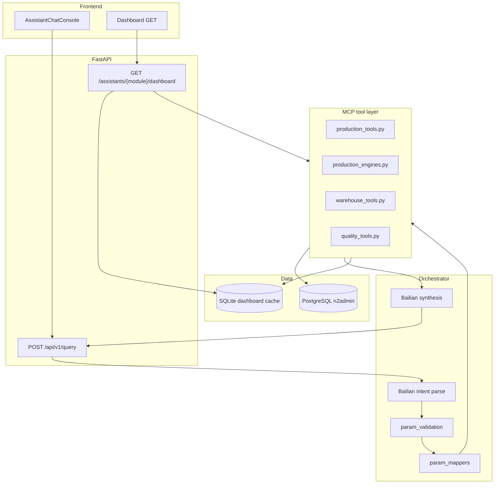
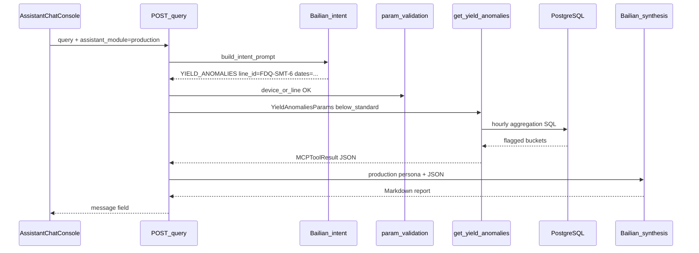

# MES AI — MCP Architecture & Module Report

Comprehensive reference for how **MCP tools** are built, registered, and used across the five assistant modules documented in [all-features.md](./all-features.md).

**Companion docs:** [all-connections.md](./all-connections.md) (PostgreSQL connection usage) · [integration.md](./integration.md) · [mesai-mcp-1.1.md](./mesai-mcp-1.1.md)

---

## 1. What “MCP” means in this project

This codebase does **not** run a separate MCP server process (no standalone `mcp/` daemon). **MCP** here means an **in-process, typed tool layer**:

| Principle | Implementation |
|-----------|----------------|
| **No Text-to-SQL** | The LLM never generates SQL. It only returns structured **intents + parameters**. |
| **Predefined SQL** | Each tool executes fixed `sqlalchemy.text()` queries with bound parameters. |
| **Typed I/O** | Pydantic models for tool params and results; `MCPToolResult` envelope on output. |
| **Python math** | Aggregates, growth rates, std dev computed in Python (`core/math_safeguard.py`), not by the LLM. |



---

## 2. Tool contract

**Base class:** [`mcp_tools/base.py`](../mcp_tools/base.py)

```python
class BaseMCPTool(ABC):
    name: str
    description: str

    async def execute(params, context: MCPContext) -> TResult: ...

    async def run(params, context) -> MCPToolResult:
        # wraps execute(); catches exceptions → success=False
```

| Field | Purpose |
|-------|---------|
| `name` | Stable tool identifier (e.g. `get_yield_aggregation`) |
| `description` | Human-readable purpose (for docs / future tool-calling) |
| `execute()` | Opens DB session, runs SQL/analytics, returns Pydantic result |
| `run()` | Public entry — orchestrator and dashboard builders call this |

**Context:** `MCPContext` carries `workshop_id`, `user_id`, `permission_level` from HTTP header `X-MES-Workshop-Id`. Most SQL filters use **line_id / wh_code / device_sn from intent**, not workshop_id.

**DB access:** Each tool calls `get_session()` → one PostgreSQL connection per tool invocation (see [all-connections.md](./all-connections.md)).

---

## 3. Orchestrator pipeline (chat)

**Entry:** `POST /api/v1/query` → [`orchestrator/router.py`](../orchestrator/router.py) → `route_and_execute()`

| Step | Component | Output |
|------|-----------|--------|
| 1 | `strip_domain_prefix()` + `resolve_module()` | Clean query + `assistant_module` (production, warehouse, …) |
| 2 | `parse_intent()` — Bailian + [`orchestrator/prompts/intent.py`](../orchestrator/prompts/intent.py) | `IntentSchema` (intent enum + extracted entities) |
| 3 | Optional RAG | `retrieve_context()` for selected intents (Chroma/file by default) |
| 4 | Special intents | `CROSS_MODULE_ANALYSIS`, `EXPORT_REPORT`, `UNKNOWN` — see §8 |
| 5 | `validate_intent_params(intent, locale)` | Block dispatch if required entities missing (locale-aware messages) |
| 6 | `get_tool_for_intent()` + `param_mappers` | Map intent → tool params |
| 7 | `tool.run(params, context)` | `MCPToolResult` with JSON `data` |
| 8 | `generate_ai_analysis()` | Markdown report using **module persona** + synthesis rules (incl. **exact `area_name` copy** — rule #15 in [all-prompt.md](./all-prompt.md)) |
| 9 | Fallback | `_fallback_markdown_report()` if Bailian fails |

**Frontend wiring:** [`frontend/src/adapters/chat.js`](../frontend/src/adapters/chat.js) prefixes queries with `【AI…助手】` and sends `assistant_module`. Live chat is gated by `VITE_INTEGRATED_ASSISTANTS` (default: `production` only) — backend MCP is wired regardless.

**Chat history (parallel to query, not MCP):** [`core/chat_store.py`](../core/chat_store.py) persists messages in SQLite (`CHAT_DB_PATH`). [`api/routes.py`](../api/routes.py) exposes:

| Method | Path | Scope |
|--------|------|-------|
| `GET` | `/api/v1/chat/history?assistant_module={module}` | List messages for workshop + module |
| `POST` | `/api/v1/chat/messages` | Append message (`assistant_module` in body) |
| `DELETE` | `/api/v1/chat/history?assistant_module={module}` | Clear one module thread |

Frontend: [`frontend/src/api/chat.js`](../frontend/src/api/chat.js), [`frontend/src/composables/useChatHistory.js`](../frontend/src/composables/useChatHistory.js), wired in [`AssistantChatConsole.vue`](../frontend/src/components/AssistantChatConsole.vue). Valid modules: `production`, `warehouse`, `quality`, `equipment`, `procurement`.

**Report format:** Dynamic AI Markdown (primary) or deterministic template fallback — **not** a fixed PDF layout. Persona and section hints come from [`orchestrator/module_personas.py`](../orchestrator/module_personas.py); numbers come from tool JSON.

---

## 4. Intent system

### 4.1 Intent types (`models/schemas.py`)

| Domain | IntentType values | Count |
|--------|-------------------|-------|
| Production | `YIELD_AGGREGATION`, `YIELD_ANOMALIES`, `YIELD_COMPARISON`, `PRODUCTION_PRODUCT_YIELD`, `PRODUCTION_DEVICE_RATE`, `PRODUCTION_STANDARD_TIME`, `PRODUCTION_PLAN_ACHIEVEMENT`, `PRODUCTION_ROOT_CAUSE`, `PRODUCTION_SCHEDULING_OPT`, `PRODUCTION_CAPACITY_FORECAST`, `FACTORY_METADATA_LOOKUP` | 11 |
| Quality | `QUALITY_DEFECT_ANALYSIS`, `QUALITY_ROOT_CAUSE`, `QUALITY_ERROR_PREVENTION`, `QUALITY_EFFECTIVENESS_VERIFY` | 4 |
| Warehouse | `WAREHOUSE_INVENTORY_MONITOR`, `WAREHOUSE_INBOUND_OUTBOUND`, `WAREHOUSE_OBSOLETE_PROFILE`, `WAREHOUSE_TRACE_FORWARD`, `WAREHOUSE_TRACE_REVERSE` | 5 |
| System | `EXPORT_REPORT`, `CROSS_MODULE_ANALYSIS`, `VOICE_QUERY`, `UNKNOWN` | — |

**Not registered:** Equipment-specific intents, procurement intents.

### 4.2 Registration map

[`orchestrator/tool_registry.py`](../orchestrator/tool_registry.py) binds each intent to `(tool, param_mapper, success_message)`. Loaded at import via `register_all_tools(PARAM_MAPPERS)`.

### 4.3 Param mappers & validation

| File | Role |
|------|------|
| [`orchestrator/param_mappers.py`](../orchestrator/param_mappers.py) | `IntentSchema` → tool-specific Pydantic params; date defaults use **`get_reference_today()`** (server local calendar date) when missing |
| [`orchestrator/param_validation.py`](../orchestrator/param_validation.py) | Pre-dispatch checks — bilingual user-facing errors; **`YIELD_AGGREGATION` blocks `metric=achievement_rate`** (use `PRODUCTION_PLAN_ACHIEVEMENT`); plant-wide scope allowed for sum/avg |
| [`core/reference_date.py`](../core/reference_date.py) | Single source of truth for “today” in intent prompts, param mappers, cross-module, and dashboards (`date.today()` on server clock) |

**Yield type routing:** `_resolve_yield_type()` defaults to **`equipment`** unless intent sets `yield_type: "reported"`.

| `yield_type` | Data source | Scope filter |
|--------------|-------------|--------------|
| `equipment` | `t_smt_program_consumption_record` | `device_sn` **or** `eq.area_sn` (+ Chinese `area_name` lookup via `t_co_area`) |
| `reported` | `t_wip_detail` JOIN `t_co_area` | `line.area_sn` or `line.area_name = line_id` (via workstation hierarchy) |

**Global scoping tokens:**

| `line_id` value | Behavior (`get_yield_aggregation`) |
|-----------------|--------------------------------------|
| `null` / omitted | Plant-wide aggregate (`scope: "plant"`); sets `refinement_suggested: true` when value > 0 |
| `"all"` | Per-line comparative matrix (`scope: "all_lines"`) — `GROUP BY area_sn` on transactional tables |
| Specific code/name | Single-line filter (e.g. `FDQ-SMT-6`, `防盗器贴片六线`) |

**Intent routing (LLM prompt rules):** Plan attainment / 达成率 → `PRODUCTION_PLAN_ACHIEVEMENT`; equipment output volume → `YIELD_AGGREGATION` (sum/avg only); line + product output → `PRODUCTION_PRODUCT_YIELD`; factory structure → `FACTORY_METADATA_LOOKUP`. See [all-prompt.md](./all-prompt.md) and [pm-plan-tables.md](./pm-plan-tables.md).

### 4.4 RAG-enriched intents

[`orchestrator/intent_utils.py`](../orchestrator/intent_utils.py) — `RAG_INTENTS`:

- `YIELD_ANOMALIES`
- `PRODUCTION_ROOT_CAUSE`
- `QUALITY_DEFECT_ANALYSIS`
- `QUALITY_ROOT_CAUSE`
- `WAREHOUSE_OBSOLETE_PROFILE`

---

## 5. Dashboard vs chat — two MCP consumption paths

| Path | Trigger | NL parsing? | MCP usage |
|------|---------|-------------|-----------|
| **Chat** | `POST /api/v1/query` | Yes (Bailian) | One tool per intent (usually) |
| **Chat history** | `GET/POST/DELETE /api/v1/chat/*` | No | SQLite only (`core/chat_store.py`); scoped by `workshop_id` + `assistant_module` |
| **Dashboard** | `GET /assistants/{module}/dashboard` | No | Direct `tool.run()` from `core/dashboard/{module}.py` |

Dashboard builders call MCP tools **directly** with explicit Pydantic params — faster, deterministic, no intent extraction. Some chart slots use **additional custom SQL** in the dashboard file (not separate MCP tools).

Cached snapshots (SQLite) avoid PostgreSQL on cache **hit**; MCP runs on **miss**, **stale background revalidate**, and **scheduler refresh**.

---

## 6. Module reports (aligned with all-features.md)

Legend:

| Mark | Meaning |
|------|---------|
| ✅ | Dedicated MCP tools + intents registered |
| ⚡ | Dashboard calls MCP directly (may also be chat-available) |
| 🔧 | Custom SQL in dashboard only (no MCP tool) |
| ❌ | No MCP; mock fallback or persona-only |

---

### 6.1 Production / AI生产助手 — ✅

**MCP files:** [`mcp_tools/production_tools.py`](../mcp_tools/production_tools.py), [`mcp_tools/production_engines.py`](../mcp_tools/production_engines.py), [`core/analytics/`](../core/analytics/)

**Chat status:** ✅ 10 intents registered  
**Dashboard:** ⚡ 6 MCP calls + 🔧 1 custom SQL (`_fetch_monthly_defect_counts`)

#### Tools (chat + details)

| Intent | Tool name | Tables | Logic summary |
|--------|-----------|--------|-----------------|
| `YIELD_AGGREGATION` | `get_yield_aggregation` | `t_smt_program_consumption_record`, `t_wip_detail`, `t_co_area` | Route by `yield_type`; group by daily/hourly/total; metrics **sum/avg only** (`achievement_rate` deprecated — use plan tool); plant-wide / all-lines / single-line |
| `PRODUCTION_PLAN_ACHIEVEMENT` | `get_plan_achievement_rate` | `t_pm_mo_base`, `t_pm_project_base`, `t_pm_mo_online`, `t_pm_mo_online_log`, `t_co_area` | **达成率 = SUM(output_qty)/SUM(plan_qty)×100**; online-order filter; `mo_number` → `project_base`; `line_id="all"` per-line matrix (`mb.area_sn LIKE '%-SMT-%'` + `t_co_area.area_name`); matrix enabled for `group_by="total"` **or** single-day range; group by daily/weekly/monthly/total — see [pm-plan-tables.md](./pm-plan-tables.md) |
| `YIELD_ANOMALIES` | `get_yield_anomalies_and_peaks` | Same as aggregation | Hourly series → volatility (std dev), below_standard buckets (default 90% threshold), or peak hourly; requires line, device, or `"all"` |
| `YIELD_COMPARISON` | `compare_yield_periods` | Same | Two period totals + Python growth rate; requires line, device, or `"all"` |
| `PRODUCTION_PRODUCT_YIELD` | `get_product_yield` | `t_wip_detail`, `t_co_area`, `t_co_item` | Daily good qty per `product_code` on line; validation requires line + product |
| `PRODUCTION_DEVICE_RATE` | `get_device_production_rate` | `t_smt_program_consumption_record`, `t_co_device` | AVG/SUM `finish_qty` grouped by device; filter by `eq.area_sn` or device_sn; `t_co_device` join for names only |
| `PRODUCTION_STANDARD_TIME` | `get_standard_time_achievement` | `t_smt_program_consumption_record`, `t_co_standard_time` | Actual vs standard time achievement % for model on line |
| `PRODUCTION_ROOT_CAUSE` | `get_production_root_cause` | `t_wip_detail`, `t_co_area`, `t_co_device`, consumption | [`analyze_root_cause()`](../core/analytics/root_cause.py) — correlate low hourly WIP with lot/operator/device |
| `PRODUCTION_SCHEDULING_OPT` | `optimize_production_schedule` | `t_aps_plan_mo_info` | [`optimize_schedule()`](../core/analytics/scheduling.py) — heuristic priority scores on upcoming MOs (**note:** SQL does not filter by `line_id` today) |
| `PRODUCTION_CAPACITY_FORECAST` | `forecast_capacity_hr` | `t_smt_program_consumption_record`, `t_co_device` | [`forecast_capacity()`](../core/analytics/capacity.py) — 30-day throughput → utilization / overtime / personnel gap |
| `FACTORY_METADATA_LOOKUP` | `get_factory_structure_metadata` | `t_co_area` | `SELECT DISTINCT area_sn, area_name` — line count and factory structure; **no required params** |

#### Dashboard MCP usage ([`core/dashboard/production.py`](../core/dashboard/production.py))

| Chart/KPI slot | Source | Status |
|----------------|--------|--------|
| KPI plan attainment | ⚡ `get_plan_achievement_rate` (total) | ✅ |
| KPI utilization trend | ⚡ `get_plan_achievement_rate` (prev period vs current) | ✅ |
| KPI WIP orders | — | ❌ mock |
| Chart 0 line trend | ⚡ `get_plan_achievement_rate` (daily) | ✅ |
| Chart 1 WO status | — | ❌ mock |
| Chart 2 capacity gauge | ⚡ `forecast_capacity_hr` | ✅ |
| Chart 3 line load | ⚡ `get_device_production_rate` | ✅ |
| Chart 4 defect analysis | 🔧 `_fetch_monthly_defect_counts` → `t_wip_detail` | ✅ |
| Chart 5 downtime | ⚡ `get_yield_anomalies` (below_standard) | ✅ |

**Report persona:** Production planning analyst; RAG on anomalies + root cause.

**`get_plan_achievement_rate` result extensions** ([`core/analytics/plan_achievement.py`](../core/analytics/plan_achievement.py)):

| Field | When set |
|-------|----------|
| `scope` | `"line"`, `"plant"` (no line/mo/product filter), or `"all_lines"` (`line_id="all"` with per-line rows) |
| `refinement_suggested` | `true` when plant-wide total has data — synthesis may ask user to drill down |
| `line_breakdown` | `{area_sn, area_name, achievement_rate, actual_qty, planned_qty}` per line when `scope="all_lines"` (e.g. 「今天各产线达成率」) |
| `breakdown` | Time buckets when `group_by` is daily/weekly/monthly |

**Example NL query:** 「今天各产线的达成率如何？」→ intent sets `line_id="all"`, single-day dates → returns all SMT lines with online MOs for that day; names come from `t_co_area.area_name` (e.g. `HZ-SMT-6` → 鸿志贴片六线).

---

### 6.2 Warehouse / AI仓库助手 — ✅

**MCP file:** [`mcp_tools/warehouse_tools.py`](../mcp_tools/warehouse_tools.py)

**Chat status:** ✅ 5 intents  
**Dashboard:** ⚡ 2 MCP tools + 🔧 3 SQL helpers

#### Tools

| Intent | Tool name | Tables | Logic summary |
|--------|-----------|--------|-----------------|
| `WAREHOUSE_INVENTORY_MONITOR` | `get_inventory_status` | `t_wms_stock_info`, `t_co_item` | Scan all stock rows (optional wh/item filter); classify low_stock vs min_stock, expiring within 30 days |
| `WAREHOUSE_INBOUND_OUTBOUND` | `guide_inbound_outbound` | `t_wms_area`, `t_wms_stock_info` | Recommend bay (first area row) + FIFO lot ordering by `instock_time` |
| `WAREHOUSE_OBSOLETE_PROFILE` | `profile_obsolete_inventory` | `t_wms_stock_info`, `t_co_item` | Stagnant items where age > `dull_days_threshold` (default 90) or item `dull_cycle` |
| `WAREHOUSE_TRACE_FORWARD` | `trace_material_forward` | `t_wms_mid_item`, `t_wip_detail` | 2-hop chain: material lot → mid item → WIP lots |
| `WAREHOUSE_TRACE_REVERSE` | `trace_product_reverse` | `t_wip_detail`, `t_wms_mid_item` | 2-hop chain: finished lot → WIP → supplier mid item |

#### Dashboard ([`core/dashboard/warehouse.py`](../core/dashboard/warehouse.py))

| Slot | Source | Status |
|------|--------|--------|
| KPI accuracy / turnover | 🔧 `_fetch_stock_summary` | ✅ |
| KPI pick tasks | ⚡ `get_inventory_status` (low-stock count) | ✅ |
| Chart 0 in/out trend | — | ❌ mock |
| Chart 1 inventory structure | 🔧 `_fetch_stock_summary` | ✅ |
| Chart 2 bin utilization | 🔧 `_fetch_bin_utilization` → `t_wms_area` | ✅ |
| Chart 3 slow-moving | 🔧 `_fetch_age_buckets` | ✅ |
| Charts 4–5 | — | ❌ mock |
| Build parallel | ⚡ inventory + obsolete MCP + 3 SQL (5 conn) | |

**Report persona:** WMS operator; RAG on obsolete profile.

---

### 6.3 Quality / AI质量助手 — ✅

**MCP file:** [`mcp_tools/quality_tools.py`](../mcp_tools/quality_tools.py)

**Chat status:** ✅ 4 intents  
**Dashboard:** ⚡ 2 MCP + 🔧 2 SQL

#### Tools

| Intent | Tool name | Tables | Logic summary |
|--------|-----------|--------|-----------------|
| `QUALITY_DEFECT_ANALYSIS` | `get_quality_defect_aggregation` | `t_qm_inspect_info` | Defect rate by `test_step`; optional process filter |
| `QUALITY_ROOT_CAUSE` | `analyze_defect_root_cause` | `t_qm_problem_report`, `t_qm_problem_reason` | Top 10 problem/reason pairs by count → scored hypotheses |
| `QUALITY_ERROR_PREVENTION` | `check_error_prevention` | `t_qm_inspect_scheme_info`, `t_qm_ipqc_doc` | Compare scheme items vs IPQC docs for process; list omissions |
| `QUALITY_EFFECTIVENESS_VERIFY` | `verify_quality_effectiveness` | `t_qm_inspect_info` | Before/after defect rate around milestone date |

#### Dashboard ([`core/dashboard/quality.py`](../core/dashboard/quality.py))

| Slot | Source | Status |
|------|--------|--------|
| KPIs FPY / lots / closure | ⚡ defect MCP + 🔧 `_fetch_problem_summary` | ✅ |
| Charts 0,3 daily/rework | 🔧 `_fetch_daily_defect_rates` | ✅ |
| Charts 1,4 defect rank / process | ⚡ root cause + defect breakdown | ✅ |
| Chart 2 health gauge | ⚡ `get_quality_defect_aggregation` | ✅ |
| Chart 5 inspection on-time | — | ❌ mock |

**Report persona:** Quality engineer; RAG on defect analysis + root cause.

---

### 6.4 Equipment / AI设备助手 — ❌ (reuses Production MCP)

**Dedicated MCP module:** None  
**Chat status:** ❌ No equipment intents in registry  
**Dashboard:** ⚡ Production MCP tools with `yield_type=EQUIPMENT` + 🔧 device registry SQL

#### How it works today

| Layer | Behavior |
|-------|----------|
| **Chat UI** | Prefix `【AI设备助手】`, `assistant_module=equipment` |
| **Intent routing** | Same Bailian prompt as production/quality/warehouse — **no equipment intent list** |
| **Tool dispatch** | Only if NL maps to a **production** intent (e.g. `PRODUCTION_DEVICE_RATE`, `YIELD_AGGREGATION` with equipment yield) |
| **Synthesis** | Equipment maintenance **persona** from `module_personas.py` when a tool runs |
| **UNKNOWN** | Fixed equipment greeting + sample prompts — **no DB** |

#### Dashboard ([`core/dashboard/equipment.py`](../core/dashboard/equipment.py))

| Slot | MCP / SQL | Status |
|------|-----------|--------|
| KPI health | ⚡ `get_plan_achievement_rate` + prior-period comparison | ✅ |
| KPI alerts | ⚡ yield anomalies | ✅ |
| KPI avg downtime | — | ❌ |
| Chart 0 health trend | ⚡ `get_plan_achievement_rate` (daily) | ✅ |
| Chart 1 alert levels | — | ❌ mock |
| Chart 2 maintenance | 🔧 `_fetch_device_registry_summary` | ✅ |
| Chart 3 downtime | ⚡ device production rate (inverse proxy) | ✅ |
| Chart 4 MTBF | — | ❌ mock |
| Chart 5 inspection | 🔧 `_fetch_active_device_ratio` | ✅ |

**Gap:** Equipment questions that do not match production intent vocabulary often return UNKNOWN greeting even on the equipment page.

---

### 6.5 Procurement / AI采购助手 — ❌ (dashboard SQL only)

**Dedicated MCP module:** None  
**Chat status:** ❌ No procurement intents  
**Dashboard:** 🔧 Custom receive/supplier SQL + ⚡ one warehouse MCP for insight

#### Chat

| Scenario | Result |
|----------|--------|
| Supplier / spend / OTD question | Usually `UNKNOWN` → procurement greeting |
| Inventory phrasing | May route to `WAREHOUSE_INVENTORY_MONITOR` → `get_inventory_status` |
| Tool + synthesis | Procurement **persona** if any tool runs |

#### Dashboard ([`core/dashboard/procurement.py`](../core/dashboard/procurement.py))

All procurement KPIs and most charts use **inline SQL** (not MCP tools):

| SQL helper | Tables |
|------------|--------|
| `_fetch_receive_docs`, `_fetch_receive_summary` | `t_wms_receive_doc` |
| `_fetch_spend_comparison`, `_fetch_daily_spend` | `t_wms_receive_item`, `t_wms_receive_doc`, `t_co_item` |
| `_fetch_supplier_scores` | `t_wms_receive_doc`, `t_co_supplier` |
| `_fetch_lead_time_by_abc` | receive doc/item, `t_co_item` |
| `_fetch_kit_rate` | `t_wms_stock_info`, `t_co_item` |

| MCP in dashboard | Tool | Purpose |
|------------------|------|---------|
| Insight context only | ⚡ `get_inventory_status` | Low-stock items for narrative |

**Gap:** Receive/supplier analytics exist for dashboard but are **not** exposed as chat MCP tools.

---

## 7. System-level MCP paths

### 7.1 Cross-module analysis

**Intent:** `CROSS_MODULE_ANALYSIS`  
**Handler:** [`orchestrator/cross_module.py`](../orchestrator/cross_module.py) — **not** a single registered tool

Parallel MCP calls (3 connections):

1. `get_yield_anomalies` (production, equipment yield, line scoped)
2. `get_quality_defect_aggregation` (7-day window)
3. `get_inventory_status` (global / optional wh)

Results merged into `CrossModuleResult` → synthesis with caller’s module persona.

### 7.2 Export report

**Intent:** `EXPORT_REPORT` — no MCP; returns hint to `POST /api/v1/export`.

### 7.3 Unknown intent

**Intent:** `UNKNOWN` — no MCP; `get_module_greeting()` from persona for `assistant_module`.

---

## 8. Production yield routing (core design)

The most reused MCP pattern is **dual-table yield routing** in `production_tools.py`, implemented via [`core/line_scope.py`](../core/line_scope.py):

```text
yield_type = equipment
  FROM t_smt_program_consumption_record eq
  WHERE eq.device_sn = :device_sn
     OR eq.area_sn = :line_id
     OR eq.area_sn IN (SELECT area_sn FROM t_co_area
                       WHERE area_sn = :line_id OR area_name = :line_id)

yield_type = reported
  FROM t_wip_detail wd
  JOIN t_co_area ws ON wd.work_stationsn = ws.area_sn
  JOIN t_co_area line ON ws.parent_sn = line.area_sn
  WHERE line.area_sn = :line_id OR line.area_name = :line_id

line_id = "all" (equipment)
  GROUP BY eq.area_sn, area_name — no single-line WHERE filter

line_id = null (equipment or reported)
  No line filter (1=1) — plant-wide total
```

**Important:** Chat MCP tools scope equipment rows via **`eq.area_sn`** on the consumption record (with Chinese name resolution through `t_co_area`). They do **not** join `t_co_device.cd_location`. The equipment **dashboard** (`core/dashboard/equipment.py`) still uses `cd_location` for registry KPIs — a separate code path.

**Achievement rate:** `finish_qty / mount_sheet_qty` (equipment) or good qty / pro_qty (reported).

**`get_yield_aggregation` result extensions:**

| Field | When set |
|-------|----------|
| `scope` | `"line"` (default), `"plant"` (no line/device), `"all_lines"` (`line_id="all"`) |
| `refinement_suggested` | `true` when plant-wide total > 0 — synthesis asks user to drill down by line/product |
| `line_breakdown` | Per-line `{area_sn, area_name, value}` matrix when `scope="all_lines"` |

**System date anchoring:** Intent prompts, param mappers, cross-module analysis, and dashboard windows use **`get_reference_today()`** → server local **`date.today()`**. Colloquial dates like “今天” resolve against the API host calendar. Recommend `TZ=Asia/Shanghai` in Docker when operators expect China local time.

**Data availability caveat:** MES PostgreSQL history currently ends around **2026-06-21** ([data-may-june.md](./data-may-june.md)). Queries for “today” after the last data day may return empty or zero results until live data catches up.

---

## 9. MCP inventory summary

### 9.1 All registered tools (19 chat intents → 19 tool bindings)

| # | Tool | Module file | Chat | Dashboard use |
|---|------|-------------|------|---------------|
| 1 | `get_yield_aggregation` | production_tools | ✅ | Production, Equipment |
| 2 | `get_yield_anomalies_and_peaks` | production_tools | ✅ | Production, Equipment |
| 3 | `compare_yield_periods` | production_tools | ✅ | Production, Equipment |
| 4 | `get_product_yield` | production_tools | ✅ | — |
| 5 | `get_device_production_rate` | production_tools | ✅ | Production, Equipment |
| 6 | `get_standard_time_achievement` | production_tools | ✅ | — |
| 7 | `get_factory_structure_metadata` | production_tools | ✅ | — |
| 8 | `get_production_root_cause` | production_engines | ✅ | — |
| 9 | `optimize_production_schedule` | production_engines | ✅ | — |
| 10 | `forecast_capacity_hr` | production_engines | ✅ | Production |
| 11 | `get_quality_defect_aggregation` | quality_tools | ✅ | Quality |
| 12 | `analyze_defect_root_cause` | quality_tools | ✅ | Quality |
| 13 | `check_error_prevention` | quality_tools | ✅ | — |
| 14 | `verify_quality_effectiveness` | quality_tools | ✅ | — |
| 15 | `get_inventory_status` | warehouse_tools | ✅ | Warehouse, Procurement |
| 16 | `guide_inbound_outbound` | warehouse_tools | ✅ | — |
| 17 | `profile_obsolete_inventory` | warehouse_tools | ✅ | Warehouse |
| 18 | `trace_material_forward` | warehouse_tools | ✅ | — |
| 19 | `trace_product_reverse` | warehouse_tools | ✅ | — |

### 9.2 Module integration matrix (from all-features.md)

| Module | Chat MCP | Tool count | Dashboard MCP calls | Dashboard-only SQL |
|--------|----------|------------|---------------------|-------------------|
| Production | ✅ | 10 | 6 + engines | Defect monthly SQL |
| Warehouse | ✅ | 5 | 2 | Stock summary, bins, age |
| Quality | ✅ | 4 | 2 | Daily defects, problem summary |
| Equipment | ❌ | 0 (reuse prod) | 5 production tools | Device registry, active ratio |
| Procurement | ❌ | 0 | 1 (inventory insight) | Receive/supplier/spend SQL |

---

## 10. Known limitations & gaps

| Limitation | Impact |
|------------|--------|
| **No equipment/procurement intents** | Equipment/procurement chat depends on NL mapping to other domains |
| **No “output per product per line” composite tool** | Questions like “equipment output for each product on FDQ-SMT-6” need `get_device_production_rate` (by device) or multiple `get_product_yield` calls (one product at a time) |
| **Scheduling SQL ignores line_id** | `optimize_production_schedule` queries all upcoming MOs globally |
| **Dashboard vs MCP line scoping differs** | Equipment dashboard uses `t_co_device.cd_location`; chat MCP uses `eq.area_sn` on consumption rows |
| **Factory metadata returns all `t_co_area` rows** | `get_factory_structure_metadata` does not filter to production-line node type only |
| **Dashboard scheduler prewarms one line** | Default `FDQ-SMT-3` only — not all lines |
| **Parallel dashboard gathers** | 4–7 simultaneous DB connections per build ([all-connections.md](./all-connections.md)) |
| **Partial fallback charts** | When MCP returns empty data, dashboard sets `source: fallback` and UI shows mock series |

**Resolved (2026 colloquial-query refactor):**

| Former gap | Current behavior |
|------------|------------------|
| Host clock vs factory data year | `get_reference_today()` uses real server date; historical MES data ends **2026-06-21** — post-snapshot “today” queries may be empty |
| Plant-wide yield blocked by validation | `YIELD_AGGREGATION` accepts null `line_id` / `device_sn` |
| “有几条产线?” → UNKNOWN | `FACTORY_METADATA_LOOKUP` → `get_factory_structure_metadata` |
| Line yield misrouted to product yield | Intent prompt routing rules prefer `YIELD_AGGREGATION` when no product code |
| English-only validation/fallback in zh-CN | Bilingual messages in `param_validation`, `router`, `report_generator` |

---

## 11. End-to-end example (chat)

**User on Production page:** “Show below-standard hourly yield on FDQ-SMT-6 for the week ending 2026-06-21.”



---

## 12. Source file index

| Area | Path |
|------|------|
| MCP base | `mcp_tools/base.py` |
| Production SQL tools | `mcp_tools/production_tools.py` |
| Production analytics tools | `mcp_tools/production_engines.py` |
| Warehouse tools | `mcp_tools/warehouse_tools.py` |
| Quality tools | `mcp_tools/quality_tools.py` |
| Intent → tool map | `orchestrator/tool_registry.py` |
| Intent → params | `orchestrator/param_mappers.py` |
| Param validation | `orchestrator/param_validation.py` |
| Router | `orchestrator/router.py` |
| Intent prompt | `orchestrator/prompts/intent.py` |
| Reference date | `core/reference_date.py` (`get_reference_today()` → `date.today()`) |
| Synthesis prompt | `orchestrator/prompts/synthesis.py` |
| Cross-module | `orchestrator/cross_module.py` |
| Personas / greetings | `orchestrator/module_personas.py` |
| Report synthesis | `orchestrator/report_generator.py` |
| Math safeguards | `core/math_safeguard.py` |
| Analytics engines | `core/analytics/{root_cause,capacity,scheduling}.py` |
| Dashboard builders | `core/dashboard/{production,warehouse,quality,equipment,procurement}.py` |
| Intent models | `models/schemas.py`, `models/intents/*.py` |
| API | `api/routes.py` |
| Frontend chat | `frontend/src/adapters/chat.js`, `frontend/src/composables/useAssistantChat.js`, `frontend/src/composables/useChatHistory.js`, `frontend/src/api/chat.js` |
| Chat persistence | `core/chat_store.py`, `db/migrations/002_chat_history.sql` (PG schema doc; runtime SQLite) |

---
