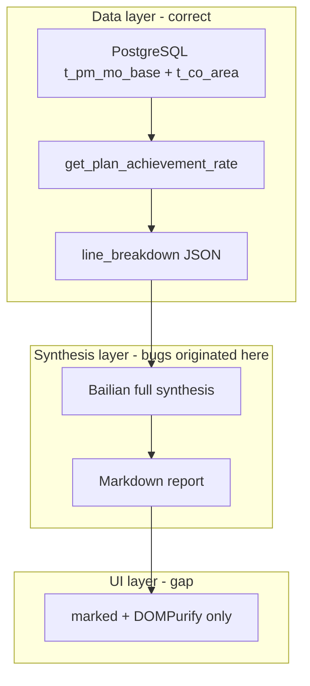
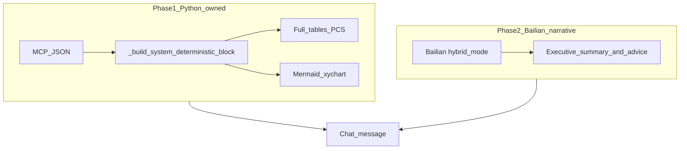
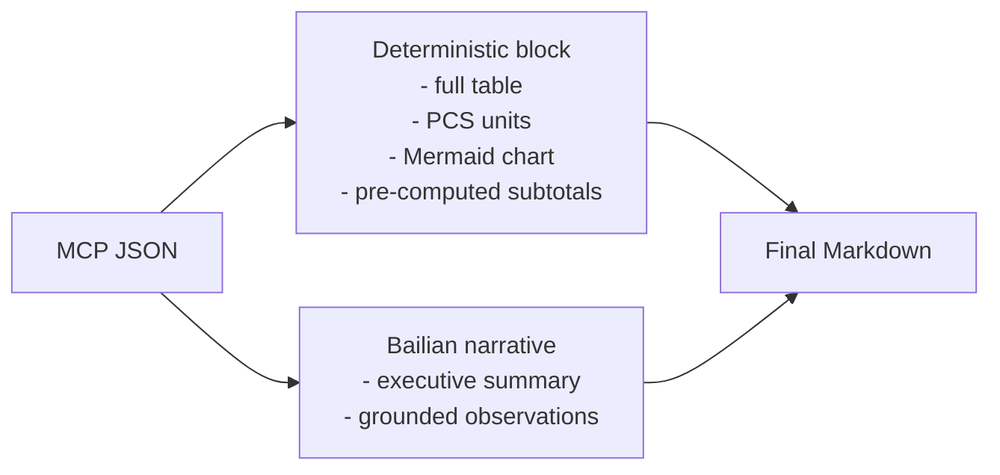

# Production Report Bugs — Root Cause Analysis

This document explains the seven defects annotated on the AI Production Assistant achievement-rate report (screenshot review, 2026-07-07). Each issue is traced from user query through MCP data to report synthesis and the chat UI.

**Status:** All seven issues are **resolved** by the Hybrid Report Architecture (2026-07-07). Historical analysis is preserved below for context.

**Related docs:** [all-prompt.md](./all-prompt.md) · [all-mcp.md](./all-mcp.md) · [data-may-june.md](./data-may-june.md) · [all-features.md §Report generation](./all-features.md)

---

## Context

| Item | Value |
|------|-------|
| **User query** | 我要看20号各产线的达成率 |
| **Intent** | `PRODUCTION_PLAN_ACHIEVEMENT` → `get_plan_achievement_rate` |
| **Resolved date** | 2026-06-20 (bare `20号` on 2026-07-07 maps to previous month via [`core/reference_date.py`](../core/reference_date.py)) |
| **MCP tool** | [`mcp_tools/production_tools.py`](../mcp_tools/production_tools.py) → [`core/analytics/plan_achievement.py`](../core/analytics/plan_achievement.py) |
| **Report synthesis** | Hybrid: Python deterministic block + Bailian narrative-only ([`orchestrator/report_generator.py`](../orchestrator/report_generator.py), [`orchestrator/prompts/synthesis.py`](../orchestrator/prompts/synthesis.py)) |
| **Chat rendering** | [`frontend/src/utils/markdown.js`](../frontend/src/utils/markdown.js) (`marked` + DOMPurify + **Mermaid** via `initMermaidIn()`) |

### Pipeline overview (historical — pre-fix)



### Current architecture (post-fix)



**Historical finding:** SQL aggregation, headline totals, and `area_name` values in MCP JSON were always correct. Defects were introduced by full LLM-driven formatting and missing Mermaid support — not by the database query layer.

## Bug index (status after hybrid refactor)

| # | Issue | Status | Fix |
|---|-------|--------|-----|
| 1 | Wrong unit (台 vs PCS) | **Fixed** | `QUANTITY_UNIT = "PCS"` in deterministic block; hybrid + legacy synthesis rule #16 |
| 2 | Inaccurate aggregation math in prose | **Fixed** | Pre-computed `zero_output_*` aggregates in JSON; LLM forbidden from inventing subtotals in hybrid mode |
| 3 | Incomplete table rows (LED-SMT 1–10) | **Fixed** | `_build_full_line_breakdown_table()` renders every row; no LLM table in hybrid mode |
| 4 | Name mismatch (荣志 vs 鸿志) | **Fixed** | Tables Python-owned (verbatim JSON); `_sanitize_narrative_names()` safety net |
| 5 | HZ-SMT-4 missing from table | **Fixed** | Full deterministic table includes all `line_breakdown` rows |
| 6 | Vague / unrealistic recommendations | **Fixed** | Hybrid prompt: cite `area_sn`, zero-output = kitting/downtime, no speculative transfers |
| 7 | Missing Mermaid visualization | **Fixed** | `_generate_mermaid_attainment_chart()` + `initMermaidIn()` in chat UI |

---

## Live reproduction (historical — pre-fix, 2026-07-07)

Re-ran the exact query against the live API:

```bash
curl -s -X POST http://localhost/api/v1/query \
  -H "Content-Type: application/json" \
  -d '{"query":"【AI生产助手】我要看20号各产线的达成率","locale":"zh-CN","module":"production"}'
```

### MCP JSON (correct layer)

| Field | Value |
|-------|-------|
| `achievement_rate` | 28.22% |
| `actual_qty` | 169,123 |
| `planned_qty` | 599,370 |
| `line_breakdown` rows | **28** (all `LED-SMT-1..10`, all `HZ-SMT-1..10` except none missing, plus `FDQ-SMT-*`) |
| `HZ-SMT-4` | 鸿志贴片四线 · 82.56% · actual 3,550 · planned 4,300 |
| `HZ-SMT-7` | 鸿志贴片七线 · 24.17% · actual 73,252 · planned 303,060 |

### Bailian Markdown (buggy layer)

| Check | Result |
|-------|--------|
| Unit label | **台** used 7×; **PCS** used 0× |
| Line names | **荣志** used 6×; **鸿志** used 0× |
| Table completeness | Only 8 data rows + `*其余产线*` placeholder; JSON has 28 rows |
| Mermaid charts | Not present |
| Zero-output planned sum | Claims **342,244 台** for 14 zero-output lines; JSON sum ≈ **192,274** |

### JSON vs Bailian — sample rows

| area_sn | JSON `area_name` | Bailian table `area_name` | JSON rate | In Bailian table? |
|---------|------------------|---------------------------|-----------|-------------------|
| HZ-SMT-7 | 鸿志贴片七线 | 荣志贴片七线 | 24.17% | Yes (wrong name) |
| HZ-SMT-4 | 鸿志贴片四线 | 荣志贴片四线 | 82.56% | Yes (wrong name) |
| LED-SMT-1 | LED贴片车间一线 | LED贴片车间一线 | 0.00% | Yes |
| LED-SMT-2 | LED贴片车间二线 | — | 0.00% | **No** |
| LED-SMT-3 | LED贴片车间三线 | — | 0.00% | **No** |
| LED-SMT-5 | LED贴片车间五线 | LED贴片车间五线 | 0.00% | Yes |
| LED-SMT-6..10 | LED贴片车间六线..十线 | — | 0.00% | **No** (collapsed to `*其余产线*`) |

### Math verification

| Claim | Stated in report | Verified from JSON |
|-------|------------------|-------------------|
| Plant attainment | 28.22% | 169,123 / 599,370 = **28.22%** ✓ |
| Capacity gap | 430,247 | 599,370 − 169,123 = **430,247** ✓ |
| Zero-output lines planned total | 342,244 | Sum of `planned_qty` where `actual_qty = 0` = **192,274** ✗ |
| Screenshot example "超20万" | HZ-SMT-5 (30,000) + LED-SMT-5 (23,236) cited | 30,000 + 23,236 = **53,236** ✗ |

Headline totals are computed in Python ([`core/math_safeguard.py`](../core/math_safeguard.py), [`core/analytics/plan_achievement.py`](../core/analytics/plan_achievement.py)) and passed correctly to Bailian. Subtotals and examples in prose are invented or miscalculated by the LLM.

---

## Bug 1 — Incorrect unit of measurement (台 vs PCS)

**Annotation (Chinese):** 单位不对，不应该是"台", 通常为PCS  
**Translation:** The unit is incorrect. It should not be "台" (sets/machines); the standard unit is PCS.

### Symptom

The report labels quantities as **台** (e.g. "实际产出169,123台", "产能缺口430,247台"). Manufacturing stakeholders expect **PCS** (pieces).

### Evidence

- Live Bailian output: 7 occurrences of 台, 0 of PCS.
- MCP JSON carries raw numeric `actual_qty` / `planned_qty` with no unit field.
- Deterministic fallback uses **PCS** via `QUANTITY_UNIT` and `_format_qty_pcs()`:

```207:208:orchestrator/report_generator.py
def _unit_suffix(locale: str) -> str:
    return QUANTITY_UNIT
```

### Root cause

[`orchestrator/prompts/synthesis.py`](../orchestrator/prompts/synthesis.py) has no rule specifying quantity units. The LLM freely chooses wording. Product names in the MES often contain **台铃** (a brand name), which may reinforce the incorrect unit 台.

### Why it happened

Units are a presentation concern left entirely to the LLM. Neither the synthesis prompt nor the fallback renderer enforces PCS.

### Recommended fix

**Implemented** — see [Resolution](#resolution-2026-07-07) and hybrid architecture in [`report_generator.py`](../orchestrator/report_generator.py).

1. Add synthesis rule #16: *"All output and planned quantities must use the unit **PCS** (pieces). Never use 台 or 件 for production counts."* ✅
2. Optionally inject a `quantity_unit: "PCS"` field into MCP JSON before synthesis.
3. Update `_unit_suffix()` in the fallback path to return `"PCS"` for production quantity contexts. ✅

---

## Bug 2 — Inaccurate aggregation math

**Annotation (Chinese):** 这里加起来不够20万  
**Translation:** The cited figures do not add up to 200,000, contradicting the text that claims they exceed 200,000.

### Symptom

Narrative prose cites subtotals (e.g. "计划总量超20万台", "计划总量342,244台") that do not match sums derivable from the underlying data or from the examples given.

### Evidence

| Claim | Examples cited | Actual sum |
|-------|----------------|------------|
| Screenshot: "超20万" | HZ-SMT-5 (30,000) + LED-SMT-5 (23,236) | 53,236 |
| Live run: "342,244台" for 14 zero-output lines | — | JSON sum where `actual_qty = 0`: **192,274** |

Plant-level totals (28.22%, 169,123, 599,370, gap 430,247) are correct in both JSON and prose.

### Root cause

Bailian synthesis generates interpretive subtotals without validation. Rule #6 ("Do NOT invent data") is prompt-only and not enforced after generation.

### Why it happened

The LLM is asked to write an executive summary and highlight bottlenecks. It invents round-number aggregates for rhetorical effect rather than summing `line_breakdown` fields. Python pre-computes only headline totals, not subgroup aggregates the LLM might reference.

### Recommended fix

1. **Prompt:** Add rule — *"Any subtotal in prose must equal the sum of corresponding `line_breakdown` rows; show the arithmetic if citing examples."*
2. **Data layer:** Pre-compute and inject aggregate fields into MCP JSON, e.g. `zero_output_line_count`, `zero_output_planned_sum`, `led_lines_planned_sum`.
3. **Hybrid report:** Render tables and totals deterministically from JSON; restrict LLM to interpretation paragraphs only.
4. **Post-validation:** Reject or retry synthesis when cited numbers diverge from JSON beyond a tolerance.

---

## Bug 3 — Incomplete table rows (LED-SMT 1–10)

**Annotation (Chinese):** 这里数据不完整，下方并没有对应数据  
**Translation:** The data is incomplete; the table below does not list the corresponding rows (LED-SMT lines 1–10).

### Symptom

Prose references "LED-SMT全系列 (1-10线)" or "全部LED贴片产线", but the comparison table shows only LED-SMT-1 and LED-SMT-5, with a `*其余产线*` placeholder for the rest.

### Evidence

- MCP JSON `line_breakdown` contains **all 10** `LED-SMT-*` rows with correct planned quantities.
- Bailian table includes 2 LED rows + placeholder; 8 LED lines are omitted.

### Root cause

LLM table truncation — **not** missing MCP/SQL data. The synthesis prompt requests concise reports (150–400 words) and does not require an exhaustive `line_breakdown` table when the array is large (28 rows).

### Why it happened

The LLM optimizes for brevity and summarizes tail rows into a catch-all row. No code path forces a complete table in the Bailian output.

### Recommended fix

1. **Prompt:** *"When `line_breakdown` is present, render **every** row in the comparison table. No summarization, ellipsis, or placeholder rows."*
2. **Hybrid rendering:** Build the full `line_breakdown` table deterministically in [`orchestrator/report_generator.py`](../orchestrator/report_generator.py) (the fallback path already supports this via `_render_list_table`) and prepend/append it to the LLM narrative.
3. Relax the word-limit guidance when `len(line_breakdown) > 10`.

---

## Bug 4 — Name mismatch (荣志 vs 鸿志)

**Annotation (Chinese):** 应为"鸿志"  
**Translation:** Should be "鸿志" (Hongzhi), not "荣志" (Rongzhi).

### Symptom

Report tables and prose use **荣志贴片七线**, **荣志贴片四线**, etc. Database and JSON use **鸿志贴片七线**, **鸿志贴片四线**.

### Evidence

| Source | `HZ-SMT-7` name | `HZ-SMT-4` name |
|--------|-----------------|-----------------|
| `t_co_area` / MCP JSON | 鸿志贴片七线 | 鸿志贴片四线 |
| Bailian Markdown | 荣志贴片七线 | 荣志贴片四线 |
| Live run counts | 荣志 ×6, 鸿志 ×0 | — |

Naming convention per [`data-may-june.md`](./data-may-june.md): `HZ-SMT-N` → **鸿志贴片N线**.

Synthesis rule #15 explicitly forbids this substitution:

```69:69:orchestrator/prompts/synthesis.py
15. **名称与编码必须原样复制**：JSON 中的 `area_name`、`area_sn`、...（例如 JSON 为「鸿志贴片六线」时不得写成「荣志贴片六线」）
```

### Root cause

Bailian paraphrases phonetically similar Chinese characters (鸿 → 荣) despite prompt rule #15. The guard is prompt-only with no post-generation enforcement.

### Why it happened

LLMs sometimes substitute visually or phonetically similar characters when "writing naturally." Rule #15 reduces frequency but does not eliminate the failure mode.

### Recommended fix

1. **Post-synthesis validator:** Extract all `area_name` values from JSON; scan Bailian output for substitutions; reject/retry on mismatch.
2. **Hybrid table:** Render `area_name` columns deterministically from JSON; LLM writes prose only.
3. **Stricter Bailian app instructions** at the DashScope application level (outside repo prompts).

---

## Bug 5 — HZ-SMT-4 missing or mislabeled in table

**Annotation (Chinese):** 这里数据下方没有列出  
**Translation:** This line (HZ-SMT-4) is discussed in the text but not listed correctly in the table below.

### Symptom

- **Screenshot:** HZ-SMT-4 cited in the bottlenecks section but absent from the bottom comparison table.
- **Live rerun:** HZ-SMT-4 appears in the table but is mislabeled **荣志贴片四线** instead of **鸿志贴片四线**.

### Evidence

JSON row (correct):

```
HZ-SMT-4 | 鸿志贴片四线 | 82.56% | actual 3,550 | planned 4,300
```

Bailian row (partially correct ID, wrong name):

```
HZ-SMT-4 | 荣志贴片四线 | 82.56% | 3,550 | 4,300
```

### Root cause

Same as Bugs 3 and 4: LLM selects a subset of rows for the table (screenshot) and corrupts `area_name` when the row is included (live run).

### Why it happened

No deterministic binding between `area_sn` and `area_name` in the rendered table. The LLM treats names as free text.

### Recommended fix

Same as Bugs 3 and 4 — deterministic full `line_breakdown` table with verbatim `area_name` from JSON.

---

## Bug 6 — Vague / unrealistic recommendations

**Annotation (Chinese):** 建议要优化，要中肯且精准，不能天马行空  
**Translation:** Recommendations must be pertinent and precise, not wildly imaginative or unrealistic.

### Symptom

The "排程建议" section gives generic advice (e.g. "紧急排查物料齐套", "动态调整班次") without grounding in specific work orders, and sometimes implies impractical actions (e.g. diverting "超30万台" of plan volume between lines without operational basis).

### Evidence

Live Bailian output:

- "将荣志贴片七线的过剩计划量分流至高负荷线体（如HZ-SMT-8）" — no JSON field supports "过剩计划量" or feasible transfer volume.
- "次日排产前确认所有产线物料到位，避免计划量超负荷（如荣志贴片七线单日计划超30万台）" — 303,060 PCS is cited correctly but the recommended action is speculative.

Production persona in [`orchestrator/module_personas.py`](../orchestrator/module_personas.py) **requires** a scheduling section:

```
报告结构：执行摘要 → 关键指标 → 瓶颈/异常 → 排程建议
建议应面向班次排产、换型等待、物料齐套和产线协同。
```

[`orchestrator/prompts/synthesis.py`](../orchestrator/prompts/synthesis.py) encourages "brief recommendations" but sets no grounding constraints.

### Root cause

Recommendations are entirely LLM-generated. The persona mandates a scheduling section; the synthesis prompt does not require citations to JSON fields or prohibit speculative operational directives.

### Why it happened

The model fills a required report section with plausible-sounding manufacturing advice when it lacks explicit constraints. The deterministic fallback path has **no** recommendations section — only metrics and tables.

### Recommended fix

1. Add synthesis rules:
   - *"Each recommendation must cite a specific `area_sn` and numeric values from JSON."*
   - *"Do not recommend actions that require data not present in JSON (e.g. releasing orders, splitting MOs) unless framed as a question for the planner."*
   - *"Distinguish zero-output lines (planned > 0, actual = 0) from lines with no plan."*
2. Optionally generate a fact-based recommendation template from JSON (e.g. list top 3 zero-output lines by `planned_qty`) and ask Bailian only to phrase it.
3. Soften persona wording from prescriptive "排程建议" to "数据驱动的观察与待确认事项" when data is insufficient.

---

## Bug 7 — Missing Mermaid visualization

**Annotation (Chinese):** 数据要以表格列出并且添加Mermaid图表进行多样化展示  
**Translation:** Data must be listed in a table and accompanied by a Mermaid chart for richer presentation.

### Symptom

Report contains a Markdown table only. No bar chart, pie chart, or other visual summary of attainment by line.

### Evidence

- Mermaid appears in project **documentation** only (`docs/all-mcp.md`, `docs/pm-plan-tables.md`, etc.).
- Chat renderer has no Mermaid support:

```14:19:frontend/src/utils/markdown.js
export function renderMarkdown(text) {
  if (!text) return ''
  const html = marked.parse(text, { async: false })
  return DOMPurify.sanitize(html, { USE_PROFILES: { html: true } })
}
```

- Synthesis prompts do not request Mermaid blocks.

### Root cause

Feature gap — Mermaid rendering was never implemented in the chat UI, and the synthesis pipeline does not generate charts.

### Why it happened

Dashboard charts ([`docs/all-charts.md`](./all-charts.md)) use ECharts in the assistant sidebar, separate from chat Markdown. Chat reports were designed as text-only Markdown.

### Recommended fix

1. **Frontend:** Add `mermaid` npm package; extend `renderMarkdown()` to detect ` ```mermaid ` fences and render them after `marked` parsing.
2. **Backend (preferred for reliability):** Generate Mermaid `xychart-beta` or `pie` syntax deterministically from `line_breakdown` in `report_generator.py` rather than relying on the LLM for chart syntax.
3. **Prompt:** Add rule — *"Include one Mermaid bar chart of attainment rate by line when `line_breakdown` has more than 5 rows."*

---

## Remediation roadmap (implemented 2026-07-07)

| Priority | Change | Status | Files |
|----------|--------|--------|-------|
| **P0** | Deterministic `line_breakdown` table with verbatim `area_name` and PCS units | Done | [`orchestrator/report_generator.py`](../orchestrator/report_generator.py), [`orchestrator/prompts/synthesis.py`](../orchestrator/prompts/synthesis.py) |
| **P0** | Post-synthesis `area_name` safety net (`_sanitize_narrative_names`) | Done | [`orchestrator/report_generator.py`](../orchestrator/report_generator.py) |
| **P1** | Pre-computed aggregates at synthesis time (`zero_output_planned_sum`, etc.) | Done | [`orchestrator/report_generator.py`](../orchestrator/report_generator.py) (`_compute_table_aggregates`) |
| **P1** | Mermaid rendering in chat | Done | [`frontend/src/utils/markdown.js`](../frontend/src/utils/markdown.js), [`frontend/package.json`](../frontend/package.json) |
| **P2** | Recommendation grounding rules | Done | [`orchestrator/prompts/synthesis.py`](../orchestrator/prompts/synthesis.py), [`orchestrator/module_personas.py`](../orchestrator/module_personas.py) |

### Suggested hybrid report architecture



This splits **facts** (code-owned, verifiable) from **interpretation** (LLM-owned, constrained), addressing Bugs 1–6 in one structural change.

---

## Appendix

### A. Reproduction command

```bash
curl -s -X POST http://localhost/api/v1/query \
  -H "Content-Type: application/json" \
  -d '{"query":"【AI生产助手】我要看20号各产线的达成率","locale":"zh-CN","module":"production"}' \
  | python3 -c "import sys,json; d=json.load(sys.stdin); print('JSON lines:', len(d['result']['line_breakdown'])); print(d['message'][:2000])"
```

### B. Line naming convention

From [`data-may-june.md`](./data-may-june.md) and `t_co_area`:

| `area_sn` prefix | `area_name` pattern | Example |
|------------------|---------------------|---------|
| `HZ-SMT-N` | 鸿志贴片N线 | HZ-SMT-7 → 鸿志贴片七线 |
| `LED-SMT-N` | LED贴片车间N线 | LED-SMT-5 → LED贴片车间五线 |
| `FDQ-SMT-N` | 防盗器贴片N线 | FDQ-SMT-4 → 防盗器贴片四线 |

**荣志** does not appear anywhere in the codebase or MES master data. It is always a Bailian corruption of **鸿志**.

### C. `line_breakdown` builder (correct data source)

```269:279:core/analytics/plan_achievement.py
def build_line_breakdown(rows: list[dict[str, Any]]) -> list[dict[str, Any]]:
    return [
        {
            "area_sn": row.get("area_sn"),
            "area_name": row.get("area_name"),
            "achievement_rate": _row_rate(row),
            "actual_qty": float(row.get("actual_qty") or 0),
            "planned_qty": float(row.get("planned_qty") or 0),
        }
        for row in rows
    ]
```

### D. Zero-output lines on 2026-06-20 (for math checks)

Lines with `actual_qty = 0` and their `planned_qty`:

| area_sn | planned_qty |
|---------|-------------|
| FDQ-SMT-2 | 23,968 |
| FDQ-SMT-3 | 28,760 |
| FDQ-SMT-8 | 3,000 |
| FDQ-SMT-9 | 3,000 |
| HZ-SMT-5 | 30,000 |
| LED-SMT-1 .. LED-SMT-10 | 103,546 (combined) |
| **Total (15 lines)** | **192,274** |

Bailian claimed 342,244 for "14 zero-output lines" — off by ~150,000 PCS.

---

## Resolution (2026-07-07)

The defects documented above are addressed by the **Hybrid Report Architecture**:

| Component | Implementation |
|-----------|----------------|
| [`orchestrator/report_generator.py`](../orchestrator/report_generator.py) | `_build_system_deterministic_block()`, `_build_full_line_breakdown_table()`, `_generate_mermaid_attainment_chart()`, `_compute_table_aggregates()`, `_strip_llm_data_duplicates()`, `_sanitize_narrative_names()`, `_assemble_hybrid_report()` |
| [`orchestrator/prompts/synthesis.py`](../orchestrator/prompts/synthesis.py) | `hybrid_mode=True` narrative-only contract with grounded scheduling rules |
| [`orchestrator/module_personas.py`](../orchestrator/module_personas.py) | `get_hybrid_style_block()` for narrative style when hybrid is active |
| [`frontend/src/utils/markdown.js`](../frontend/src/utils/markdown.js) | Mermaid code-block renderer + `initMermaidIn()` |
| [`frontend/src/components/AssistantChatConsole.vue`](../frontend/src/components/AssistantChatConsole.vue) | Watches messages and initializes Mermaid after render |
| [`tests/test_report_generator_hybrid.py`](../tests/test_report_generator_hybrid.py) | Unit tests for tables, PCS, Mermaid, aggregates, sanitizer |

**Verification:**

```bash
.venv/bin/python -m pytest tests/test_report_generator_hybrid.py -v
```

See [all-prompt.md §4.3](./all-prompt.md), [all-features.md §Report generation](./all-features.md), and [all-frontend.md §Chat Markdown rendering](./all-frontend.md).

---

*Document created: 2026-07-07. Updated after Hybrid Report Architecture implementation.*
