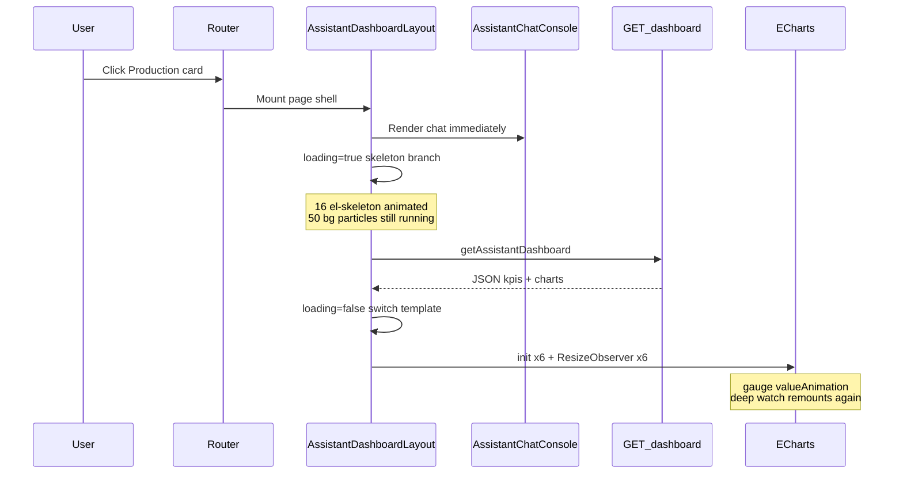

# Assistant Dashboard — Browser Slowdown & Crash Investigation

**Date:** 2026-06-29  
**Scope:** Firefox freeze / “This page is slowing down Firefox” after deploying dashboard cache + non-blocking UX changes  
**Symptoms reported:** Ugly white skeleton loaders (no themed animation), then Firefox warning, then tab freeze/crash when opening any assistant module from the home page.

---

## 1. Executive summary

The assistant page is **not crashing because of a single bug**, but because **many heavy visual systems run at the same time** on the main browser thread:

1. **Sixteen Element Plus skeleton animations** during dashboard load — most use **default light/white** colors because chart skeletons were never themed for the dark UI.
2. **Fifty animated background particles** plus grid/scan animations (always running on every page).
3. **Six full ECharts instances** initialized in one burst when the dashboard API completes — including gauges with `valueAnimation: true`.
4. **Six `ResizeObserver` → `echarts.resize()` callbacks** that can trigger layout feedback loops in Firefox.
5. **Redundant chart remounting** from overlapping Vue watchers when loading finishes.

On a slow server (cache miss, remote MES DB), the user can sit on animated skeletons for a long time, then hit a **large synchronous spike** when charts mount. Firefox interprets this as an unresponsive page and may kill the tab.

The SQLite dashboard cache helps **API latency** but does **not reduce frontend rendering cost** once data arrives.

---

## 2. What happens when you open a module



| Step | What the user sees | Main-thread work |
|------|-------------------|------------------|
| 0–100 ms | Header, dark background, chat panel | Route chunk + **ECharts bundle (~1.1 MB gzip ~386 KB)** parses on first visit |
| 100 ms – API done | White/gray skeleton blocks in report area | **16 CSS skeleton animations** + background animations |
| API completes | Skeleton swaps to KPI cards + charts | **6× `echarts.init()`**, `setOption`, gauge animations, **`pulse-orb`** CSS animation |
| Steady state | Live dashboard | 6 canvases + 6 ResizeObservers + background particles |

---

## 3. Symptom 1 — Ugly white skeleton (no themed animation)

### Cause

Loading UI uses Element Plus `<el-skeleton animated>` inside dark cards, but **only KPI and insight skeletons** were given dark-theme CSS variables.

**Themed (works):**

```1061:1065:frontend/src/assets/styles/assistant-dashboard.css
.kpi-card--skeleton .el-skeleton,
.insight-card--skeleton .el-skeleton {
  --el-skeleton-color: rgba(51, 65, 85, 0.45);
  --el-skeleton-to-color: rgba(71, 85, 105, 0.55);
}
```

**Not themed (defaults to light/white shimmer):**

```41:54:frontend/src/components/AssistantDashboardLayout.vue
              <div class="chart-mosaic chart-mosaic--skeleton" :class="pageConfig.layout">
                ...
                  <el-card class="chart-card" shadow="never">
                    <el-skeleton animated :rows="0" />
                    <div class="chart-box chart-box--skeleton">
                      <el-skeleton animated :rows="4" />
                    </div>
```

Chart area = **6 cards × 2 skeleton components = 12 animated skeletons** with Element Plus default colors → bright white blocks on a dark dashboard.

### Extra redundancy

Each chart placeholder mounts **two** animated skeletons (one empty `rows="0"`, one with 4 rows). That doubles DOM nodes and animation work for no visual benefit.

---

## 4. Symptom 2 — Firefox “page is slowing down” / freeze

### 4.1 Skeleton animation load (during API wait)

While `loading === true`, the report panel renders:

| Element | Count | Animated? |
|---------|-------|-------------|
| KPI skeletons | 3 | Yes |
| Chart skeletons (inner) | 12 | Yes |
| Insight skeleton | 1 | Yes |
| **Total** | **16** | All `animated` |

If the dashboard API is slow (cache miss, remote DB, up to **60 s timeout** in `frontend/src/api/dashboard.js`), these animations run continuously on the main thread together with:

### 4.2 Always-on background animations

`AppBackground.vue` renders **50 particles** with independent CSS float animations, plus moving grid and scan line:

```8:10:frontend/src/components/AppBackground.vue
      <div class="particles">
        <div v-for="i in 50" :key="i" class="particle" :style="getParticleStyle()"></div>
      </div>
```

`app.css` defines perpetual animations: `gridMove` (25s), `scanLine` (4s), `float` (18s per particle), etc.

This existed before the dashboard UX change but **adds baseline CPU/GPU load** while skeletons and ECharts also run.

### 4.3 ECharts burst when loading ends

When `loading` flips to `false`, the template switches from the skeleton branch to `AssistantChartMosaic`, which mounts **six chart containers** and calls `echarts.init()` for each.

ECharts is imported as the **full library** in `useAssistantPage.js`:

```1:2:frontend/src/composables/useAssistantPage.js
import { computed, nextTick, onMounted, ref, watch } from 'vue'
import * as echarts from 'echarts'
```

Production build output (local `npm run build`):

- `chartSlots-*.js` ≈ **1,145 KB** (gzip ≈ 386 KB)
- Main bundle ≈ **1,060 KB** (gzip ≈ 353 KB)

Six charts on one screen is heavy but normally survivable; the problem is **timing and duplication** (below).

### 4.4 Gauge `valueAnimation` on multiple charts

Several modules use gauge charts with animation enabled:

```72:78:frontend/src/utils/chartPresets.js
      detail: {
        valueAnimation: true,
        color: '#e0f2fe',
        fontSize: 14,
        ...
      },
```

Up to **three gauges per page** can animate numeric values at the same time right after init, on top of skeleton teardown and canvas creation.

### 4.5 ResizeObserver ↔ ECharts resize feedback

Each chart registers:

```88:92:frontend/src/composables/useAssistantPage.js
    resizeObservers[index] = new ResizeObserver(() => {
      instance.resize()
    })
    resizeObservers[index].observe(el)
    requestAnimationFrame(() => instance.resize())
```

`resize()` can change canvas pixel dimensions; the observer fires again. Browsers normally cap this (“ResizeObserver loop limit exceeded”), but Firefox may still **spend long periods in layout/paint** when:

- Skeleton mosaic grid (`chart-mosaic--skeleton`) **lacks** `grid-template-rows` used by the real mosaic (see `assistant-dashboard.css` lines 775–786 vs 1067–1071).
- Switching `v-if` branches causes a **large layout recalculation**.
- Six observers fire together after mount.

This pattern is a **known risk** for jank and main-thread stalls.

### 4.6 Triple chart mount when loading completes

Three separate mechanisms fire when dashboard data arrives:

| Trigger | File | Action |
|---------|------|--------|
| `watch(dashboardLoading)` → `false` | `useAssistantPage.js:136-141` | `renderCharts()` |
| `watch(charts, { deep: true })` | `useAssistantPage.js:133-135` | `renderCharts()` on any nested option change |
| Template ref callbacks | `AssistantChartMosaic.vue:15` | `setChartRef()` → `mountChartAt()` per chart |

When `loading` becomes `false`:

1. `liveKpis`, `liveChartSlots`, and `insightOverride` update.
2. `charts` computed rebuilds six full ECharts option trees.
3. `dashboardLoading` watcher runs `renderCharts()`.
4. DOM switches to `AssistantChartMosaic`; refs call `mountChartAt` six times.
5. Deep watcher on `charts` runs **`renderCharts()` again**, disposing and re-creating all six instances.

So the browser may **init 12 ECharts instances** (6 disposed + 6 recreated) in one frame cluster.

The deep watcher is especially expensive: it walks entire option objects (series, axes, tooltips) on every change.

### 4.7 Insight card `pulse-orb` animation

After load, the insight card runs a continuous CSS animation:

```914:921:frontend/src/assets/styles/assistant-dashboard.css
.pulse-orb {
  ...
  animation: assistantOrb 2s ease-in-out infinite;
}
```

Minor alone, but adds to total animation budget with skeletons (pre-load) and gauges (post-load).

---

## 5. Backend / cache — what it does and does not fix

The deployed SQLite cache (`core/dashboard_cache/`, `scripts/refresh_dashboard_cache.py`) reduces **time waiting on the network/DB** when:

- Cache is warm (`X-Dashboard-Cache: hit`)
- Stale snapshot is served while revalidating (`stale`)

It does **not**:

- Reduce ECharts initialization cost
- Reduce skeleton animation count
- Prevent triple chart remount
- Fix unthemed skeleton colors

If the first visitor (or a new scope/locale) gets a **cache miss**, they still wait on the remote MES database — now with **16 skeleton animations** running the entire time.

The background scheduler also runs `refresh_all_dashboards()` **immediately on API startup** (`core/dashboard_cache/scheduler.py`), which can keep server response times variable under load but is unrelated to Firefox crashing directly.

---

## 6. Likely crash scenario (reconstructed)

1. User opens **Production** (or any module) from home.
2. Vue loads assistant route + ECharts chunk; page shell appears; chat works.
3. `loading` starts `true` → **16 white skeleton animations** + **50 particle animations** run.
4. Dashboard `GET` takes several seconds to minutes (cache miss / slow DB / server under refresh).
5. Firefox main thread stays busy with CSS animations and periodic header clock updates (`setInterval` 1s in `AppHeader.vue`).
6. API returns → `loading = false` → large DOM swap.
7. Six ECharts inits + six ResizeObservers + gauge valueAnimations + **second** full remount from deep watcher.
8. Main thread blocked long enough → Firefox shows **“This page is slowing down Firefox”** → user may lose tab.

This matches “page opens, ugly loading, then Firefox dies” without requiring an infinite JavaScript loop — **death by cumulative main-thread overload** is sufficient.

---

## 7. Risk ranking

| Priority | Issue | Location | Impact |
|----------|-------|----------|--------|
| **P0** | Triple ECharts mount on load end | `useAssistantPage.js` watchers + refs | Double init cost, layout thrash |
| **P0** | 16× default white `el-skeleton animated` | `AssistantDashboardLayout.vue` | Wrong UX; high animation cost |
| **P1** | `watch(charts, { deep: true })` on large option trees | `useAssistantPage.js` | CPU on every chart rebuild |
| **P1** | ResizeObserver → `resize()` without debounce | `useAssistantPage.js` | Layout feedback / jank |
| **P1** | Full `echarts` bundle on critical path | `useAssistantPage.js` | Slow first paint, memory |
| **P2** | 50 background particles always animating | `AppBackground.vue` | Baseline GPU/CPU use |
| **P2** | Gauge `valueAnimation: true` × multiple | `chartPresets.js` | Post-load animation spike |
| **P2** | Skeleton grid missing `grid-template-rows` | `assistant-dashboard.css` | Layout jump when charts appear |
| **P3** | 60 s dashboard timeout | `dashboard.js` | Long skeleton animation window |

---

## 8. Recommended fixes (not yet implemented)

These are ordered by impact vs effort. See [database.md](./database.md) for cache operations; this list is **frontend/rendering only**.

### Quick wins (1–2 hours)

1. **Theme all skeletons** — extend `--el-skeleton-color` / `--el-skeleton-to-color` to `.chart-mosaic--skeleton .el-skeleton` and `.chart-box--skeleton .el-skeleton`; or replace with a single custom CSS shimmer (subtle gray, matches `#94a3b8` axis labels).
2. **One skeleton per chart** — remove duplicate `<el-skeleton>` (`rows="0"` wrapper).
3. **Remove triple mount** — on load complete, either rely on ref callbacks **or** `renderCharts()`, not both; remove `deep: true` from `watch(charts)` or watch only `liveChartSlots` reference.
4. **Debounce ResizeObserver** — e.g. `requestAnimationFrame` flag or 100 ms debounce before `instance.resize()`.

### Medium (half day)

5. **Lazy-load ECharts** — dynamic `import('echarts')` when `loading` becomes false; optional `echarts/core` + register only line/bar/gauge.
6. **Disable gauge `valueAnimation`** during initial mount or globally for dashboard gauges.
7. **Reduce skeleton motion** — use static placeholders or `animated={false}` until themed shimmer exists; respect `prefers-reduced-motion`.
8. **Align skeleton grid CSS** with `.chart-mosaic` (`grid-template-rows`, flex/min-height) to avoid layout jump.

### Larger (follow-up)

9. **Virtualize or stagger chart init** — mount charts in `requestIdleCallback` batches (2 at a time).
10. **Tone down AppBackground** on assistant routes — fewer particles or pause animations while `loading`.
11. **Code-split assistant routes** — already lazy; ensure ECharts is not pulled into home page bundle (verify with `rollup-plugin-visualizer`).

---

## 9. How to verify locally

1. Open Firefox → **Performance** tool → record while navigating Home → Production.
2. Watch for long tasks when skeleton visible and when API completes.
3. In Network tab, check dashboard request duration and `X-Dashboard-Cache` header (`hit` / `stale` / `miss`).
4. In console, temporarily log chart inits:

   ```js
   // In mountChartAt — count how many times init runs per page load
   console.count('echarts.init')
   ```

   Expect **6** once; if **12+**, triple-mount is confirmed.

5. Test with **Reduce motion** enabled in OS settings — if freeze improves, CSS animation load is a major factor.

---

## 10. Files involved (checklist)

| File | Role in issue |
|------|----------------|
| [`frontend/src/components/AssistantDashboardLayout.vue`](../frontend/src/components/AssistantDashboardLayout.vue) | Skeleton structure, white unthemed loaders |
| [`frontend/src/composables/useAssistantPage.js`](../frontend/src/composables/useAssistantPage.js) | ECharts init, ResizeObserver, overlapping watchers |
| [`frontend/src/composables/useIntegratedAssistantPage.js`](../frontend/src/composables/useIntegratedAssistantPage.js) | `loading` starts `true`, triggers skeleton then chart path |
| [`frontend/src/components/AssistantChartMosaic.vue`](../frontend/src/components/AssistantChartMosaic.vue) | Ref callbacks → chart mount |
| [`frontend/src/utils/chartPresets.js`](../frontend/src/utils/chartPresets.js) | Gauge valueAnimation |
| [`frontend/src/assets/styles/assistant-dashboard.css`](../frontend/src/assets/styles/assistant-dashboard.css) | Partial skeleton theming |
| [`frontend/src/components/AppBackground.vue`](../frontend/src/components/AppBackground.vue) | 50 perpetual particle animations |
| [`frontend/src/api/dashboard.js`](../frontend/src/api/dashboard.js) | 60 s timeout extends skeleton phase |
| [`core/dashboard_cache/`](../core/dashboard_cache/) | Helps API latency only |

---

## 11. Conclusion

The deployment **successfully** made the page shell and chat appear immediately, but the **loading state introduced high-cost animated placeholders** that clash with the dark UI, and the **chart lifecycle on load end performs redundant ECharts work** on top of an already animation-heavy page background.

Firefox is particularly sensitive to **main-thread blocking** from layout + canvas + CSS animation combined. Fixing skeleton styling and eliminating duplicate chart initialization should address both the visual issue and the freeze/crash without removing the cache or async dashboard architecture.

For cache/server behavior, see [database.md](./database.md). For dashboard integration details, see [integration.md](./integration.md).
