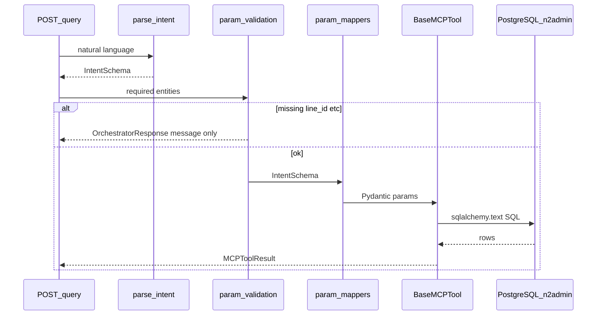

# NEUTRON MES AI — MCP Debugging Report (v1.1)

**Generated:** 2026-06-23 | **Backend version:** 0.3.0

Full audit of all MCP tools, orchestration flow, verbatim SQL, and database schemas for external debugging.
Companion test-data reference: [mesai-query-1.1.md](./mesai-query-1.1.md)

---

## 1. Debugging context

### Request pipeline



### RBAC
- Header `X-MES-Workshop-Id` → `MCPContext.workshop_id` → SQL bind `:workshop_id`
- Applied as `data_auth = :workshop_id` on the primary table alias in each query
- This is **authorization scope**, not extracted from user natural language

### Real identifiers vs placeholders
- Production lines in DB use `area_sn` values like `FDQ-SMT-3`, `HZ-SMT-1` (see mesai-query-1.1.md)
- Generic placeholders like `L-01` are **not** valid line IDs in this database
- Equipment data date range: ~`2026-05-09` to `2026-06-21`; WIP: ~`2026-01-20` to `2026-06-21`

---

## 2. Orchestration layer

| Component | File | Role |
|---|---|---|
| Intent router | `orchestrator/router.py` | `route_and_execute()` — parse → validate → dispatch |
| Tool registry | `orchestrator/tool_registry.py` | Maps 18 `IntentType` values to MCP tool singletons |
| Param validation | `orchestrator/param_validation.py` | Blocks DB call when required entities missing |
| Param mappers | `orchestrator/param_mappers.py` | `IntentSchema` → tool Pydantic params |
| Intent prompt | `orchestrator/intent_prompt.py` | Bailian JSON extraction prompt |
| Intent utils | `orchestrator/intent_utils.py` | `parse_intent()`, markdown JSON strip |
| Base tool | `mcp_tools/base.py` | `BaseMCPTool.run()` wraps execute + error envelope |

### Master intent map

| Intent | Tool name | Source file | Required params (validation) | Primary tables |
|---|---|---|---|---|
| `yield_aggregation` | `get_yield_aggregation` | `production_tools.py` | line_id | t_smt_program_consumption_record OR t_wip_detail+t_co_area |
| `yield_anomalies` | `get_yield_anomalies_and_peaks` | `production_tools.py` | line_id | same as yield aggregation |
| `yield_comparison` | `compare_yield_periods` | `production_tools.py` | line_id | same as yield aggregation |
| `production_product_yield` | `get_product_yield` | `production_tools.py` | line_id + product_code | t_wip_detail, t_co_area, t_co_item |
| `production_device_rate` | `get_device_production_rate` | `production_tools.py` | device_sn OR line_id | t_smt_program_consumption_record, t_co_device |
| `production_standard_time` | `get_standard_time_achievement` | `production_tools.py` | line_id + model_code | t_smt_program_consumption_record, t_co_standard_time |
| `production_root_cause` | `get_production_root_cause` | `production_engines.py` | line_id | t_wip_detail, t_co_area, t_smt_program_consumption_record |
| `production_scheduling_opt` | `optimize_production_schedule` | `production_engines.py` | line_id | t_aps_plan_mo_info |
| `production_capacity_forecast` | `forecast_capacity_hr` | `production_engines.py` | line_id | t_smt_program_consumption_record |
| `quality_defect_analysis` | `get_quality_defect_aggregation` | `quality_tools.py` | (none — workshop scoped) | t_qm_inspect_info |
| `quality_root_cause` | `analyze_defect_root_cause` | `quality_tools.py` | (none) | t_qm_problem_report, t_qm_problem_reason |
| `quality_error_prevention` | `check_error_prevention` | `quality_tools.py` | process_code | t_qm_inspect_scheme_info, t_qm_ipqc_doc |
| `quality_effectiveness_verify` | `verify_quality_effectiveness` | `quality_tools.py` | start_date (milestone) | t_qm_inspect_info |
| `warehouse_inventory_monitor` | `get_inventory_status` | `warehouse_tools.py` | (none) | t_wms_stock_info, t_co_item |
| `warehouse_inbound_outbound` | `guide_inbound_outbound` | `warehouse_tools.py` | wh_code + item_code | t_wms_area, t_wms_stock_info |
| `warehouse_obsolete_profile` | `profile_obsolete_inventory` | `warehouse_tools.py` | (none) | t_wms_stock_info, t_co_item |
| `warehouse_trace_forward` | `trace_material_forward` | `warehouse_tools.py` | material_batch | t_wms_mid_item, t_wip_detail |
| `warehouse_trace_reverse` | `trace_product_reverse` | `warehouse_tools.py` | finished_lot | t_wip_detail, t_wms_mid_item |
| `cross_module_analysis` | `cross_module_analysis` | `cross_module.py` | line_id | delegates to 3 tools |

---

## 3. Shared production yield SQL routing

Used by `get_yield_aggregation`, `get_yield_anomalies_and_peaks`, `compare_yield_periods`.

### Equipment yield (`yield_type=equipment`)
- **Table:** `n2admin.t_smt_program_consumption_record` (alias `eq`)
- **Line filter:** `eq.area_sn = :line_id`
- **RBAC:** `eq.data_auth = :workshop_id`
- **Time:** `eq.create_time BETWEEN :start_date AND :end_date`
- **Qty:** `finish_qty`; **denom:** `mount_sheet_qty`

### Reported yield (`yield_type=reported`)
```sql
FROM n2admin.t_wip_detail wd
JOIN n2admin.t_co_area ws ON wd.work_stationsn = ws.area_sn
JOIN n2admin.t_co_area line ON ws.parent_sn = line.area_sn
WHERE line.area_sn = :line_id
  AND wd.data_auth = :workshop_id
  AND COALESCE(wd.in_time, wd.create_time) BETWEEN :start_date AND :end_date
```
- **Good qty:** `pro_qty - ng_qty - scrap_qty`

### Dynamic aggregation SQL builder
- `group_by=total` → single SUM row
- `group_by=daily|hourly` → `date_trunc('day'|'hour', time_col)` GROUP BY bucket
- Metrics computed in Python (`_compute_metric`, `core/math_safeguard.py`) — not in SQL

---

## 4. Per-tool MCP logic

### 4.1 `get_yield_aggregation`

| Field | Value |
|---|---|
| **Intent** | `yield_aggregation` |
| **Source** | `mcp_tools/production_tools.py` |
| **Tables** | t_smt_program_consumption_record OR t_wip_detail + t_co_area×2 |
| **RBAC** | eq.data_auth or wd.data_auth |

**Parameters (SQL binds):**

- `line_id`
- `workshop_id`
- `start_date`
- `end_date`
- `yield_type`
- `group_by`
- `metric`

**SQL:**
```sql
-- Dynamic via _build_aggregation_sql(yield_type, group_by)
-- Equipment example (group_by=hourly):
SELECT date_trunc('hour', eq.create_time) AS bucket,
       SUM(COALESCE(eq.finish_qty, 0)) AS qty,
       SUM(COALESCE(eq.mount_sheet_qty, 0)) AS denom
FROM n2admin.t_smt_program_consumption_record eq
WHERE eq.area_sn = :line_id
  AND eq.data_auth = :workshop_id
  AND eq.create_time BETWEEN :start_date AND :end_date
GROUP BY bucket ORDER BY bucket
```

**Columns referenced:** `area_sn`, `finish_qty`, `mount_sheet_qty`, `create_time`, `data_auth`, `pro_qty`, `ng_qty`, `scrap_qty`, `in_time`

**Post-SQL Python:**
`_compute_metric()` for sum/average/achievement_rate

**Example NL query:** "Total equipment yield on line FDQ-SMT-3 for 2026-06-20"

---

### 4.2 `get_yield_anomalies_and_peaks`

| Field | Value |
|---|---|
| **Intent** | `yield_anomalies` |
| **Source** | `mcp_tools/production_tools.py` |
| **Tables** | same yield routing |
| **RBAC** | eq.data_auth or wd.data_auth |

**Parameters (SQL binds):**

- `line_id`
- `workshop_id`
- `start_date`
- `end_date`
- `analysis_type`
- `threshold_percentage`

**SQL:**
```sql
-- Fetches hourly buckets via _build_aggregation_sql (same as aggregation)
-- analysis_type=volatility: population_std_dev(series) in Python
-- analysis_type=below_standard: hourly achievement_rate < threshold
-- analysis_type=peak_hourly: max qty bucket
```

**Post-SQL Python:**
`population_std_dev()` from core/math_safeguard.py for volatility

**Example NL query:** "Show below-standard hourly yield on FDQ-SMT-3 for 2026-06-15"

---

### 4.3 `compare_yield_periods`

| Field | Value |
|---|---|
| **Intent** | `yield_comparison` |
| **Source** | `mcp_tools/production_tools.py` |
| **Tables** | same yield routing |
| **RBAC** | eq.data_auth or wd.data_auth |

**Parameters (SQL binds):**

- `line_id`
- `workshop_id`
- `period_1_start/end`
- `period_2_start/end`

**SQL:**
```sql
-- Two calls to _fetch_period_total (group_by=total aggregation SQL)
-- growth_rate = period_over_period_growth_rate(p2, p1) in Python
```

**Post-SQL Python:**
`period_over_period_growth_rate()` from core/math_safeguard.py

**Example NL query:** "Compare equipment yield on FDQ-SMT-3 between 2026-06-10 and 2026-06-17"

---

### 4.4 `get_product_yield`

| Field | Value |
|---|---|
| **Intent** | `production_product_yield` |
| **Source** | `mcp_tools/production_tools.py` |
| **Tables** | t_wip_detail, t_co_area×2, t_co_item |
| **RBAC** | wd.data_auth |

**Parameters (SQL binds):**

- `line_id`
- `product_code`
- `workshop_id`
- `start_date`
- `end_date`

**SQL:**
```sql
SELECT date_trunc('day', COALESCE(wd.in_time, wd.create_time)) AS bucket,
       SUM(COALESCE(wd.pro_qty, 0) - COALESCE(wd.ng_qty, 0) - COALESCE(wd.scrap_qty, 0)) AS good_qty,
       ci.item_name
FROM n2admin.t_wip_detail wd
JOIN n2admin.t_co_area ws ON wd.work_stationsn = ws.area_sn
JOIN n2admin.t_co_area line ON ws.parent_sn = line.area_sn
JOIN n2admin.t_co_item ci ON wd.model_code = ci.item_code
WHERE line.area_sn = :line_id
  AND wd.model_code = :product_code
  AND wd.data_auth = :workshop_id
  AND COALESCE(wd.in_time, wd.create_time) BETWEEN :start_date AND :end_date
GROUP BY bucket, ci.item_name ORDER BY bucket
```

**Columns referenced:** `model_code`, `item_code`, `item_name`, `work_stationsn`, `parent_sn`, `area_sn`

**Post-SQL Python:**
Sum good_qty for total_qty; daily breakdown list

**Example NL query:** "Equipment yield for product 2101200000217 on HZ-SMT-1 for past week"

---

### 4.5 `get_device_production_rate`

| Field | Value |
|---|---|
| **Intent** | `production_device_rate` |
| **Source** | `mcp_tools/production_tools.py` |
| **Tables** | t_smt_program_consumption_record, t_co_device |
| **RBAC** | eq.data_auth |

**Parameters (SQL binds):**

- `workshop_id`
- `start_date`
- `end_date`
- `device_sn (optional)`
- `line_id (optional)`

**SQL:**
```sql
SELECT eq.device_sn, d.device_name,
       AVG(COALESCE(eq.finish_qty, 0)) AS avg_rate,
       SUM(COALESCE(eq.finish_qty, 0)) AS total_qty
FROM n2admin.t_smt_program_consumption_record eq
JOIN n2admin.t_co_device d ON eq.device_sn = d.device_sn
WHERE eq.data_auth = :workshop_id
  AND eq.create_time BETWEEN :start_date AND :end_date
  [AND eq.device_sn = :device_sn]
  [AND eq.area_sn = :line_id]
GROUP BY eq.device_sn, d.device_name ORDER BY avg_rate DESC
```

**Columns referenced:** `device_sn`, `device_name`, `finish_qty`, `area_sn`

**Post-SQL Python:**
Round avg_rate and total_qty per device

**Example NL query:** "Average production rate for device BB-SMT-029 on 2026-06-20"

---

### 4.6 `get_standard_time_achievement`

| Field | Value |
|---|---|
| **Intent** | `production_standard_time` |
| **Source** | `mcp_tools/production_tools.py` |
| **Tables** | t_smt_program_consumption_record, t_co_standard_time |
| **RBAC** | eq.data_auth |

**Parameters (SQL binds):**

- `line_id`
- `model_code`
- `workshop_id`
- `start_date`
- `end_date`

**SQL:**
```sql
SELECT SUM(COALESCE(eq.finish_qty, 0)) AS actual_qty,
       MAX(st.standard_time) AS standard_time,
       EXTRACT(EPOCH FROM (MAX(eq.create_time) - MIN(eq.create_time))) / 3600.0 AS elapsed_hours
FROM n2admin.t_smt_program_consumption_record eq
JOIN n2admin.t_co_standard_time st ON eq.area_sn = st.area_sn AND eq.model_code = st.model_code
WHERE eq.area_sn = :line_id AND eq.model_code = :model_code
  AND eq.data_auth = :workshop_id
  AND eq.create_time BETWEEN :start_date AND :end_date
```

**Columns referenced:** `standard_time`, `model_code`, `area_sn`, `finish_qty`

**Post-SQL Python:**
achievement_pct = actual_qty / (standard_time * elapsed_hours) * 100

**Example NL query:** "Standard time achievement for model 2101200000242 on FDQ-SMT-1 last week"

---

### 4.7 `get_production_root_cause`

| Field | Value |
|---|---|
| **Intent** | `production_root_cause` |
| **Source** | `core/analytics/root_cause.py` |
| **Tables** | t_wip_detail, t_co_area×2, t_smt_program_consumption_record |
| **RBAC** | wd.data_auth |

**Parameters (SQL binds):**

- `line_id`
- `workshop_id`
- `start_date`
- `end_date`

**SQL:**
```sql
SELECT wd.pro_lot, wd.create_user, eq.device_sn,
       date_trunc('hour', COALESCE(wd.in_time, wd.create_time)) AS bucket,
       SUM(COALESCE(wd.pro_qty, 0) - COALESCE(wd.ng_qty, 0) - COALESCE(wd.scrap_qty, 0)) AS good_qty
FROM n2admin.t_wip_detail wd
JOIN n2admin.t_co_area ws ON wd.work_stationsn = ws.area_sn
JOIN n2admin.t_co_area line ON ws.parent_sn = line.area_sn
LEFT JOIN n2admin.t_smt_program_consumption_record eq
  ON eq.area_sn = line.area_sn AND eq.create_time BETWEEN :start_date AND :end_date
WHERE line.area_sn = :line_id AND wd.data_auth = :workshop_id
  AND COALESCE(wd.in_time, wd.create_time) BETWEEN :start_date AND :end_date
GROUP BY wd.pro_lot, wd.create_user, eq.device_sn, bucket
```

**Post-SQL Python:**
Counter scoring on dip rows (< 85% of mean); rank batch_lot, device_sn, operator

**Known issues:**
- **BUG:** SQL uses `wd.create_user` — column does not exist; schema has `operator`

**Example NL query:** "Root cause for yield dip on FDQ-SMT-3 between 2026-06-10 and 2026-06-17"

---

### 4.8 `optimize_production_schedule`

| Field | Value |
|---|---|
| **Intent** | `production_scheduling_opt` |
| **Source** | `core/analytics/scheduling.py` |
| **Tables** | t_aps_plan_mo_info |
| **RBAC** | mo.data_auth |

**Parameters (SQL binds):**

- `workshop_id`

**SQL:**
```sql
SELECT mo.mo_number, mo.plan_qty, mo.plan_start_time, mo.plan_end_time, mo.status
FROM n2admin.t_aps_plan_mo_info mo
WHERE mo.data_auth = :workshop_id AND mo.plan_start_time >= NOW()
ORDER BY mo.plan_start_time LIMIT 50
```

**Post-SQL Python:**
Priority score heuristic; returns [] on SQL error or no rows

**Known issues:**
- **BUG:** `mo.status` column does not exist in t_aps_plan_mo_info
- SQL exceptions swallowed → empty schedule

**Example NL query:** "Optimize production schedule for line FDQ-SMT-3"

---

### 4.9 `forecast_capacity_hr`

| Field | Value |
|---|---|
| **Intent** | `production_capacity_forecast` |
| **Source** | `core/analytics/capacity.py` |
| **Tables** | t_smt_program_consumption_record |
| **RBAC** | eq.data_auth |

**Parameters (SQL binds):**

- `line_id`
- `workshop_id`
- `forecast_days (default 14)`

**SQL:**
```sql
SELECT SUM(COALESCE(eq.finish_qty, 0)) AS total_qty,
       COUNT(DISTINCT date_trunc('day', eq.create_time)) AS active_days
FROM n2admin.t_smt_program_consumption_record eq
WHERE eq.area_sn = :line_id AND eq.data_auth = :workshop_id
  AND eq.create_time BETWEEN :start_date AND :end_date  -- last 30 days
```

**Post-SQL Python:**
utilization, overtime_hours_estimate, personnel_gap computed in Python

**Example NL query:** "Capacity forecast for line FDQ-SMT-3 for next 14 days"

---

### 4.10 `get_quality_defect_aggregation`

| Field | Value |
|---|---|
| **Intent** | `quality_defect_analysis` |
| **Source** | `mcp_tools/quality_tools.py` |
| **Tables** | t_qm_inspect_info |
| **RBAC** | qi.data_auth |

**Parameters (SQL binds):**

- `workshop_id`
- `start_date`
- `end_date`
- `process_code (optional)`

**SQL:**
```sql
SELECT qi.test_step AS process_code,
       SUM(COALESCE(qi.real_qty, 0)) AS inspected,
       SUM(COALESCE(qi.error_qty, 0)) AS defects
FROM n2admin.t_qm_inspect_info qi
WHERE qi.data_auth = :workshop_id
  AND qi.test_start_time BETWEEN :start_date AND :end_date
  [AND qi.test_step = :process_code]
GROUP BY qi.test_step
```

**Columns referenced:** `test_step`, `real_qty`, `error_qty`, `test_start_time`

**Post-SQL Python:**
defect_rate = defects/inspected*100; per-step breakdown

**Example NL query:** "Quality defect rate for workshop last 7 days"

---

### 4.11 `analyze_defect_root_cause`

| Field | Value |
|---|---|
| **Intent** | `quality_root_cause` |
| **Source** | `mcp_tools/quality_tools.py` |
| **Tables** | t_qm_problem_report, t_qm_problem_reason |
| **RBAC** | pr.data_auth |

**Parameters (SQL binds):**

- `workshop_id`
- `start_date`
- `end_date`

**SQL:**
```sql
SELECT pr.problem_desc, prr.reason_desc, COUNT(*) AS cnt
FROM n2admin.t_qm_problem_report pr
LEFT JOIN n2admin.t_qm_problem_reason prr ON pr.id = prr.problem_id
WHERE pr.data_auth = :workshop_id
  AND pr.create_time BETWEEN :start_date AND :end_date
GROUP BY pr.problem_desc, prr.reason_desc ORDER BY cnt DESC LIMIT 10
```

**Post-SQL Python:**
Score = cnt/10 per hypothesis

**Known issues:**
- **BUG:** Join should use `prr.doc_id = pr.id` not `prr.problem_id`
- **BUG:** Column is `cause_desc` not `reason_desc`

**Example NL query:** "Analyze quality root causes last 30 days"

---

### 4.12 `check_error_prevention`

| Field | Value |
|---|---|
| **Intent** | `quality_error_prevention` |
| **Source** | `mcp_tools/quality_tools.py` |
| **Tables** | t_qm_inspect_scheme_info, t_qm_ipqc_doc |
| **RBAC** | data_auth |

**Parameters (SQL binds):**

- `workshop_id`
- `process_code`

**SQL:**
```sql
SELECT scheme_name, inspect_item FROM n2admin.t_qm_inspect_scheme_info
WHERE data_auth = :workshop_id AND test_step = :process_code LIMIT 20;
SELECT doc_no, inspect_item FROM n2admin.t_qm_ipqc_doc
WHERE data_auth = :workshop_id AND test_step = :process_code LIMIT 20;
```

**Post-SQL Python:**
Set diff scheme_items - doc_items = omissions

**Known issues:**
- **BUG:** None of scheme_name, inspect_item, test_step exist on these tables — see schema appendix

**Example NL query:** "Check error prevention for process step 01"

---

### 4.13 `verify_quality_effectiveness`

| Field | Value |
|---|---|
| **Intent** | `quality_effectiveness_verify` |
| **Source** | `mcp_tools/quality_tools.py` |
| **Tables** | t_qm_inspect_info |
| **RBAC** | data_auth |

**Parameters (SQL binds):**

- `workshop_id`
- `milestone_date`
- `comparison_days (default 30)`

**SQL:**
```sql
SELECT SUM(COALESCE(real_qty, 0)) AS inspected, SUM(COALESCE(error_qty, 0)) AS defects
FROM n2admin.t_qm_inspect_info
WHERE data_auth = :workshop_id AND test_start_time BETWEEN :start_date AND :end_date
-- Run twice: before milestone and after milestone
```

**Post-SQL Python:**
`period_over_period_growth_rate(after_rate, before_rate)`

**Example NL query:** "Verify quality effectiveness since milestone 2026-05-01"

---

### 4.14 `get_inventory_status`

| Field | Value |
|---|---|
| **Intent** | `warehouse_inventory_monitor` |
| **Source** | `mcp_tools/warehouse_tools.py` |
| **Tables** | t_wms_stock_info, t_co_item |
| **RBAC** | s.data_auth |

**Parameters (SQL binds):**

- `workshop_id`
- `wh_code (optional)`
- `item_code (optional)`

**SQL:**
```sql
SELECT s.item_code, s.item_qty, s.wh_code, s.invalid_date, ci.min_stock
FROM n2admin.t_wms_stock_info s
LEFT JOIN n2admin.t_co_item ci ON s.item_code = ci.item_code
WHERE s.data_auth = :workshop_id [AND s.wh_code = :wh_code] [AND s.item_code = :item_code]
```

**Post-SQL Python:**
low_stock if qty < min_stock; expiring if invalid_date within 30 days

**Example NL query:** "Show low stock inventory items"

---

### 4.15 `guide_inbound_outbound`

| Field | Value |
|---|---|
| **Intent** | `warehouse_inbound_outbound` |
| **Source** | `mcp_tools/warehouse_tools.py` |
| **Tables** | t_wms_area, t_wms_stock_info |
| **RBAC** | data_auth |

**Parameters (SQL binds):**

- `wh_code`
- `item_code`
- `workshop_id`

**SQL:**
```sql
SELECT storage_code, district_code FROM n2admin.t_wms_area
WHERE wh_code = :wh_code AND data_auth = :workshop_id LIMIT 1;
SELECT item_lot, item_qty, instock_time FROM n2admin.t_wms_stock_info
WHERE wh_code = :wh_code AND item_code = :item_code AND data_auth = :workshop_id AND item_qty > 0
ORDER BY instock_time ASC
```

**Post-SQL Python:**
FIFO sort by instock_time; recommended_bay from area query

**Known issues:**
- **BUG:** t_wms_area has no wh_code, storage_code, or district_code columns

**Example NL query:** "Guide outbound for item 2101200000217 from warehouse WH01"

---

### 4.16 `profile_obsolete_inventory`

| Field | Value |
|---|---|
| **Intent** | `warehouse_obsolete_profile` |
| **Source** | `mcp_tools/warehouse_tools.py` |
| **Tables** | t_wms_stock_info, t_co_item |
| **RBAC** | s.data_auth |

**Parameters (SQL binds):**

- `workshop_id`
- `wh_code (optional)`
- `dull_days_threshold (default 90)`

**SQL:**
```sql
SELECT s.item_code, s.item_qty, s.wh_code, s.instock_time,
       COALESCE(ci.dull_cycle, :default_dull) AS dull_cycle
FROM n2admin.t_wms_stock_info s
LEFT JOIN n2admin.t_co_item ci ON s.item_code = ci.item_code
WHERE s.data_auth = :workshop_id AND s.item_qty > 0
```

**Post-SQL Python:**
Stagnant if instock_time < now - dull_days_threshold

**Example NL query:** "Profile obsolete inventory older than 90 days"

---

### 4.17 `trace_material_forward`

| Field | Value |
|---|---|
| **Intent** | `warehouse_trace_forward` |
| **Source** | `mcp_tools/warehouse_tools.py` |
| **Tables** | t_wms_mid_item, t_wip_detail |
| **RBAC** | m.data_auth, wd.data_auth |

**Parameters (SQL binds):**

- `material_batch`
- `workshop_id`

**SQL:**
```sql
-- Hop 1
SELECT m.item_code, m.item_lot, m.item_sn
FROM n2admin.t_wms_mid_item m
WHERE m.item_lot = :material_batch
  AND m.data_auth = :workshop_id
LIMIT 20;

-- Hop 2
SELECT wd.pro_lot, wd.model_code, wd.pro_qty
FROM n2admin.t_wip_detail wd
WHERE wd.data_auth = :workshop_id
  AND wd.pro_lot IN (
      SELECT DISTINCT item_lot FROM n2admin.t_wms_mid_item
      WHERE item_lot = :material_batch AND data_auth = :workshop_id
  )
LIMIT 20;
```

**Post-SQL Python:**
2-hop chain JSON

**Example NL query:** "Trace material batch LOT-12345 forward"

---

### 4.18 `trace_product_reverse`

| Field | Value |
|---|---|
| **Intent** | `warehouse_trace_reverse` |
| **Source** | `mcp_tools/warehouse_tools.py` |
| **Tables** | t_wip_detail, t_wms_mid_item |
| **RBAC** | data_auth |

**Parameters (SQL binds):**

- `finished_lot`
- `workshop_id`

**SQL:**
```sql
-- Hop 1
SELECT wd.pro_lot, wd.model_code, wd.pro_qty
FROM n2admin.t_wip_detail wd
WHERE wd.pro_lot = :finished_lot
  AND wd.data_auth = :workshop_id
LIMIT 10;

-- Hop 2
SELECT m.item_code, m.item_lot, m.supplier_code
FROM n2admin.t_wms_mid_item m
WHERE m.data_auth = :workshop_id
  AND m.item_lot IN (
      SELECT pro_lot FROM n2admin.t_wip_detail
      WHERE pro_lot = :finished_lot AND data_auth = :workshop_id
  )
LIMIT 20;
```

**Post-SQL Python:**
2-hop reverse chain JSON

**Example NL query:** "Reverse trace finished lot PRO-98765"

---

### 4.19 `cross_module_analysis`

| Field | Value |
|---|---|
| **Intent** | `cross_module_analysis` |
| **Source** | `orchestrator/cross_module.py` |
| **SQL** | None direct — delegates via `asyncio.gather` |

Calls in parallel:
1. `get_yield_anomalies_and_peaks` — line_id from params, 7-day window, below_standard
2. `get_quality_defect_aggregation` — workshop-scoped, 7-day window
3. `get_inventory_status` — workshop-scoped, no filters

**Example:** "Cross-module analysis for line FDQ-SMT-3"

---

## 5. Known schema / SQL mismatches

| Tool / file | SQL uses | Actual schema | Severity |
|---|---|---|---|
| root_cause.py | `wd.create_user` | `t_wip_detail.operator` (no create_user) | SQL error |
| quality_tools analyze_defect_root_cause | `prr.problem_id` | `t_qm_problem_reason.doc_id` | Join fails / empty |
| quality_tools analyze_defect_root_cause | `prr.reason_desc` | `t_qm_problem_reason.cause_desc` | SQL error |
| check_error_prevention | `scheme_name`, `inspect_item`, `test_step` on scheme | Scheme has `doc_no`, `test_item_type` — no those columns | SQL error |
| check_error_prevention | `inspect_item`, `test_step` on IPQC | IPQC has `area_sn`, `model_code`, `product_step` | SQL error |
| scheduling.py | `mo.status` | Not in `t_aps_plan_mo_info` | SQL error (swallowed) |
| guide_inbound_outbound | `t_wms_area.wh_code`, `storage_code`, `district_code` | `t_wms_area` has `area_sn`, `area_name`; storage cols on `t_wms_stock_info` | SQL error |
| get_product_yield filter | `wd.model_code = :product_code` | Product codes are numeric item codes e.g. `2101200000217` — must match `model_code` column | Empty results if wrong format |
| Line ID format | `line_id` = `L-01` | Real values: `FDQ-SMT-3`, `HZ-SMT-1` per mesai-query-1.1.md | Empty results |
| data_auth RBAC | `X-MES-Workshop-Id: WS-042` | Must match actual `data_auth` values in DB rows | Empty results |
| Date range | Queries for today only | Equipment data starts ~2026-05-09 | Empty results |

### Operational notes
- Scheduling tool catches all SQL exceptions and returns `[]` — failures appear as empty schedule, not error message
- `BaseMCPTool.run()` catches exceptions and returns `MCPToolResult(success=False, error=str(exc))`
- Param validation returns user message **before** DB when `line_id` etc. missing (no dummy `L-01` fallback)

---

## 6. Debugging checklist

1. `curl http://127.0.0.1:8000/api/v1/health` — confirm version 0.3.0
2. Verify `DATABASE_URL` in `.env` — run `SELECT 1` at startup
3. Set `X-MES-Workshop-Id` to a real `data_auth` value from the database
4. Use line IDs from [mesai-query-1.1.md](./mesai-query-1.1.md) (`FDQ-SMT-3`, not `L-01`)
5. Use in-range dates (`2026-05-09` – `2026-06-21` for equipment)
6. Set `DEBUG=true` for Bailian raw JSON + SQL echo
7. Cross-reference SQL column names against Section 7 before assuming empty data
8. Test single tool directly:

```python
import asyncio
from datetime import datetime
from mcp_tools.production_tools import get_yield_aggregation_tool, YieldAggregationParams, YieldType, GroupBy, Metric
from models.schemas import MCPContext

async def test():
    params = YieldAggregationParams(
        yield_type=YieldType.EQUIPMENT,
        line_id="FDQ-SMT-3",
        start_date=datetime(2026, 6, 20),
        end_date=datetime(2026, 6, 21),
        group_by=GroupBy.DAILY,
        metric=Metric.SUM,
    )
    result = await get_yield_aggregation_tool.run(params, MCPContext(workshop_id="YOUR_DATA_AUTH"))
    print(result)

asyncio.run(test())
```

---

## 7. Database schema appendix

All tables in schema `n2admin`. Source: `db/schema.sql`.

### n2admin.t_smt_program_consumption_record

- **schema.sql line:** 136721
- **Comment:** PM-设备程式消耗记录表
- **Used by MCP tools:** get_yield_aggregation, get_yield_anomalies_and_peaks, compare_yield_periods, get_device_production_rate, get_standard_time_achievement, get_production_root_cause, forecast_capacity_hr

| column_name | data_type | nullable |
|---|---|---|
| `id` | `character varying(40)` | NO |
| `dept_id` | `character varying(40)` | YES |
| `create_user` | `character varying(40)` | YES |
| `create_time` | `timestamp without time zone` | YES |
| `edit_user` | `character varying(40)` | YES |
| `edit_time` | `timestamp without time zone` | YES |
| `data_auth` | `character varying(40)` | YES |
| `area_sn` | `character varying(50)` | YES |
| `mo_number` | `character varying(50)` | YES |
| `program_name` | `character varying(255)` | YES |
| `device_sn` | `character varying(50)` | YES |
| `device_seq` | `numeric` | YES |
| `finish_qty` | `numeric` | YES |
| `a_work_beat` | `numeric` | YES |
| `b_work_beat` | `numeric` | YES |
| `transfer_beat` | `numeric` | YES |
| `mount_sheet_qty` | `numeric` | YES |
| `model_code` | `character varying(50)` | YES |

### n2admin.t_wip_detail

- **schema.sql line:** 140176
- **Comment:** PM-产品过站详情
- **Used by MCP tools:** get_yield_aggregation (reported), get_product_yield, get_production_root_cause, trace_material_forward, trace_product_reverse

| column_name | data_type | nullable |
|---|---|---|
| `id` | `character varying(33)` | NO |
| `data_auth` | `character varying(33)` | YES |
| `dept_id` | `character varying(33)` | YES |
| `create_user` | `character varying(33)` | YES |
| `create_time` | `timestamp(6) without time zone` | YES |
| `edit_user` | `character varying(33)` | YES |
| `edit_time` | `timestamp(6) without time zone` | YES |
| `pro_sn` | `character varying(50)` | YES |
| `pro_qty` | `numeric` | YES |
| `model_code` | `character varying(100)` | YES |
| `project_no` | `character varying(50)` | YES |
| `mo_number` | `character varying(50)` | YES |
| `cust_code` | `character varying(50)` | YES |
| `pro_lot` | `character varying(50)` | YES |
| `sn_type` | `character varying(2)` | YES |
| `tech_id` | `character varying(33)` | YES |
| `work_stationid` | `character varying(33)` | YES |
| `work_stationsn` | `character varying(50)` | YES |
| `work_stationname` | `character varying(100)` | YES |
| `group_id` | `character varying(33)` | YES |
| `group_code` | `character varying(50)` | YES |
| `group_name` | `character varying(100)` | YES |
| `group_seq` | `numeric` | YES |
| `test_count` | `numeric` | YES |
| `sn_relid` | `character varying(33)` | YES |
| `link_qty` | `numeric` | YES |
| `in_time` | `timestamp(6) without time zone` | YES |
| `operator` | `character varying(33)` | YES |
| `error_flag` | `character varying(33)` | YES |
| `is_scrap` | `character varying(1)` | YES |
| `is_rework` | `character varying(1)` | YES |
| `route_end` | `character varying(1)` | YES |
| `sc_end` | `character varying(1)` | YES |
| `ng_qty` | `numeric` | YES |
| `scrap_qty` | `numeric` | YES |
| `wt_id` | `character varying(33)` | YES |

### n2admin.t_co_area

- **schema.sql line:** 41142
- **Comment:** PM-区域车间线体工作中心信息表
- **Used by MCP tools:** get_yield_aggregation (reported), get_product_yield, get_production_root_cause

| column_name | data_type | nullable |
|---|---|---|
| `id` | `character varying(33)` | NO |
| `data_auth` | `character varying(33)` | YES |
| `dept_id` | `character varying(33)` | YES |
| `create_user` | `character varying(33)` | YES |
| `create_time` | `timestamp(6) without time zone` | YES |
| `edit_user` | `character varying(33)` | YES |
| `edit_time` | `timestamp(6) without time zone` | YES |
| `area_sn` | `character varying(20)` | YES |
| `area_name` | `character varying(50)` | YES |
| `area_type` | `character varying(1)` | YES |
| `parent_sn` | `character varying(20)` | YES |
| `role_id` | `character varying(33)` | YES |
| `group_code` | `character varying(20)` | YES |
| `is_valid` | `character varying(1)` | YES |
| `is_feeder_control` | `character varying(1)` | YES |
| `is_stop` | `character varying(1)` | YES |
| `stop_time` | `numeric` | YES |
| `product_step` | `character varying(2)` | YES |
| `track_type` | `character varying(1)` | YES |
| `is_two_track` | `character varying(1)` | YES |
| `area_attr` | `character varying(20)` | YES |
| `online_control` | `character varying(1)` | YES |
| `erp_ids` | `character varying(50)` | YES |
| `erp_number` | `character varying(50)` | YES |

### n2admin.t_co_item

- **schema.sql line:** 65096
- **Comment:** PM-物料料号基础表
- **Used by MCP tools:** get_product_yield, get_inventory_status, profile_obsolete_inventory

| column_name | data_type | nullable |
|---|---|---|
| `item_name` | `character varying(255)` | YES |
| `item_code` | `character varying(100)` | YES |
| `item_spec` | `character varying(255)` | YES |
| `item_source` | `character varying(10)` | YES |
| `item_genre` | `character varying(20)` | YES |
| `item_type` | `character varying(20)` | YES |
| `item_group` | `character varying(20)` | YES |
| `cust_code` | `character varying(50)` | YES |
| `supplier_code` | `character varying(50)` | YES |
| `id` | `character varying(40)` | NO |
| `dept_id` | `character varying(40)` | YES |
| `create_user` | `character varying(40)` | YES |
| `create_time` | `timestamp(6) without time zone` | YES |
| `edit_user` | `character varying(40)` | YES |
| `edit_time` | `timestamp(6) without time zone` | YES |
| `data_auth` | `character varying(40)` | YES |
| `unit_group_id` | `character varying(33)` | YES |
| `is_sync_ml` | `character varying(10) DEFAULT 'N'::character varying` | YES |
| `min_pack` | `numeric` | YES |
| `stock_cycle` | `numeric` | YES |
| `cycle_remind` | `numeric` | YES |
| `unit` | `character varying(10)` | YES |
| `is_iqc_free` | `character varying(1)` | YES |
| `min_stock` | `numeric` | YES |
| `max_stock` | `numeric` | YES |
| `is_msd` | `character varying(1)` | YES |
| `is_rohs` | `character varying(1)` | YES |
| `dull_cycle` | `numeric` | YES |
| `abc_type` | `character varying(1)` | YES |
| `memo` | `character varying(1000)` | YES |
| `thickness` | `numeric` | YES |
| `msd_level` | `character varying(50)` | YES |
| `item_attr` | `character varying(1)` | YES |
| `is_excess_pick` | `character varying(1)` | YES |
| `is_excess_receive` | `character varying(1)` | YES |
| `item_model` | `character varying(100)` | YES |
| `qc_qty` | `numeric` | YES |
| `recheck_id` | `character varying(33)` | YES |
| `pcb_expose_time` | `numeric` | YES |
| `is_pcb` | `character varying(1)` | YES |
| `pcb_expose_warn` | `numeric` | YES |
| `single_price` | `numeric` | YES |
| `lcr_unit` | `character varying(10)` | YES |
| `lcr_max` | `numeric` | YES |
| `length` | `numeric` | YES |
| `lcr_min` | `numeric` | YES |
| `width` | `numeric` | YES |
| `is_lcr` | `character varying(1)` | YES |
| `lcr_stand` | `numeric` | YES |
| `pcb_link` | `numeric` | YES |
| `f_id` | `character varying(50)` | YES |
| `no_pick_check` | `character varying(255) DEFAULT 'N'::character varying` | YES |
| `wre_hse` | `character varying(255)` | YES |
| `delivery_mark` | `character varying(2) DEFAULT 'N'::character varying` | YES |
| `docking_type` | `character varying(50)` | YES |
| `base_unit` | `character varying(10)` | YES |

### n2admin.t_co_device

- **schema.sql line:** 45171
- **Comment:** PM-设备信息
- **Used by MCP tools:** get_device_production_rate

| column_name | data_type | nullable |
|---|---|---|
| `id` | `character varying(33)` | NO |
| `dept_id` | `character varying(33)` | YES |
| `create_user` | `character varying(33)` | YES |
| `create_time` | `timestamp(6) without time zone` | YES |
| `edit_user` | `character varying(33)` | YES |
| `edit_time` | `timestamp(6) without time zone` | YES |
| `data_auth` | `character varying(33)` | YES |
| `device_sn` | `character varying(100)` | YES |
| `device_type` | `character varying(33)` | YES |
| `device_name` | `character varying(250)` | YES |
| `used_times` | `numeric` | YES |
| `expire_date` | `timestamp(6) without time zone` | YES |
| `memo` | `character varying(500)` | YES |
| `device_status` | `character varying(2)` | YES |
| `real_name` | `character varying(100)` | YES |
| `photo_path` | `character varying(250)` | YES |
| `device_model` | `character varying(100)` | YES |
| `is_valid` | `character varying(2)` | YES |
| `use_dept` | `character varying(33)` | YES |
| `setup_location` | `character varying(100)` | YES |
| `delivery_date` | `timestamp(6) without time zone` | YES |
| `manufacturer` | `character varying(100)` | YES |
| `delivery_no` | `character varying(100)` | YES |
| `pohto_name` | `character varying(100)` | YES |
| `cd_valid_flag` | `character varying(10) DEFAULT 'N'::character varying` | YES |
| `picture_size` | `character varying(100)` | YES |
| `cdp_plan_sn` | `character varying(50)` | YES |
| `cd_buy_date` | `timestamp(6) without time zone` | YES |
| `cd_charge_man` | `character varying(50)` | YES |
| `cd_charge_man_three` | `character varying(50)` | YES |
| `cd_charge_man_two` | `character varying(50)` | YES |
| `cd_cycle` | `numeric` | YES |
| `cd_day_leader` | `character varying(100)` | YES |
| `cd_device_genre` | `character varying(10)` | YES |
| `cd_device_spec` | `character varying(150)` | YES |
| `cd_eqp_operation` | `character varying(50)` | YES |
| `cd_files` | `character varying(500)` | YES |
| `cd_file_name` | `character varying(4000)` | YES |
| `cd_location` | `character varying(50)` | YES |
| `cd_mt_date` | `timestamp(6) without time zone` | YES |
| `cd_night_leader` | `character varying(100)` | YES |
| `cd_operation_time` | `character varying(50)` | YES |
| `cd_original_value` | `character varying(50)` | YES |
| `cd_picture` | `text` | YES |
| `cd_product_status` | `character varying(100) DEFAULT '0'::character varying` | YES |
| `cd_remaining_time` | `character varying(50)` | YES |
| `cd_replace_sn` | `character varying(50)` | YES |
| `cd_supplier_id` | `character varying(50)` | YES |
| `cd_total_power` | `character varying(100)` | YES |
| `cd_ynqc` | `character varying(10)` | YES |
| `cd_prodect_date` | `timestamp(6) without time zone` | YES |
| `device_order_num` | `character varying(50)` | YES |
| `material_num` | `character varying(50)` | YES |
| `accept_status` | `character varying(1)` | YES |
| `control_ip` | `character varying(20)` | YES |
| `control_port` | `character varying(20)` | YES |
| `local_udp_port` | `character varying(100)` | YES |
| `machine_udp_port` | `character varying(100)` | YES |
| `local_tcp_port_report` | `character varying(100)` | YES |
| `local_tcp_port_reply` | `character varying(100)` | YES |
| `local_ip` | `character varying(100)` | YES |
| `machine_ip` | `character varying(100)` | YES |
| `is_throw_active` | `character varying(10)` | YES |
| `local_ip_set` | `character varying(50)` | YES |

### n2admin.t_co_standard_time

- **schema.sql line:** 74535
- **Comment:** PM-标准工时
- **Used by MCP tools:** get_standard_time_achievement

| column_name | data_type | nullable |
|---|---|---|
| `id` | `character varying(40)` | NO |
| `dept_id` | `character varying(40)` | YES |
| `create_user` | `character varying(40)` | YES |
| `create_time` | `timestamp(6) without time zone` | YES |
| `edit_user` | `character varying(40)` | YES |
| `edit_time` | `timestamp(6) without time zone` | YES |
| `data_auth` | `character varying(40)` | YES |
| `area_sn` | `character varying(20)` | YES |
| `product_step` | `character varying(1)` | YES |
| `model_code` | `character varying(100)` | YES |
| `standard_time` | `numeric` | YES |
| `product_side` | `character varying(2)` | YES |
| `change_time` | `numeric` | YES |
| `technics_id` | `character varying(33)` | YES |
| `is_schedule` | `character varying(1)` | YES |
| `track_type` | `character varying(1)` | YES |
| `memo` | `character varying(500)` | YES |

### n2admin.t_aps_plan_mo_info

- **schema.sql line:** 38818
- **Comment:** PM-计划排程制令单信息表
- **Used by MCP tools:** optimize_production_schedule

| column_name | data_type | nullable |
|---|---|---|
| `id` | `character varying(40)` | NO |
| `dept_id` | `character varying(40)` | YES |
| `create_user` | `character varying(40)` | YES |
| `create_time` | `timestamp(6) without time zone` | YES |
| `edit_user` | `character varying(40)` | YES |
| `edit_time` | `timestamp(6) without time zone` | YES |
| `data_auth` | `character varying(40)` | YES |
| `plan_start_time` | `timestamp(6) without time zone` | YES |
| `plan_end_time` | `timestamp(6) without time zone` | YES |
| `track_type` | `character varying(1)` | YES |
| `memo` | `character varying(500)` | YES |
| `project_id` | `character varying(33)` | YES |
| `mo_number` | `character varying(100)` | YES |
| `product_step` | `character varying(2)` | YES |
| `area_sn` | `character varying(20)` | YES |
| `product_side` | `character varying(2)` | YES |
| `plan_qty` | `numeric` | YES |
| `project_no` | `character varying(100)` | YES |
| `model_code` | `character varying(100)` | YES |
| `model_ver` | `character varying(20)` | YES |
| `use_capacity` | `numeric` | YES |
| `spare_capacity` | `numeric` | YES |

### n2admin.t_qm_inspect_info

- **schema.sql line:** 128339
- **Comment:** PM-检验单信息
- **Used by MCP tools:** get_quality_defect_aggregation, verify_quality_effectiveness

| column_name | data_type | nullable |
|---|---|---|
| `insepct_grade` | `character varying(2)` | YES |
| `id` | `character varying(33)` | NO |
| `data_auth` | `character varying(33)` | YES |
| `dept_id` | `character varying(33)` | YES |
| `create_user` | `character varying(33)` | YES |
| `create_time` | `timestamp(6) without time zone` | YES |
| `edit_user` | `character varying(33)` | YES |
| `edit_time` | `timestamp(6) without time zone` | YES |
| `doc_no` | `character varying(50)` | YES |
| `test_step` | `character varying(2)` | YES |
| `sample_type` | `character varying(2)` | YES |
| `is_urgent` | `character varying(1)` | YES |
| `plan_id` | `character varying(33)` | YES |
| `send_dept` | `character varying(33)` | YES |
| `item_code` | `character varying(255)` | YES |
| `cust_code` | `character varying(50)` | YES |
| `supplier_code` | `character varying(50)` | YES |
| `status` | `character varying(2)` | YES |
| `send_qty` | `numeric` | YES |
| `plan_qty` | `numeric` | YES |
| `real_qty` | `numeric` | YES |
| `error_qty` | `numeric` | YES |
| `pressure` | `numeric` | YES |
| `temperature` | `numeric` | YES |
| `humidity` | `numeric` | YES |
| `test_result` | `character varying(1)` | YES |
| `test_start_time` | `timestamp(6) without time zone` | YES |
| `test_end_time` | `timestamp(6) without time zone` | YES |
| `send_user` | `character varying(33)` | YES |
| `send_end_time` | `timestamp(6) without time zone` | YES |
| `config_id` | `character varying(33)` | YES |
| `review_result` | `character varying(2)` | YES |
| `doc_source` | `character varying(2)` | YES |
| `connect_doc` | `character varying(2000)` | YES |
| `audit_user` | `character varying(33)` | YES |
| `audit_time` | `timestamp(6) without time zone` | YES |
| `cancel_user` | `character varying(33)` | YES |
| `cancel_time` | `timestamp(6) without time zone` | YES |
| `file_name` | `character varying(100)` | YES |
| `file_path` | `character varying(2000)` | YES |
| `file_display_name` | `character varying(250)` | YES |
| `memo` | `character varying(2000)` | YES |
| `doc_type` | `character varying(2)` | YES |
| `area_sn` | `character varying(255)` | YES |
| `type_setting_id` | `character varying(33)` | YES |
| `test_user` | `character varying(33)` | YES |
| `is_review` | `character varying(2)` | YES |
| `group_code` | `character varying(50)` | YES |
| `scheme_id` | `character varying(50)` | YES |
| `send_vstatus` | `character varying(2) DEFAULT 0` | YES |
| `send_cstatus` | `character varying(2) DEFAULT 0` | YES |
| `erp_ret_status` | `character varying(2) DEFAULT 0` | YES |
| `tem_storage_sn` | `character varying(50)` | YES |
| `sales_line` | `character varying(50)` | YES |
| `audit_count` | `character varying(2) DEFAULT 0` | YES |
| `is_recheck` | `character varying(2) DEFAULT 0` | YES |

### n2admin.t_qm_inspect_scheme_info

- **schema.sql line:** 129831
- **Comment:** PM-检验单抽样方案项目类型信息表
- **Used by MCP tools:** check_error_prevention

| column_name | data_type | nullable |
|---|---|---|
| `id` | `character varying(33)` | NO |
| `data_auth` | `character varying(33)` | YES |
| `dept_id` | `character varying(33)` | YES |
| `create_user` | `character varying(33)` | YES |
| `create_time` | `timestamp(6) without time zone` | YES |
| `edit_user` | `character varying(33)` | YES |
| `edit_time` | `timestamp(6) without time zone` | YES |
| `doc_no` | `character varying(50)` | YES |
| `plan_id` | `character varying(33)` | YES |
| `test_item_type` | `character varying(2)` | YES |
| `error_level` | `character varying(1)` | YES |
| `test_level` | `character varying(2)` | YES |
| `test_grade` | `character varying(10)` | YES |
| `re_value` | `numeric` | YES |
| `ac_value` | `numeric` | YES |
| `aql_value` | `numeric` | YES |
| `plan_qty` | `numeric` | YES |
| `real_qty` | `numeric` | YES |
| `error_qty` | `numeric` | YES |
| `test_result` | `character varying(1)` | YES |

### n2admin.t_qm_ipqc_doc

- **schema.sql line:** 130185
- **Comment:** PM-IPQC巡检单据表
- **Used by MCP tools:** check_error_prevention

| column_name | data_type | nullable |
|---|---|---|
| `id` | `character varying(40)` | NO |
| `dept_id` | `character varying(40)` | YES |
| `create_user` | `character varying(40)` | YES |
| `create_time` | `timestamp(6) without time zone` | YES |
| `edit_user` | `character varying(40)` | YES |
| `edit_time` | `timestamp(6) without time zone` | YES |
| `data_auth` | `character varying(40)` | YES |
| `scheme_id` | `character varying(33)` | YES |
| `doc_no` | `character varying(50)` | YES |
| `area_sn` | `character varying(20)` | YES |
| `ipqc_level` | `character varying(2)` | YES |
| `reason` | `character varying(3000)` | YES |
| `short_action` | `character varying(3000)` | YES |
| `long_action` | `character varying(3000)` | YES |
| `audit_memo` | `character varying(3000)` | YES |
| `status` | `character varying(1)` | YES |
| `doc_source` | `character varying(2)` | YES |
| `check_user` | `character varying(33)` | YES |
| `check_time` | `timestamp(6) without time zone` | YES |
| `audit_user` | `character varying(33)` | YES |
| `audit_time` | `timestamp(6) without time zone` | YES |
| `process_id` | `character varying(33)` | YES |
| `test_result` | `character varying(50)` | YES |
| `model_ver` | `character varying(20)` | YES |
| `model_code` | `character varying(100)` | YES |
| `scheme_id_detail` | `character varying(50)` | YES |
| `send_vstatus` | `character varying(50) DEFAULT 0` | YES |
| `mo_number` | `character varying(50)` | YES |
| `plan_qty` | `numeric` | YES |
| `product_step` | `character varying(50)` | YES |
| `scrap_record` | `character varying(500)` | YES |
| `scrap_user` | `character varying(50)` | YES |
| `scrap_time` | `timestamp(6) without time zone` | YES |

### n2admin.t_qm_problem_report

- **schema.sql line:** 132311
- **Comment:** PM-8D报告表
- **Used by MCP tools:** analyze_defect_root_cause

| column_name | data_type | nullable |
|---|---|---|
| `influence` | `character varying(1500)` | YES |
| `item_code` | `character varying(100)` | YES |
| `project_no` | `character varying(100)` | YES |
| `temp_basis` | `character varying(1500)` | YES |
| `temp_time` | `timestamp(6) without time zone` | YES |
| `temp_user` | `character varying(33)` | YES |
| `improve_desc` | `character varying(1500)` | YES |
| `improve_user` | `character varying(33)` | YES |
| `improve_time` | `timestamp(6) without time zone` | YES |
| `check_result` | `character varying(2)` | YES |
| `check_desc` | `character varying(1500)` | YES |
| `problem_user` | `character varying(33)` | YES |
| `check_file` | `character varying(4000)` | YES |
| `check_user` | `character varying(33)` | YES |
| `check_time` | `timestamp(6) without time zone` | YES |
| `close_desc` | `character varying(1500)` | YES |
| `close_user` | `character varying(33)` | YES |
| `close_time` | `timestamp(6) without time zone` | YES |
| `status` | `character varying(2)` | YES |
| `cause_user` | `character varying(33)` | YES |
| `cause_time` | `timestamp(6) without time zone` | YES |
| `id` | `character varying(33)` | NO |
| `data_auth` | `character varying(33)` | YES |
| `dept_id` | `character varying(33)` | YES |
| `create_user` | `character varying(33)` | YES |
| `create_time` | `timestamp(6) without time zone` | YES |
| `edit_user` | `character varying(33)` | YES |
| `edit_time` | `timestamp(6) without time zone` | YES |
| `doc_no` | `character varying(50)` | YES |
| `doc_title` | `character varying(250)` | YES |
| `file_info` | `character varying(4000)` | YES |
| `image_info` | `character varying(4000)` | YES |
| `problem_loc` | `character varying(100)` | YES |
| `problem_time` | `timestamp(6) without time zone` | YES |
| `problem_desc` | `character varying(1500)` | YES |

### n2admin.t_qm_problem_reason

- **schema.sql line:** 132186
- **Comment:** PM-8D报告表原因分析
- **Used by MCP tools:** analyze_defect_root_cause

| column_name | data_type | nullable |
|---|---|---|
| `dept_id` | `character varying(33)` | YES |
| `create_user` | `character varying(33)` | YES |
| `create_time` | `timestamp(6) without time zone` | YES |
| `edit_user` | `character varying(33)` | YES |
| `edit_time` | `timestamp(6) without time zone` | YES |
| `doc_id` | `character varying(33)` | YES |
| `cause_type` | `character varying(33)` | YES |
| `cause_desc` | `character varying(1500)` | YES |
| `id` | `character varying(33)` | NO |
| `data_auth` | `character varying(33)` | YES |

### n2admin.t_wms_stock_info

- **schema.sql line:** 171120
- **Comment:** PM-库存物料信息表
- **Used by MCP tools:** get_inventory_status, guide_inbound_outbound, profile_obsolete_inventory

| column_name | data_type | nullable |
|---|---|---|
| `id` | `character varying(40)` | NO |
| `dept_id` | `character varying(40)` | YES |
| `create_user` | `character varying(40)` | YES |
| `create_time` | `timestamp(6) without time zone` | YES |
| `edit_user` | `character varying(40)` | YES |
| `edit_time` | `timestamp(6) without time zone` | YES |
| `data_auth` | `character varying(40)` | YES |
| `item_sn` | `character varying(250)` | YES |
| `item_qty` | `numeric(64,3)` | YES |
| `item_code` | `character varying(50)` | YES |
| `supplier_code` | `character varying(50)` | YES |
| `cust_code` | `character varying(50)` | YES |
| `item_lot` | `character varying(50)` | YES |
| `invalid_date` | `timestamp(6) without time zone` | YES |
| `manufacturer` | `character varying(50)` | YES |
| `wh_code` | `character varying(20)` | YES |
| `district_code` | `character varying(20)` | YES |
| `storage_code` | `character varying(20)` | YES |
| `status` | `character varying(2)` | YES |
| `qc_status` | `character varying(2)` | YES |
| `is_inspect` | `character varying(1)` | YES |
| `is_freeze` | `character varying(1)` | YES |
| `is_return` | `character varying(1)` | YES |
| `is_scrap` | `character varying(1)` | YES |
| `product_date` | `timestamp(6) without time zone` | YES |
| `inspect_time` | `timestamp(6) without time zone` | YES |
| `instock_time` | `timestamp(6) without time zone` | YES |
| `instock_emp` | `character varying(33)` | YES |
| `pack_first` | `character varying(50)` | YES |
| `pack_second` | `character varying(50)` | YES |
| `pack_third` | `character varying(50)` | YES |
| `pack_forth` | `character varying(50)` | YES |
| `memo` | `character varying(500)` | YES |
| `light_doc` | `character varying(50)` | YES |
| `light_status` | `character varying(2) DEFAULT 0` | YES |
| `in_doc` | `character varying(50)` | YES |
| `out_doc` | `character varying(50)` | YES |
| `stock_auth` | `character varying(100)` | YES |
| `sn09_code` | `character varying(50)` | YES |
| `storage_time` | `timestamp(6) without time zone` | YES |
| `erp_ids` | `character varying(255)` | YES |
| `erp_numbers` | `character varying(255)` | YES |
| `sales_line` | `character varying(255)` | YES |
| `purchase_order_number` | `character varying(255)` | YES |
| `fowner_id` | `character varying(255)` | YES |
| `fowner` | `character varying(255)` | YES |
| `lock_doc` | `character varying(255)` | YES |
| `is_inductive` | `character varying(2)` | YES |

### n2admin.t_wms_area

- **schema.sql line:** 151183
- **Comment:** PM-仓库建模信息表
- **Used by MCP tools:** guide_inbound_outbound

| column_name | data_type | nullable |
|---|---|---|
| `area_name` | `character varying(50)` | YES |
| `area_sn` | `character varying(20)` | YES |
| `area_type` | `character varying(10)` | YES |
| `area_face` | `character varying(10)` | YES |
| `flow_no` | `character varying(50)` | YES |
| `flow_num` | `numeric` | YES |
| `area_memo` | `character varying(500)` | YES |
| `relate_orderset` | `character varying(50)` | YES |
| `set_info` | `text` | YES |
| `shelf_ip` | `character varying(50)` | YES |
| `shelf_sn` | `character varying(50)` | YES |
| `storage_capacity` | `numeric` | YES |
| `id` | `character varying(40)` | NO |
| `dept_id` | `character varying(40)` | YES |
| `create_user` | `character varying(40)` | YES |
| `create_time` | `timestamp(6) without time zone` | YES |
| `edit_user` | `character varying(40)` | YES |
| `edit_time` | `timestamp(6) without time zone` | YES |
| `data_auth` | `character varying(40)` | YES |
| `storage_flag` | `character varying(50)` | YES |
| `storey_no` | `numeric` | YES |
| `superior_sn` | `character varying(50)` | YES |
| `valid_flag` | `character varying(10)` | YES |
| `area_volume` | `numeric` | YES |
| `warehouse_type` | `character varying(50)` | YES |
| `storage_type` | `character varying(10)` | YES |
| `lamp_seq` | `numeric` | YES |
| `control_qty` | `numeric` | YES |
| `is_position_control` | `character varying(2)` | YES |
| `area_seq` | `numeric` | YES |
| `is_inductive` | `character varying(1)` | YES |

### n2admin.t_wms_mid_item

- **schema.sql line:** 156783
- **Comment:** PM-入库物料中间信息表
- **Used by MCP tools:** trace_material_forward, trace_product_reverse

| column_name | data_type | nullable |
|---|---|---|
| `id` | `character varying(50)` | NO |
| `item_sn` | `character varying(200)` | YES |
| `doc_no` | `character varying(50)` | YES |
| `item_qty` | `numeric(64,2)` | YES |
| `item_seq` | `bigint` | YES |
| `item_lot` | `character varying(50)` | YES |
| `item_type` | `character varying(50)` | YES |
| `item_code` | `character varying(50)` | YES |
| `supplier_code` | `character varying(200)` | YES |
| `produce_date` | `timestamp(6) without time zone` | YES |
| `pack_first` | `character varying(100)` | YES |
| `pack_second` | `character varying(100)` | YES |
| `pack_third` | `character varying(100)` | YES |
| `pack_fourth` | `character varying(100)` | YES |
| `project_id` | `character varying(50)` | YES |
| `cust_code` | `character varying(50)` | YES |
| `dept_id` | `character varying(40)` | YES |
| `create_user` | `character varying(40)` | YES |
| `create_time` | `timestamp(6) without time zone` | YES |
| `edit_user` | `character varying(40)` | YES |
| `edit_time` | `timestamp(6) without time zone` | YES |
| `data_auth` | `character varying(40)` | YES |
| `item_bin` | `character varying(100)` | YES |
| `unit` | `character varying(50)` | YES |
| `buss_id` | `character varying(100)` | YES |
| `status` | `bigint DEFAULT 0` | YES |
| `date_code` | `character varying(50)` | YES |
| `stock_auth` | `character varying(50)` | YES |
| `create_date` | `timestamp(6) without time zone` | YES |
| `sn09_code` | `character varying(50)` | YES |
| `in_doc_no` | `character varying(255)` | YES |
