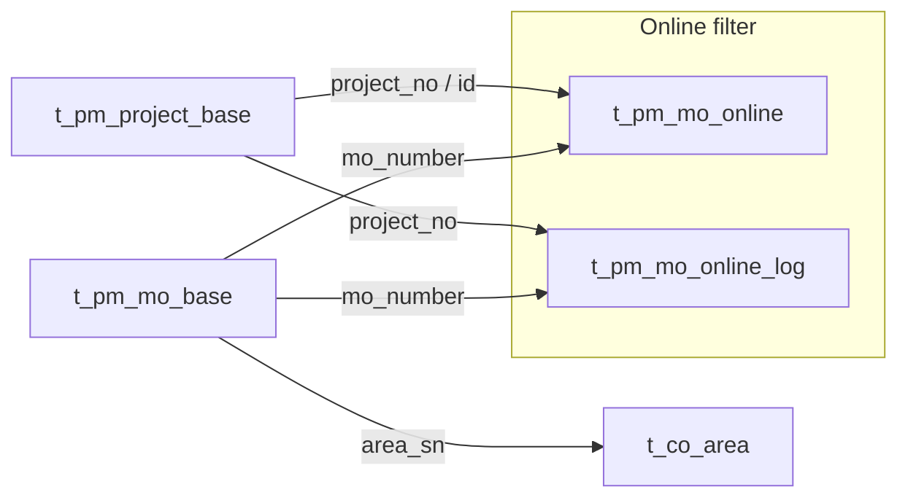

# PM Plan Tables — Schema Contract

Live introspection against `n2admin` schema (PostgreSQL). Used by `get_plan_achievement_rate` and `core/analytics/plan_achievement.py`.

## Tables

### `t_pm_mo_base` — default attainment source

| Column | Role |
|--------|------|
| `mo_number` | MO identifier; join key to online tables |
| `project_no` | Parent project / work-order number |
| `project_id` | FK to `t_pm_project_base.id` |
| `area_sn` | Production line code (e.g. `FDQ-SMT-6`) |
| `model_code` | Product / model code |
| `plan_qty` | Planned quantity (denominator) |
| `output_qty` | Actual output (numerator) |
| `actual_start_time` | Primary date for period filter |
| `actual_online_time` | Fallback date |
| `create_time` | Last-resort date |

### `t_pm_project_base` — work-order (工单) attainment

| Column | Role |
|--------|------|
| `id` | Project PK |
| `project_no` | Work-order number (user-facing 工单) |
| `model_code` | Product code |
| `area_sn` | Line (often empty — use MO join for line scope) |
| `plan_qty` | Planned quantity |
| `output_qty` | Actual output |
| `plan_start_time` | Plan date |
| `actual_start_time` | Actual start |
| `create_time` | Fallback date |

### `t_pm_mo_online` — currently online MOs

| Column | Role |
|--------|------|
| `mo_number` | MO identifier |
| `project_id` | Project FK |
| `area_sn` | Line at online time |
| `online_time` | When MO went online |
| `plan_qty` | Plan at online (no `output_qty`) |

### `t_pm_mo_online_log` — online/offline history

| Column | Role |
|--------|------|
| `mo_number` | MO identifier |
| `project_no` | Project number |
| `area_sn` | Line |
| `online_time` | Online timestamp |
| `offline_time` | Offline timestamp (NULL = still online) |
| `plan_qty`, `output_qty` | Quantities at session |
| `model_code` | Product |

## Join diagram



## Online-status predicate

Only MOs that are **on-line** (actively being processed) count toward numerator and denominator.

**`mo_base` alias `mb`:**

```sql
(
  EXISTS (SELECT 1 FROM n2admin.t_pm_mo_online o WHERE o.mo_number = mb.mo_number)
  OR EXISTS (
    SELECT 1 FROM n2admin.t_pm_mo_online_log ol
    WHERE ol.mo_number = mb.mo_number
      AND ol.online_time <= :end_date
      AND COALESCE(ol.offline_time, TIMESTAMP '2099-12-31') >= :start_date
  )
)
```

**`project_base` alias `pb`:**

```sql
(
  EXISTS (
    SELECT 1 FROM n2admin.t_pm_mo_online o
    WHERE o.project_id = pb.id
       OR o.mo_number IN (
         SELECT mb2.mo_number FROM n2admin.t_pm_mo_base mb2
         WHERE mb2.project_no = pb.project_no
       )
  )
  OR EXISTS (
    SELECT 1 FROM n2admin.t_pm_mo_online_log ol
    WHERE ol.project_no = pb.project_no
      AND ol.online_time <= :end_date
      AND COALESCE(ol.offline_time, TIMESTAMP '2099-12-31') >= :start_date
  )
)
```

## Attainment formula

**达成率 = SUM(output_qty) ÷ SUM(plan_qty) × 100**

Computed in Python via `core.math_safeguard.plan_achievement_rate()`. Rates above 100% are allowed when output exceeds plan.

## Routing rules

| Query | Table | Notes |
|-------|-------|-------|
| Line / product / plant (default) | `t_pm_mo_base` | Filter `area_sn`, `model_code` |
| Work order (`mo_number` / 工单) | `t_pm_project_base` | Match `project_no`; line via `area_sn` on base row or `mo_online_log` |
| `line_id="all"` | `t_pm_mo_base` | `GROUP BY area_sn` cross-line matrix |

## Date column for bucketing

- **`mo_base`:** `COALESCE(actual_start_time, actual_online_time, create_time)`
- **`project_base`:** `COALESCE(actual_start_time, plan_start_time, create_time)`

## Line scoping

Reuse `t_co_area` resolution: `area_sn` code or Chinese `area_name` (same pattern as `core/line_scope.py`).

## Coalesce / edge cases

- `SUM(COALESCE(output_qty, 0))` and `SUM(COALESCE(plan_qty, 0))`
- Return `0.0` rate when `planned_qty == 0`
- Rows with zero plan are included in sums (may inflate rate if output exists without plan)

## Verification (2026-06-21)

Single-day `mo_base` + online filter yields sensible line rates (e.g. FDQ-SMT-6 ≈ 30%, FDQ-SMT-1 ≈ 69%) — not equipment-log 2000%+ values.
